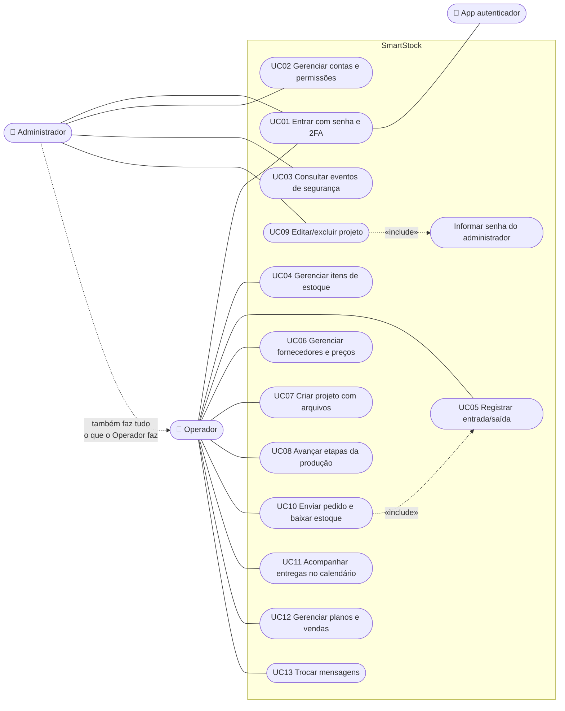

# Casos de uso do SmartStock

## Atores

| Ator | Quem é | O que pode fazer |
|------|--------|------------------|
| **Administrador** | Dono/gestor da metalúrgica | Tudo: contas, permissões, segurança e todas as abas; sua senha autoriza editar/excluir projetos |
| **Operador** | Funcionário de um setor (produção, almoxarifado, compras, financeiro) | Só as abas liberadas para a conta dele |
| **Aplicativo autenticador** | Google Authenticator, Microsoft Authenticator etc. (ator externo) | Gera o código de 6 dígitos do 2FA |
| **Supabase** | Serviço de nuvem (ator externo) | Guarda o banco de dados e os arquivos |

## Diagrama de casos de uso

> O Operador só vê os casos de uso das abas liberadas para a conta dele (ex.: o almoxarifado vê UC04 e UC05).

## Descrição dos principais casos de uso

### UC01 – Entrar com senha e 2FA

- **Atores:** Administrador ou Operador; App autenticador.
- **Pré-condição:** a conta existe.
- **Fluxo principal:**
  1. O usuário informa usuário e senha.
  2. O sistema confere a senha e pede o código de 6 dígitos do app.
  3. O usuário abre o app e digita o código.
  4. O sistema confere o código e libera o acesso às abas permitidas por 8 horas.
- **Fluxos alternativos:**
  - *2a. Primeira entrada:* o sistema mostra um QR code; o usuário lê com o app, digita o primeiro código, recebe 8
    códigos de recuperação e é obrigado a trocar a senha de exemplo.
  - *3a. Celular perdido:* o usuário digita um código de recuperação (cada um vale uma vez).
  - *1a/3b. Erro:* senha ou código errado mostram aviso; após 5 erros seguidos, a conta fica bloqueada por 15 minutos.
- **Pós-condição:** evento registrado em *Segurança*.

### UC02 – Gerenciar contas e permissões

- **Ator:** Administrador (ou Operador com a aba Usuários).
- **Fluxo principal:** o administrador cria a conta com nome, usuário, senha provisória, perfil e abas permitidas; a
  pessoa troca a senha e configura o 2FA no primeiro acesso.
- **Alternativos:** editar (se trocar a senha, as sessões da pessoa são encerradas); redefinir 2FA; excluir.
- **Regras:** não é possível excluir a própria conta nem o único administrador; um Operador só concede abas que ele tem.

### UC05 – Registrar entrada/saída de estoque

- **Ator:** Operador com a aba Movimentações.
- **Fluxo principal:** escolhe o item, o tipo (entrada ou saída), a quantidade e, na entrada, o fornecedor; o sistema
  atualiza a quantidade e registra quem fez.
- **Alternativos:** *entrada em lote* (várias linhas de uma vez: se uma falhar, nenhuma é gravada); *saída maior que o
  estoque*: recusada com a quantidade disponível.
- **Pós-condição:** se o item ficar no mínimo ou abaixo, aparece nos alertas do painel.

### UC07 – Criar projeto com arquivos

- **Ator:** Operador com a aba Progresso.
- **Fluxo principal:** informa nome e descrição, monta o checklist e a lista de materiais (ou parte de um modelo),
  anexa PDFs/desenhos e salva. O projeto entra em "Aguardando início".
- **Alternativos:** *repetir projeto* (copia dados e arquivos); *arquivo recusado* (tipo ou tamanho inválido): o projeto
  não é criado e o motivo é mostrado.

### UC09 – Editar/excluir projeto

- **Ator:** Operador com a aba Progresso + **senha de um Administrador**.
- **Fluxo principal:** o usuário altera o projeto (ou pede a exclusão), o sistema pede a senha do administrador, confere
  e grava. Na exclusão, os arquivos do projeto também são apagados.
- **Alternativo:** senha incorreta → nada é alterado; 5 erros seguidos → bloqueio de 15 minutos.

### UC10 – Enviar pedido e baixar estoque

- **Ator:** Operador com a aba Progresso.
- **Pré-condição:** projeto em "Pronto para entrega".
- **Fluxo principal:** informa cliente e meta de entrega; o sistema dá baixa em todos os materiais do projeto e move o
  pedido para o Calendário.
- **Alternativo:** falta algum material → o envio é recusado, informando o item, e **nada** é baixado.

### UC11 – Acompanhar entregas no calendário

- **Ator:** Operador com a aba Progresso.
- **Fluxo principal:** vê os pedidos enviados por data, ajusta data do pedido e meta, e marca como entregue.
- **Pós-condição:** pedidos entregues ficam no histórico.

### UC12 – Gerenciar planos e vendas

- **Ator:** Operador com a aba Financeiro.
- **Fluxo principal:** cria um plano para um cliente (opcionalmente ligado a um projeto, com custo calculado), ajusta o
  valor e, quando o cliente aceita, fecha o plano como venda.
