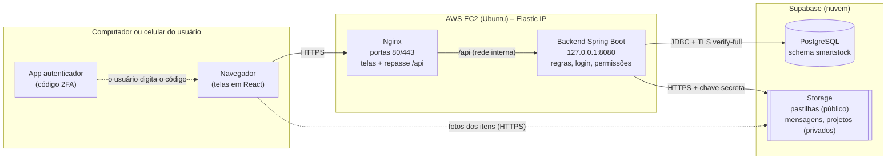
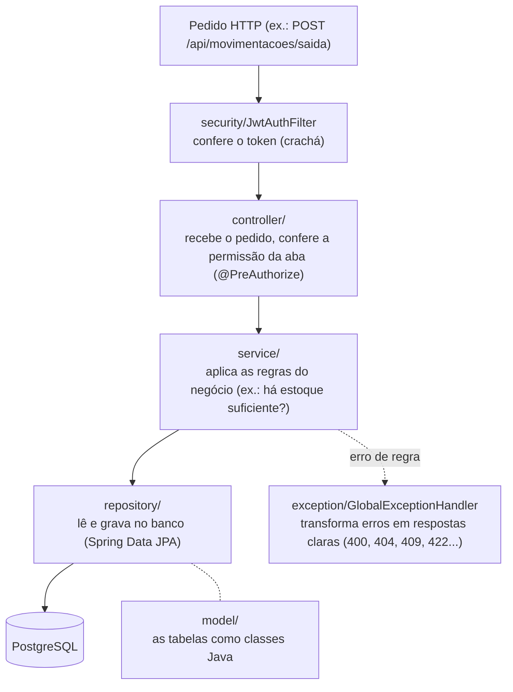
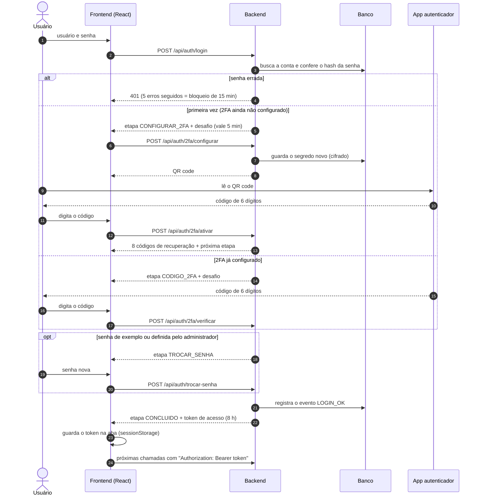
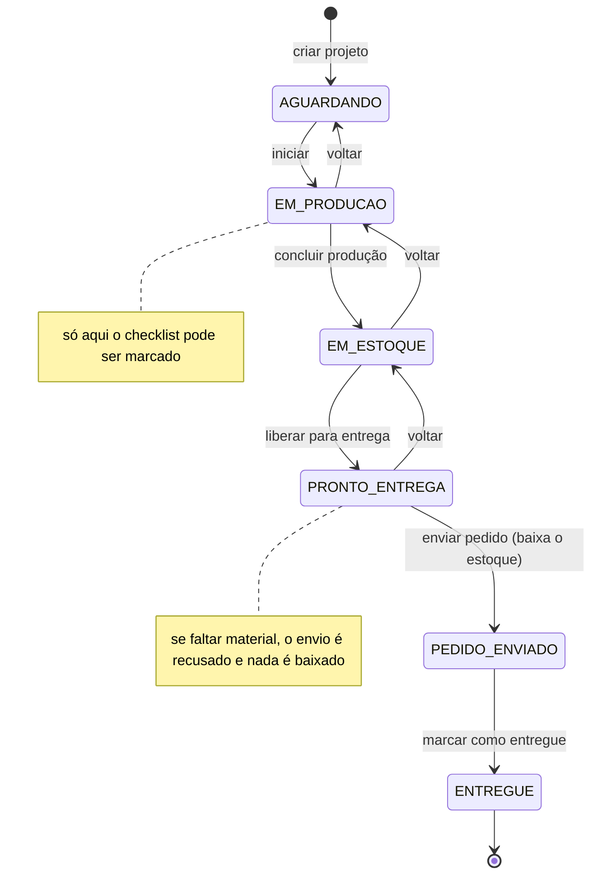
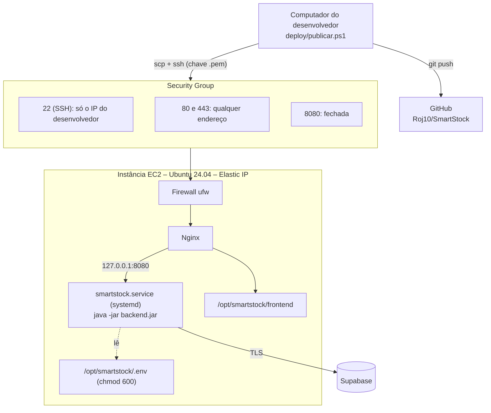

# Diagramas do SmartStock

## 1. Arquitetura (visão geral)

Quem fala com quem, e por onde passam os dados. Todo o tráfego que sai do servidor é cifrado (HTTPS/TLS).

## 2. Camadas do backend

Cada pedido percorre as camadas de cima para baixo. Cada camada tem uma única responsabilidade.

## 3. Banco de dados (modelo entidade-relacionamento)

Tabelas criadas pelas migrations `V1__esquema_inicial.sql` e `V2__seguranca_2fa.sql` (Flyway).

```mermaid
erDiagram
    USUARIOS {
        bigint id PK
        varchar nome
        varchar username UK
        varchar senha "hash BCrypt"
        varchar role "ADMIN | OPERADOR"
        boolean dois_fatores_ativo
        varchar totp_segredo "cifrado AES-GCM"
        int token_versao
        boolean trocar_senha
    }
    USUARIO_PERMISSOES {
        bigint usuario_id FK
        varchar modulo "PASTILHAS, MOVIMENTACOES..."
    }
    USUARIO_CODIGOS_RECUPERACAO {
        bigint usuario_id FK
        varchar codigo_hash
    }
    EVENTOS_SEGURANCA {
        bigint id PK
        timestamp data_hora
        varchar tipo
        varchar usuario
        varchar ip
    }
    FORNECEDORES {
        bigint id PK
        varchar nome
        varchar tipo "FABRICANTE | FORNECEDOR | AMBOS"
        varchar telefone
        varchar email
    }
    PASTILHAS {
        bigint id PK
        varchar codigo UK
        varchar descricao
        int estoque_minimo
        int quantidade_atual
        bigint fabricante_id FK
        varchar imagem_url
    }
    FORNECEDOR_PRODUTOS {
        bigint id PK
        bigint fornecedor_id FK
        bigint pastilha_id FK
        numeric preco
    }
    MOVIMENTACOES {
        bigint id PK
        varchar tipo "ENTRADA | SAIDA"
        int quantidade
        timestamp data_hora
        bigint pastilha_id FK
        bigint fornecedor_id FK
        bigint usuario_id FK
    }
    PROJETOS {
        bigint id PK
        varchar nome
        varchar status
        varchar cliente
        date data_pedido
        date meta_entrega
        timestamp data_entrega
    }
    CHECKLIST_ITENS {
        bigint id PK
        bigint projeto_id FK
        varchar texto
        boolean concluido
    }
    PROJETO_MATERIAIS {
        bigint id PK
        bigint projeto_id FK
        bigint pastilha_id FK
        int quantidade
    }
    PROJETO_ANEXOS {
        bigint id PK
        bigint projeto_id FK
        varchar nome_original
        varchar arquivo "caminho no Storage"
        bigint tamanho
    }
    MODELOS_PROJETO {
        bigint id PK
        varchar nome
    }
    MODELO_PROJETO_ETAPAS {
        bigint modelo_id FK
        int ordem
        varchar texto
    }
    MODELO_PROJETO_MATERIAIS {
        bigint modelo_id FK
        int ordem
        bigint pastilha_id
        int quantidade
    }
    VENDAS {
        bigint id PK
        varchar cliente
        numeric valor
        varchar status "PLANO | VENDA"
        bigint projeto_id FK
    }
    MENSAGENS {
        bigint id PK
        bigint remetente_id FK
        bigint destinatario_id FK
        varchar texto
        varchar imagem_arquivo
        boolean lida
    }

    USUARIOS ||--o{ USUARIO_PERMISSOES : "tem"
    USUARIOS ||--o{ USUARIO_CODIGOS_RECUPERACAO : "tem"
    USUARIOS ||--o{ MOVIMENTACOES : "registra"
    USUARIOS ||--o{ MENSAGENS : "envia"
    USUARIOS ||--o{ MENSAGENS : "recebe"
    FORNECEDORES ||--o{ PASTILHAS : "fabrica"
    FORNECEDORES ||--o{ FORNECEDOR_PRODUTOS : "vende"
    PASTILHAS ||--o{ FORNECEDOR_PRODUTOS : "tem preço em"
    PASTILHAS ||--o{ MOVIMENTACOES : "movimenta"
    FORNECEDORES |o--o{ MOVIMENTACOES : "fornece"
    PROJETOS ||--o{ CHECKLIST_ITENS : "tem"
    PROJETOS ||--o{ PROJETO_MATERIAIS : "usa"
    PASTILHAS ||--o{ PROJETO_MATERIAIS : "é usada em"
    PROJETOS ||--o{ PROJETO_ANEXOS : "tem arquivos"
    MODELOS_PROJETO ||--o{ MODELO_PROJETO_ETAPAS : "tem"
    MODELOS_PROJETO ||--o{ MODELO_PROJETO_MATERIAIS : "tem"
    PROJETOS |o--o{ VENDAS : "origina"
```

## 4. Sequência do login com 2FA

## 5. Estados de um projeto (ordem de produção)

## 6. Implantação (deploy)

