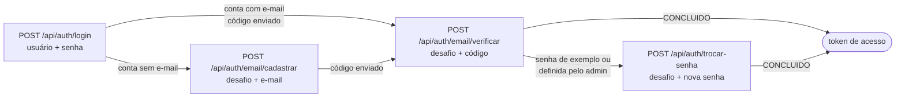

# Documentação OpenAPI do SmartStock

Referência completa da API REST do SmartStock, gerada a partir da especificação **OpenAPI 3** que o próprio sistema publica. Os exemplos de resposta foram obtidos chamando o sistema de verdade com os dados de exemplo.

| Arquivo | Para que serve |
|---------|----------------|
| [`openapi.yaml`](openapi.yaml) | Especificação OpenAPI 3.0 em YAML. Abra em <https://editor.swagger.io> (*File › Import file*) para ver e testar |
| [`openapi.json`](openapi.json) | A mesma especificação em JSON, para importar no **Postman** ou **Insomnia** (*Import › File*) |
| [`swagger.html`](swagger.html) | Documentação interativa (Swagger UI) que abre com dois cliques no navegador, sem rodar o sistema |
| Este arquivo | Todas as rotas em texto, com permissões e exemplos |

Com o sistema rodando, a mesma documentação fica em **`/swagger-ui.html`** (ex.: <http://localhost:8080/swagger-ui.html>), onde dá para testar as rotas de verdade.

> Estes arquivos são gerados por [`gerar_documentacao.py`](gerar_documentacao.py) a partir de `backend/src/main/resources/static/openapi.yaml`. Para mudar a documentação, altere esse arquivo e rode `python docs/openapi/gerar_documentacao.py`.

## Visão geral

| | |
|-|-|
| **Versão da API** | 1.0 |
| **Padrão** | OpenAPI 3.0.3 · REST · JSON (UTF-8) |
| **Endereço base** | `http://localhost:8080` (computador) · `http://34.199.252.233` (AWS) — todas as rotas começam com `/api` |
| **Rotas** | 67 operações em 47 endereços |
| **Autenticação** | Token JWT no cabeçalho `Authorization: Bearer <token>` (vale 8 horas), obtido no login em etapas |
| **Permissões** | Cada rota exige a aba correspondente na conta (Estoque, Movimentações, Progresso, Fornecedores, Financeiro, Usuários) ou perfil Administrador |

## Como autenticar

O login tem etapas. Cada resposta diz a próxima `etapa` e traz um `desafio` (token curto, 10 minutos) para usar nela. O token de acesso só vem na etapa `CONCLUIDO`.



Exemplo com `curl`:

```bash
# 1) usuário e senha -> o código de 6 dígitos vai para o e-mail da conta
curl -s -X POST http://localhost:8080/api/auth/login -H 'Content-Type: application/json' \
     -d '{"username":"admin","senha":"SUA_SENHA"}'
# {"etapa":"CODIGO_EMAIL","desafio":"eyJ...","emailMascarado":"re*********@gmail.com",...}

# 2) código que chegou no e-mail -> token de acesso
curl -s -X POST http://localhost:8080/api/auth/email/verificar -H 'Content-Type: application/json' \
     -d '{"desafio":"eyJ...","codigo":"123456"}'
# {"etapa":"CONCLUIDO","token":"eyJ...","role":"ADMIN","permissoes":[...]}

# 3) usar o token
curl -s http://localhost:8080/api/pastilhas -H 'Authorization: Bearer eyJ...'
```

Sem e-mail configurado no servidor (`MAIL_USUARIO`/`MAIL_SENHA`), a resposta vem com `"modoTeste": true` e o código aparece no terminal do backend.

## Respostas e erros

| Código | Quando acontece |
|--------|-----------------|
| **200 OK** | Consulta ou alteração feita; o corpo traz o registro |
| **201 Created** | Registro criado (cadastros, movimentações, projetos, mensagens, contas) |
| **204 No Content** | Registro excluído; resposta sem corpo |
| **400** | Dados inválidos (campo obrigatório vazio, formato errado). |
| **401** | Sem login, login vencido ou encerrado ("Sair"), ou etapa de login expirada. |
| **403** | A conta não tem permissão para esta aba/ação. |
| **404** | Registro não encontrado. |
| **409** | Não dá para excluir/alterar: o registro está ligado a outros cadastros. |
| **422** | Regra de negócio recusou (ex.: estoque insuficiente, senha do administrador incorreta, senha fraca). |
| **429** | Muitas tentativas erradas seguidas: bloqueio de 15 minutos. |

Todo erro vem no mesmo formato:

```json
{
  "status": 409,
  "message": "Não foi possível concluir: este registro está ligado a outros cadastros (movimentações, itens, projetos...).",
  "timestamp": "2026-11-01T22:10:00Z"
}
```

## Índice das rotas

### Autenticação

Login em etapas: senha → código enviado por e-mail (2FA) → troca de senha, quando exigida. Só a última etapa entrega o token de acesso.

| Método | Rota | O que faz |
|--------|------|-----------|
| `POST` | [`/api/auth/login`](#post-apiauthlogin) | Etapa 1: usuário e senha |
| `POST` | [`/api/auth/email/cadastrar`](#post-apiauthemailcadastrar) | Etapa 2 (1ª vez): informar o e-mail que recebe os códigos |
| `POST` | [`/api/auth/email/verificar`](#post-apiauthemailverificar) | Etapa 2: código de 6 dígitos que chegou por e-mail |
| `POST` | [`/api/auth/email/reenviar`](#post-apiauthemailreenviar) | Enviar outro código |
| `POST` | [`/api/auth/trocar-senha`](#post-apiauthtrocar-senha) | Etapa 3: troca obrigatória de senha |
| `POST` | [`/api/auth/sair`](#post-apiauthsair) | Sair (encerra todas as sessões da conta) |

### Painel

Resumo da tela inicial (mostra só o que a conta pode ver).

| Método | Rota | O que faz |
|--------|------|-----------|
| `GET` | [`/api/dashboard`](#get-apidashboard) | Resumo da tela inicial |

### Itens de estoque

Cadastro dos itens (no código chamados de "pastilhas"): código, descrição, fabricante, estoque mínimo/atual e foto.

| Método | Rota | O que faz |
|--------|------|-----------|
| `GET` | [`/api/pastilhas`](#get-apipastilhas) | Listar itens |
| `POST` | [`/api/pastilhas`](#post-apipastilhas) | Cadastrar item |
| `GET` | [`/api/pastilhas/alertas`](#get-apipastilhasalertas) | Itens com estoque crítico |
| `GET` | [`/api/pastilhas/{id}`](#get-apipastilhasid) | Buscar um item |
| `PUT` | [`/api/pastilhas/{id}`](#put-apipastilhasid) | Editar item |
| `DELETE` | [`/api/pastilhas/{id}`](#delete-apipastilhasid) | Excluir item |
| `POST` | [`/api/pastilhas/{id}/imagem`](#post-apipastilhasidimagem) | Enviar/trocar a foto do item |
| `DELETE` | [`/api/pastilhas/{id}/imagem`](#delete-apipastilhasidimagem) | Remover a foto do item |

### Movimentações

Entradas e saídas de estoque. Cada movimentação altera a quantidade do item e registra quem fez.

| Método | Rota | O que faz |
|--------|------|-----------|
| `GET` | [`/api/movimentacoes`](#get-apimovimentacoes) | Listar movimentações |
| `POST` | [`/api/movimentacoes/entrada`](#post-apimovimentacoesentrada) | Registrar entrada |
| `POST` | [`/api/movimentacoes/entrada/lote`](#post-apimovimentacoesentradalote) | Registrar várias entradas de uma vez (compra geral) |
| `POST` | [`/api/movimentacoes/saida`](#post-apimovimentacoessaida) | Registrar saída |

### Fornecedores

Fabricantes e fornecedores, e o preço de cada item por fornecedor.

| Método | Rota | O que faz |
|--------|------|-----------|
| `GET` | [`/api/fornecedores`](#get-apifornecedores) | Listar fornecedores e fabricantes |
| `POST` | [`/api/fornecedores`](#post-apifornecedores) | Cadastrar fornecedor |
| `GET` | [`/api/fornecedores/{id}`](#get-apifornecedoresid) | Buscar um fornecedor |
| `PUT` | [`/api/fornecedores/{id}`](#put-apifornecedoresid) | Editar fornecedor |
| `DELETE` | [`/api/fornecedores/{id}`](#delete-apifornecedoresid) | Excluir fornecedor |
| `GET` | [`/api/fornecedores/produtos`](#get-apifornecedoresprodutos) | Preços de todos os fornecedores |
| `PUT` | [`/api/fornecedores/{id}/produtos`](#put-apifornecedoresidprodutos) | Definir o que o fornecedor vende e o preço |

### Projetos

Ordem de produção (aba Progresso) e entregas (aba Calendário), com checklist, materiais e arquivos anexados.

| Método | Rota | O que faz |
|--------|------|-----------|
| `GET` | [`/api/projetos/progresso`](#get-apiprojetosprogresso) | Quadro de produção (aba Progresso) |
| `GET` | [`/api/projetos/calendario`](#get-apiprojetoscalendario) | Pedidos enviados e entregues (aba Calendário) |
| `GET` | [`/api/projetos/{id}`](#get-apiprojetosid) | Buscar um projeto |
| `PUT` | [`/api/projetos/{id}`](#put-apiprojetosid) | Editar projeto (exige senha do administrador) |
| `DELETE` | [`/api/projetos/{id}`](#delete-apiprojetosid) | Excluir projeto (exige senha do administrador) |
| `POST` | [`/api/projetos`](#post-apiprojetos) | Criar projeto (com ou sem arquivos) |
| `PATCH` | [`/api/projetos/{id}/status`](#patch-apiprojetosidstatus) | Avançar ou voltar uma etapa |
| `PATCH` | [`/api/projetos/{id}/checklist/{itemId}`](#patch-apiprojetosidchecklistitemid) | Marcar/desmarcar etapa do checklist |
| `POST` | [`/api/projetos/{id}/enviar-pedido`](#post-apiprojetosidenviar-pedido) | Enviar o pedido ao cliente (baixa o estoque) |
| `PATCH` | [`/api/projetos/{id}/calendario`](#patch-apiprojetosidcalendario) | Alterar data do pedido e meta de entrega |
| `POST` | [`/api/projetos/{id}/entregar`](#post-apiprojetosidentregar) | Marcar como entregue |
| `POST` | [`/api/projetos/{id}/anexos`](#post-apiprojetosidanexos) | Anexar arquivos a um projeto existente (exige senha do administrador) |
| `GET` | [`/api/projetos/{id}/anexos/{anexoId}`](#get-apiprojetosidanexosanexoid) | Baixar/abrir um arquivo do projeto |
| `DELETE` | [`/api/projetos/{id}/anexos/{anexoId}`](#delete-apiprojetosidanexosanexoid) | Remover um arquivo do projeto (exige senha do administrador) |

### Modelos de projeto

Modelos reaproveitáveis de checklist e materiais para criar projetos novos.

| Método | Rota | O que faz |
|--------|------|-----------|
| `GET` | [`/api/modelos-projeto`](#get-apimodelos-projeto) | Listar modelos |
| `POST` | [`/api/modelos-projeto`](#post-apimodelos-projeto) | Salvar modelo pelo nome |
| `GET` | [`/api/modelos-projeto/{id}`](#get-apimodelos-projetoid) | Buscar um modelo |
| `PUT` | [`/api/modelos-projeto/{id}`](#put-apimodelos-projetoid) | Editar modelo |
| `DELETE` | [`/api/modelos-projeto/{id}`](#delete-apimodelos-projetoid) | Excluir modelo |

### Financeiro

Valores: preço por fornecedor, valor parado em estoque, custo e margem dos projetos.

| Método | Rota | O que faz |
|--------|------|-----------|
| `GET` | [`/api/financeiro/resumo`](#get-apifinanceiroresumo) | Resumo financeiro |
| `GET` | [`/api/financeiro/pecas`](#get-apifinanceiropecas) | Preço de cada item por fornecedor |
| `GET` | [`/api/financeiro/projetos`](#get-apifinanceiroprojetos) | Custo e margem de cada projeto |

### Vendas e planos

Planos (orçamentos) feitos para clientes; ao fechar, viram venda.

| Método | Rota | O que faz |
|--------|------|-----------|
| `GET` | [`/api/vendas`](#get-apivendas) | Listar vendas e planos |
| `POST` | [`/api/vendas`](#post-apivendas) | Criar plano para um cliente |
| `GET` | [`/api/vendas/{id}`](#get-apivendasid) | Buscar uma venda/plano |
| `PUT` | [`/api/vendas/{id}`](#put-apivendasid) | Editar venda/plano |
| `DELETE` | [`/api/vendas/{id}`](#delete-apivendasid) | Excluir venda/plano |
| `POST` | [`/api/vendas/{id}/fechar`](#post-apivendasidfechar) | Fechar o plano (vira venda) |

### Mensagens

Conversa entre as contas (setores), com texto e imagens privadas.

| Método | Rota | O que faz |
|--------|------|-----------|
| `GET` | [`/api/mensagens/contatos`](#get-apimensagenscontatos) | Contas para conversar |
| `GET` | [`/api/mensagens/nao-lidas`](#get-apimensagensnao-lidas) | Total de mensagens não lidas |
| `GET` | [`/api/mensagens/conversa/{usuarioId}`](#get-apimensagensconversausuarioid) | Abrir conversa |
| `POST` | [`/api/mensagens/conversa/{usuarioId}`](#post-apimensagensconversausuarioid) | Enviar mensagem de texto |
| `POST` | [`/api/mensagens/conversa/{usuarioId}/imagem`](#post-apimensagensconversausuarioidimagem) | Enviar imagem (com legenda opcional) |
| `GET` | [`/api/mensagens/{mensagemId}/imagem`](#get-apimensagensmensagemidimagem) | Baixar a imagem de uma mensagem |

### Usuários

Contas, perfis, permissões por aba e e-mail do 2FA; redefinição do 2FA.

| Método | Rota | O que faz |
|--------|------|-----------|
| `GET` | [`/api/usuarios`](#get-apiusuarios) | Listar contas |
| `POST` | [`/api/usuarios`](#post-apiusuarios) | Criar conta |
| `GET` | [`/api/usuarios/{id}`](#get-apiusuariosid) | Buscar uma conta |
| `PUT` | [`/api/usuarios/{id}`](#put-apiusuariosid) | Editar conta (e redefinir senha) |
| `DELETE` | [`/api/usuarios/{id}`](#delete-apiusuariosid) | Excluir conta |
| `POST` | [`/api/usuarios/{id}/redefinir-2fa`](#post-apiusuariosidredefinir-2fa) | Redefinir o 2FA (perdeu o acesso ao e-mail) |

### Segurança

Registro de eventos de segurança (logins, falhas, bloqueios, 2FA, senhas).

| Método | Rota | O que faz |
|--------|------|-----------|
| `GET` | [`/api/seguranca/eventos`](#get-apisegurancaeventos) | Eventos de segurança (últimos 200) |

## Detalhe de cada rota

### Autenticação

#### POST /api/auth/login

**Etapa 1: usuário e senha**

Confere a senha. Se a conta já tem e-mail, envia na hora um código de 6 dígitos para ele e devolve a etapa CODIGO_EMAIL (com o e-mail mascarado); se ainda não tem, devolve CADASTRAR_EMAIL. Junto vem um `desafio` (token curto, 10 min) para usar na etapa seguinte. Nunca devolve o token de acesso aqui. Se o servidor estiver sem e-mail configurado, `modoTeste` vem true e o código aparece no terminal do backend.

**Quem pode:** Pública.

Corpo (JSON):

```json
{
  "username": "admin",
  "senha": "SuaSenha2026"
}
```

Resposta **200** — OK.

<details><summary>Exemplo</summary>

```json
{
  "etapa": "CODIGO_EMAIL",
  "desafio": "eyJhbGciOiJIUzI1NiJ9...(desafio)",
  "nome": "Administrador",
  "token": null,
  "username": null,
  "role": null,
  "permissoes": null,
  "modoTeste": false,
  "emailMascarado": "re*********@gmail.com"
}
```

</details>

Erros possíveis: `400`, `401`, `429`

#### POST /api/auth/email/cadastrar

**Etapa 2 (1ª vez): informar o e-mail que recebe os códigos**

Só para contas ainda sem e-mail. Guarda o e-mail como pendente e envia um código para ele; o e-mail só passa a valer depois que o código for digitado em /email/verificar. Um envio a cada 60 s.

**Quem pode:** Pública (exige o `desafio` da etapa 1).

Corpo (JSON):

```json
{
  "desafio": "eyJhbGciOiJIUzI1NiJ9...(desafio)",
  "email": "renan@gmail.com"
}
```

Resposta **200** — OK.

<details><summary>Exemplo</summary>

```json
{
  "etapa": "CODIGO_EMAIL",
  "desafio": "eyJhbGciOiJIUzI1NiJ9...(desafio)",
  "nome": "Administrador",
  "token": null,
  "username": null,
  "role": null,
  "permissoes": null,
  "modoTeste": false,
  "emailMascarado": "re***@gmail.com"
}
```

</details>

Erros possíveis: `400`, `401`, `422`

#### POST /api/auth/email/verificar

**Etapa 2: código de 6 dígitos que chegou por e-mail**

Confere o código (vale 10 min e uma única vez). 5 erros cancelam o código e bloqueiam novas tentativas por 15 min. Na primeira vez, confirma o e-mail informado. Se a conta não precisar trocar a senha, já devolve o token de acesso.

**Quem pode:** Pública (exige o `desafio`).

Corpo (JSON):

```json
{
  "desafio": "eyJhbGciOiJIUzI1NiJ9...(desafio)",
  "codigo": "123456"
}
```

Resposta **200** — OK.

<details><summary>Exemplo</summary>

```json
{
  "etapa": "CONCLUIDO",
  "desafio": null,
  "token": "eyJhbGciOiJIUzI1NiJ9...(token JWT)",
  "username": "admin",
  "nome": "Administrador",
  "role": "ADMIN",
  "permissoes": [
    "PASTILHAS",
    "MOVIMENTACOES",
    "PROJETOS",
    "FORNECEDORES",
    "FINANCEIRO",
    "USUARIOS"
  ],
  "emailMascarado": null,
  "modoTeste": false
}
```

</details>

Erros possíveis: `401`, `422`, `429`

#### POST /api/auth/email/reenviar

**Enviar outro código**

Envia um código novo para o e-mail da etapa atual; o anterior deixa de valer. No máximo um envio a cada 60 segundos (422 com o tempo que falta).

**Quem pode:** Pública (exige o `desafio`).

Corpo (JSON):

```json
{
  "desafio": "eyJhbGciOiJIUzI1NiJ9...(desafio)"
}
```

Resposta **200** — OK.

<details><summary>Exemplo</summary>

```json
{
  "etapa": "CODIGO_EMAIL",
  "desafio": "eyJhbGciOiJIUzI1NiJ9...(desafio)",
  "nome": "Administrador",
  "token": null,
  "username": null,
  "role": null,
  "permissoes": null,
  "modoTeste": false,
  "emailMascarado": "re*********@gmail.com"
}
```

</details>

Erros possíveis: `401`, `422`

#### POST /api/auth/trocar-senha

**Etapa 3: troca obrigatória de senha**

Exigida quando a conta usa senha de exemplo ou definida pelo administrador. Senha nova: 8+ caracteres, com letras e números, sem conter o nome de usuário. Devolve o token de acesso.

**Quem pode:** Pública (exige o `desafio`).

Corpo (JSON):

```json
{
  "desafio": "eyJhbGciOiJIUzI1NiJ9...(desafio)",
  "novaSenha": "Estoque2026forte"
}
```

Resposta **200** — OK.

<details><summary>Exemplo</summary>

```json
{
  "etapa": "CONCLUIDO",
  "desafio": null,
  "token": "eyJhbGciOiJIUzI1NiJ9.eyJzdWIiOiJhZG1pbiI...(token JWT)",
  "username": "admin",
  "nome": "Administrador",
  "role": "ADMIN",
  "permissoes": [
    "PASTILHAS",
    "FORNECEDORES"
  ],
  "emailMascarado": null,
  "modoTeste": false
}
```

</details>

Erros possíveis: `401`, `422`

#### POST /api/auth/sair

**Sair (encerra todas as sessões da conta)**

O token usado (e qualquer outro dessa conta) deixa de valer.

**Quem pode:** Conta logada.

Resposta **200** — OK.

Erros possíveis: `401`

### Painel

#### GET /api/dashboard

**Resumo da tela inicial**

Totais, itens com estoque crítico e últimas movimentações, conforme as permissões da conta.

**Quem pode:** Conta logada.

Resposta **200** — OK.

<details><summary>Exemplo</summary>

```json
{
  "podeVerPastilhas": true,
  "podeVerFornecedores": true,
  "podeVerMovimentacoes": true,
  "totalPastilhas": 8,
  "totalFornecedores": 3,
  "itensAbaixoDoMinimo": 2,
  "alertas": [
    {
      "id": 3,
      "codigo": "TIN-ESM-04",
      "descricao": "Tinta esmalte sintético exterior (lata 0,4 kg)",
      "fabricante": {
        "id": 2,
        "nome": "Tintas Serrana",
        "tipo": "FABRICANTE",
        "contato": "Atendimento ao cliente",
        "telefone": "(47) 3333-2222",
        "email": "atendimento@serrana.example.com"
      },
      "estoqueMinimo": 12,
      "quantidadeAtual": 8,
      "imagemUrl": "/arquivos/pastilhas/seed-tinta-esmalte.jpg",
      "abaixoDoMinimo": true
    },
    {
      "id": 7,
      "codigo": "DOB-PORT-REF",
      "descricao": "Dobradiça de portão reforçada com pino regulável",
      "fabricante": {
        "id": 3,
        "nome": "Ferragens Fraiburgo",
        "tipo": "FORNECEDOR",
        "contato": "Vendas",
        "telefone": "(49) 3222-4444",
        "email": "vendas@ferragensfraiburgo.example.com"
      },
      "estoqueMinimo": 10,
      "quantidadeAtual": 10,
      "imagemUrl": "/arquivos/pastilhas/seed-dobradica-portao.jpg",
      "abaixoDoMinimo": true
    }
  ],
  "ultimasMovimentacoes": []
}
```

</details>

Erros possíveis: `401`

### Itens de estoque

#### GET /api/pastilhas

**Listar itens**

**Quem pode:** Estoque, Movimentações, Progresso ou Fornecedores.

Resposta **200** — OK.

<details><summary>Exemplo</summary>

```json
[
  {
    "id": 1,
    "codigo": "BAR-FE-01",
    "descricao": "Barra de ferro quadrada 1\" (barra de 6 m)",
    "fabricante": {
      "id": 1,
      "nome": "Siderúrgica Planalto",
      "tipo": "FABRICANTE",
      "contato": "Vendas de aço",
      "telefone": "(47) 3333-1111",
      "email": "vendas@planalto.example.com"
    },
    "estoqueMinimo": 20,
    "quantidadeAtual": 45,
    "imagemUrl": "/arquivos/pastilhas/seed-barra-ferro-chata.jpg",
    "abaixoDoMinimo": false
  },
  {
    "id": 2,
    "codigo": "RDA-PORT-150",
    "descricao": "Roda de portão em ferro fundido 150 mm",
    "fabricante": {
      "id": 3,
      "nome": "Ferragens Fraiburgo",
      "tipo": "FORNECEDOR",
      "contato": "Vendas",
      "telefone": "(49) 3222-4444",
      "email": "vendas@ferragensfraiburgo.example.com"
    },
    "estoqueMinimo": 10,
    "quantidadeAtual": 14,
    "imagemUrl": "/arquivos/pastilhas/seed-roda-portao.jpg",
    "abaixoDoMinimo": false
  }
]
```

</details>

Erros possíveis: `401`, `403`

#### POST /api/pastilhas

**Cadastrar item**

A quantidade informada é o estoque inicial; depois ela só muda por movimentações.

**Quem pode:** Estoque.

Corpo (JSON):

```json
{
  "codigo": "CHP-AC-03",
  "descricao": "Chapa de aço carbono 3 mm (1,2 x 3 m)",
  "fabricanteId": 1,
  "estoqueMinimo": 5,
  "quantidadeAtual": 12
}
```

Resposta **201** — Criado.

<details><summary>Exemplo</summary>

```json
{
  "id": 9,
  "codigo": "CHP-AC-03",
  "descricao": "Chapa de aço carbono 3 mm (1,2 x 3 m)",
  "fabricante": {
    "id": 1,
    "nome": "Siderúrgica Planalto",
    "tipo": "FABRICANTE",
    "contato": "Vendas de aço",
    "telefone": "(47) 3333-1111",
    "email": "vendas@planalto.example.com"
  },
  "estoqueMinimo": 5,
  "quantidadeAtual": 12,
  "imagemUrl": null,
  "abaixoDoMinimo": false
}
```

</details>

Erros possíveis: `400`, `401`, `403`, `422`

#### GET /api/pastilhas/alertas

**Itens com estoque crítico**

Itens com quantidade atual menor ou igual ao estoque mínimo.

**Quem pode:** Estoque, Movimentações, Progresso ou Fornecedores.

Resposta **200** — OK.

<details><summary>Exemplo</summary>

```json
[
  {
    "id": 3,
    "codigo": "TIN-ESM-04",
    "descricao": "Tinta esmalte sintético exterior (lata 0,4 kg)",
    "fabricante": {
      "id": 2,
      "nome": "Tintas Serrana",
      "tipo": "FABRICANTE",
      "contato": "Atendimento ao cliente",
      "telefone": "(47) 3333-2222",
      "email": "atendimento@serrana.example.com"
    },
    "estoqueMinimo": 12,
    "quantidadeAtual": 8,
    "imagemUrl": "/arquivos/pastilhas/seed-tinta-esmalte.jpg",
    "abaixoDoMinimo": true
  },
  {
    "id": 7,
    "codigo": "DOB-PORT-REF",
    "descricao": "Dobradiça de portão reforçada com pino regulável",
    "fabricante": {
      "id": 3,
      "nome": "Ferragens Fraiburgo",
      "tipo": "FORNECEDOR",
      "contato": "Vendas",
      "telefone": "(49) 3222-4444",
      "email": "vendas@ferragensfraiburgo.example.com"
    },
    "estoqueMinimo": 10,
    "quantidadeAtual": 10,
    "imagemUrl": "/arquivos/pastilhas/seed-dobradica-portao.jpg",
    "abaixoDoMinimo": true
  }
]
```

</details>

Erros possíveis: `401`, `403`

#### GET /api/pastilhas/{id}

**Buscar um item**

**Quem pode:** Estoque, Movimentações, Progresso ou Fornecedores.

| Parâmetro | Onde | Obrigatório | Descrição |
|-----------|------|-------------|-----------|
| `id` | caminho | sim | Número (id) do registro |

Resposta **200** — OK.

<details><summary>Exemplo</summary>

```json
{
  "id": 1,
  "codigo": "BAR-FE-01",
  "descricao": "Barra de ferro quadrada 1\" (barra de 6 m)",
  "fabricante": {
    "id": 1,
    "nome": "Siderúrgica Planalto",
    "tipo": "FABRICANTE",
    "contato": "Vendas de aço",
    "telefone": "(47) 3333-1111",
    "email": "vendas@planalto.example.com"
  },
  "estoqueMinimo": 20,
  "quantidadeAtual": 45,
  "imagemUrl": "/arquivos/pastilhas/seed-barra-ferro-chata.jpg",
  "abaixoDoMinimo": false
}
```

</details>

Erros possíveis: `401`, `403`, `404`

#### PUT /api/pastilhas/{id}

**Editar item**

**Quem pode:** Estoque.

| Parâmetro | Onde | Obrigatório | Descrição |
|-----------|------|-------------|-----------|
| `id` | caminho | sim | Número (id) do registro |

Corpo (JSON):

```json
{
  "codigo": "CHP-AC-03",
  "descricao": "Chapa de aço carbono 3 mm (1,2 x 3 m)",
  "fabricanteId": 1,
  "estoqueMinimo": 6,
  "quantidadeAtual": 12
}
```

Resposta **200** — OK.

<details><summary>Exemplo</summary>

```json
{
  "id": 9,
  "codigo": "CHP-AC-03",
  "descricao": "Chapa de aço carbono 3 mm (1,2 x 3 m)",
  "fabricante": {
    "id": 1,
    "nome": "Siderúrgica Planalto",
    "tipo": "FABRICANTE",
    "contato": "Vendas de aço",
    "telefone": "(47) 3333-1111",
    "email": "vendas@planalto.example.com"
  },
  "estoqueMinimo": 6,
  "quantidadeAtual": 12,
  "imagemUrl": null,
  "abaixoDoMinimo": false
}
```

</details>

Erros possíveis: `400`, `401`, `403`, `404`, `422`

#### DELETE /api/pastilhas/{id}

**Excluir item**

Recusado (409) se o item tiver movimentações ou estiver em projetos.

**Quem pode:** Estoque.

| Parâmetro | Onde | Obrigatório | Descrição |
|-----------|------|-------------|-----------|
| `id` | caminho | sim | Número (id) do registro |

Resposta **204** — Feito (sem conteúdo na resposta).

Erros possíveis: `401`, `403`, `404`, `409`

#### POST /api/pastilhas/{id}/imagem

**Enviar/trocar a foto do item**

multipart/form-data com o campo `arquivo` (PNG, JPEG, WEBP ou GIF, até 5 MB; o tipo é conferido pelo conteúdo). A foto vai para o bucket público "pastilhas" do Supabase Storage.

**Quem pode:** Estoque.

| Parâmetro | Onde | Obrigatório | Descrição |
|-----------|------|-------------|-----------|
| `id` | caminho | sim | Número (id) do registro |

Corpo (`multipart/form-data`, envio de arquivos):

| Campo | Obrigatório | Descrição |
|-------|-------------|-----------|
| `arquivo` (arquivo(s)) | sim | Imagem (PNG, JPEG, WEBP ou GIF) |

Resposta **200** — OK.

<details><summary>Exemplo</summary>

```json
{
  "id": 9,
  "codigo": "CHP-AC-03",
  "descricao": "Chapa de aço carbono 3 mm (1,2 x 3 m)",
  "fabricante": {
    "id": 1,
    "nome": "Siderúrgica Planalto",
    "tipo": "FABRICANTE",
    "contato": "Vendas de aço",
    "telefone": "(47) 3333-1111",
    "email": "vendas@planalto.example.com"
  },
  "estoqueMinimo": 6,
  "quantidadeAtual": 12,
  "imagemUrl": "/arquivos/pastilhas/2d5afa00-3e71-460d-94bb-f4e9e7a0f7da.png",
  "abaixoDoMinimo": false
}
```

</details>

Erros possíveis: `401`, `403`, `404`, `422`

#### DELETE /api/pastilhas/{id}/imagem

**Remover a foto do item**

**Quem pode:** Estoque.

| Parâmetro | Onde | Obrigatório | Descrição |
|-----------|------|-------------|-----------|
| `id` | caminho | sim | Número (id) do registro |

Resposta **200** — OK.

<details><summary>Exemplo</summary>

```json
{
  "id": 9,
  "codigo": "CHP-AC-03",
  "descricao": "Chapa de aço carbono 3 mm (1,2 x 3 m)",
  "fabricante": {
    "id": 1,
    "nome": "Siderúrgica Planalto",
    "tipo": "FABRICANTE",
    "contato": "Vendas de aço",
    "telefone": "(47) 3333-1111",
    "email": "vendas@planalto.example.com"
  },
  "estoqueMinimo": 6,
  "quantidadeAtual": 12,
  "imagemUrl": null,
  "abaixoDoMinimo": false
}
```

</details>

Erros possíveis: `401`, `403`, `404`

### Movimentações

#### GET /api/movimentacoes

**Listar movimentações**

Mais recentes primeiro. Filtro opcional por item.

**Quem pode:** Movimentações.

| Parâmetro | Onde | Obrigatório | Descrição |
|-----------|------|-------------|-----------|
| `pastilhaId` | consulta (?) | não | Só as movimentações deste item |

Resposta **200** — OK.

<details><summary>Exemplo</summary>

```json
[]
```

</details>

Erros possíveis: `401`, `403`

#### POST /api/movimentacoes/entrada

**Registrar entrada**

Soma a quantidade ao estoque do item.

**Quem pode:** Movimentações.

Corpo (JSON):

```json
{
  "pastilhaId": 9,
  "quantidade": 4,
  "fornecedorId": 4,
  "observacao": "NF 1234"
}
```

Resposta **201** — Criado.

<details><summary>Exemplo</summary>

```json
{
  "id": 1,
  "pastilha": {
    "id": 9,
    "codigo": "CHP-AC-03",
    "descricao": "Chapa de aço carbono 3 mm (1,2 x 3 m)",
    "fabricante": {
      "id": 1,
      "nome": "Siderúrgica Planalto",
      "tipo": "FABRICANTE",
      "contato": "Vendas de aço",
      "telefone": "(47) 3333-1111",
      "email": "vendas@planalto.example.com"
    },
    "estoqueMinimo": 6,
    "quantidadeAtual": 16,
    "imagemUrl": null,
    "abaixoDoMinimo": false
  },
  "tipo": "ENTRADA",
  "quantidade": 4,
  "fornecedor": {
    "id": 4,
    "nome": "Aço Sul Distribuidora Ltda",
    "tipo": "FORNECEDOR",
    "contato": "Comercial",
    "telefone": "(49) 3246-1000",
    "email": "vendas@acosul.example.com"
  },
  "usuario": {
    "id": 1,
    "nome": "Administrador",
    "username": "admin",
    "role": "ADMIN",
    "permissoes": [
      "MOVIMENTACOES",
      "PASTILHAS"
    ],
    "doisFatoresAtivo": true,
    "trocarSenha": false
  },
  "dataHora": "2026-11-01T19:11:31.913699556",
  "observacao": "NF 1234"
}
```

</details>

Erros possíveis: `400`, `401`, `403`, `404`

#### POST /api/movimentacoes/entrada/lote

**Registrar várias entradas de uma vez (compra geral)**

Se uma linha falhar, nenhuma é gravada.

**Quem pode:** Movimentações.

Corpo (JSON):

```json
{
  "observacao": "Compra geral de novembro",
  "itens": [
    {
      "pastilhaId": 1,
      "quantidade": 10,
      "fornecedorId": 1
    },
    {
      "pastilhaId": 6,
      "quantidade": 20,
      "fornecedorId": 3
    }
  ]
}
```

Resposta **201** — Criado.

<details><summary>Exemplo</summary>

```json
[
  {
    "id": 2,
    "pastilha": {
      "id": 1,
      "codigo": "BAR-FE-01",
      "descricao": "Barra de ferro quadrada 1\" (barra de 6 m)",
      "fabricante": {
        "id": 1,
        "nome": "Siderúrgica Planalto",
        "tipo": "FABRICANTE",
        "contato": "Vendas de aço",
        "telefone": "(47) 3333-1111",
        "email": "vendas@planalto.example.com"
      },
      "estoqueMinimo": 20,
      "quantidadeAtual": 55,
      "imagemUrl": "/arquivos/pastilhas/seed-barra-ferro-chata.jpg",
      "abaixoDoMinimo": false
    },
    "tipo": "ENTRADA",
    "quantidade": 10,
    "fornecedor": {
      "id": 1,
      "nome": "Siderúrgica Planalto",
      "tipo": "FABRICANTE",
      "contato": "Vendas de aço",
      "telefone": "(47) 3333-1111",
      "email": "vendas@planalto.example.com"
    },
    "usuario": {
      "id": 1,
      "nome": "Administrador",
      "username": "admin",
      "role": "ADMIN",
      "permissoes": [
        "MOVIMENTACOES",
        "PASTILHAS"
      ],
      "doisFatoresAtivo": true,
      "trocarSenha": false
    },
    "dataHora": "2026-11-01T19:11:31.956792835",
    "observacao": "Compra geral de novembro"
  },
  {
    "id": 3,
    "pastilha": {
      "id": 6,
      "codigo": "DIS-COR-125",
      "descricao": "Disco de corte para aço 125 mm (1 mm)",
      "fabricante": {
        "id": 3,
        "nome": "Ferragens Fraiburgo",
        "tipo": "FORNECEDOR",
        "contato": "Vendas",
        "telefone": "(49) 3222-4444",
        "email": "vendas@ferragensfraiburgo.example.com"
      },
      "estoqueMinimo": 30,
      "quantidadeAtual": 72,
      "imagemUrl": "/arquivos/pastilhas/seed-disco-corte.jpg",
      "abaixoDoMinimo": false
    },
    "tipo": "ENTRADA",
    "quantidade": 20,
    "fornecedor": {
      "id": 3,
      "nome": "Ferragens Fraiburgo",
      "tipo": "FORNECEDOR",
      "contato": "Vendas",
      "telefone": "(49) 3222-4444",
      "email": "vendas@ferragensfraiburgo.example.com"
    },
    "usuario": {
      "id": 1,
      "nome": "Administrador",
      "username": "admin",
      "role": "ADMIN",
      "permissoes": [
        "MOVIMENTACOES",
        "PASTILHAS"
      ],
      "doisFatoresAtivo": true,
      "trocarSenha": false
    },
    "dataHora": "2026-11-01T19:11:31.962787543",
    "observacao": "Compra geral de novembro"
  }
]
```

</details>

Erros possíveis: `400`, `401`, `403`, `404`

#### POST /api/movimentacoes/saida

**Registrar saída**

Recusada (422) se não houver estoque suficiente.

**Quem pode:** Movimentações.

Corpo (JSON):

```json
{
  "pastilhaId": 9,
  "quantidade": 2,
  "observacao": "Uso na manutenção"
}
```

Resposta **201** — Criado.

<details><summary>Exemplo</summary>

```json
{
  "id": 4,
  "pastilha": {
    "id": 9,
    "codigo": "CHP-AC-03",
    "descricao": "Chapa de aço carbono 3 mm (1,2 x 3 m)",
    "fabricante": {
      "id": 1,
      "nome": "Siderúrgica Planalto",
      "tipo": "FABRICANTE",
      "contato": "Vendas de aço",
      "telefone": "(47) 3333-1111",
      "email": "vendas@planalto.example.com"
    },
    "estoqueMinimo": 6,
    "quantidadeAtual": 14,
    "imagemUrl": null,
    "abaixoDoMinimo": false
  },
  "tipo": "SAIDA",
  "quantidade": 2,
  "fornecedor": null,
  "usuario": {
    "id": 1,
    "nome": "Administrador",
    "username": "admin",
    "role": "ADMIN",
    "permissoes": [
      "MOVIMENTACOES",
      "PASTILHAS"
    ],
    "doisFatoresAtivo": true,
    "trocarSenha": false
  },
  "dataHora": "2026-11-01T19:11:31.975047095",
  "observacao": "Uso na manutenção"
}
```

</details>

Erros possíveis: `400`, `401`, `403`, `404`, `422`

### Fornecedores

#### GET /api/fornecedores

**Listar fornecedores e fabricantes**

**Quem pode:** Fornecedores, Estoque ou Movimentações.

Resposta **200** — OK.

<details><summary>Exemplo</summary>

```json
[
  {
    "id": 1,
    "nome": "Siderúrgica Planalto",
    "tipo": "FABRICANTE",
    "contato": "Vendas de aço",
    "telefone": "(47) 3333-1111",
    "email": "vendas@planalto.example.com"
  },
  {
    "id": 2,
    "nome": "Tintas Serrana",
    "tipo": "FABRICANTE",
    "contato": "Atendimento ao cliente",
    "telefone": "(47) 3333-2222",
    "email": "atendimento@serrana.example.com"
  }
]
```

</details>

Erros possíveis: `401`, `403`

#### POST /api/fornecedores

**Cadastrar fornecedor**

`tipo`: FABRICANTE, FORNECEDOR ou AMBOS.

**Quem pode:** Fornecedores.

Corpo (JSON):

```json
{
  "nome": "Aço Sul Distribuidora",
  "tipo": "FORNECEDOR",
  "contato": "Comercial",
  "telefone": "(49) 3246-1000",
  "email": "vendas@acosul.example.com"
}
```

Resposta **201** — Criado.

<details><summary>Exemplo</summary>

```json
{
  "id": 4,
  "nome": "Aço Sul Distribuidora",
  "tipo": "FORNECEDOR",
  "contato": "Comercial",
  "telefone": "(49) 3246-1000",
  "email": "vendas@acosul.example.com"
}
```

</details>

Erros possíveis: `400`, `401`, `403`

#### GET /api/fornecedores/{id}

**Buscar um fornecedor**

**Quem pode:** Fornecedores, Estoque ou Movimentações.

| Parâmetro | Onde | Obrigatório | Descrição |
|-----------|------|-------------|-----------|
| `id` | caminho | sim | Número (id) do registro |

Resposta **200** — OK.

<details><summary>Exemplo</summary>

```json
{
  "id": 1,
  "nome": "Siderúrgica Planalto",
  "tipo": "FABRICANTE",
  "contato": "Vendas de aço",
  "telefone": "(47) 3333-1111",
  "email": "vendas@planalto.example.com"
}
```

</details>

Erros possíveis: `401`, `403`, `404`

#### PUT /api/fornecedores/{id}

**Editar fornecedor**

**Quem pode:** Fornecedores.

| Parâmetro | Onde | Obrigatório | Descrição |
|-----------|------|-------------|-----------|
| `id` | caminho | sim | Número (id) do registro |

Corpo (JSON):

```json
{
  "nome": "Aço Sul Distribuidora Ltda",
  "tipo": "FORNECEDOR",
  "contato": "Comercial",
  "telefone": "(49) 3246-1000",
  "email": "vendas@acosul.example.com"
}
```

Resposta **200** — OK.

<details><summary>Exemplo</summary>

```json
{
  "id": 4,
  "nome": "Aço Sul Distribuidora Ltda",
  "tipo": "FORNECEDOR",
  "contato": "Comercial",
  "telefone": "(49) 3246-1000",
  "email": "vendas@acosul.example.com"
}
```

</details>

Erros possíveis: `400`, `401`, `403`, `404`

#### DELETE /api/fornecedores/{id}

**Excluir fornecedor**

Recusado (409) se for fabricante de algum item ou aparecer em movimentações.

**Quem pode:** Fornecedores.

| Parâmetro | Onde | Obrigatório | Descrição |
|-----------|------|-------------|-----------|
| `id` | caminho | sim | Número (id) do registro |

Resposta **204** — Feito (sem conteúdo na resposta).

Erros possíveis: `401`, `403`, `404`, `409`

#### GET /api/fornecedores/produtos

**Preços de todos os fornecedores**

**Quem pode:** Fornecedores ou Financeiro.

Resposta **200** — OK.

<details><summary>Exemplo</summary>

```json
[
  {
    "id": 1,
    "fornecedor": {
      "id": 1,
      "nome": "Siderúrgica Planalto",
      "tipo": "FABRICANTE",
      "contato": "Vendas de aço",
      "telefone": "(47) 3333-1111",
      "email": "vendas@planalto.example.com"
    },
    "pastilha": {
      "id": 1,
      "codigo": "BAR-FE-01",
      "descricao": "Barra de ferro quadrada 1\" (barra de 6 m)",
      "fabricante": {
        "id": 1,
        "nome": "Siderúrgica Planalto",
        "tipo": "FABRICANTE",
        "contato": "Vendas de aço",
        "telefone": "(47) 3333-1111",
        "email": "vendas@planalto.example.com"
      },
      "estoqueMinimo": 20,
      "quantidadeAtual": 45,
      "imagemUrl": "/arquivos/pastilhas/seed-barra-ferro-chata.jpg",
      "abaixoDoMinimo": false
    },
    "preco": 62.0
  },
  {
    "id": 2,
    "fornecedor": {
      "id": 1,
      "nome": "Siderúrgica Planalto",
      "tipo": "FABRICANTE",
      "contato": "Vendas de aço",
      "telefone": "(47) 3333-1111",
      "email": "vendas@planalto.example.com"
    },
    "pastilha": {
      "id": 8,
      "codigo": "TUB-ACO-48",
      "descricao": "Tubo de aço inox 304 redondo 1.1/2\" (barra de 6 m)",
      "fabricante": {
        "id": 1,
        "nome": "Siderúrgica Planalto",
        "tipo": "FABRICANTE",
        "contato": "Vendas de aço",
        "telefone": "(47) 3333-1111",
        "email": "vendas@planalto.example.com"
      },
      "estoqueMinimo": 15,
      "quantidadeAtual": 30,
      "imagemUrl": "/arquivos/pastilhas/seed-tubo-aco.jpg",
      "abaixoDoMinimo": false
    },
    "preco": 118.0
  }
]
```

</details>

Erros possíveis: `401`, `403`

#### PUT /api/fornecedores/{id}/produtos

**Definir o que o fornecedor vende e o preço**

Substitui a lista anterior desse fornecedor.

**Quem pode:** Fornecedores.

| Parâmetro | Onde | Obrigatório | Descrição |
|-----------|------|-------------|-----------|
| `id` | caminho | sim | Número (id) do registro |

Corpo (JSON):

```json
{
  "produtos": [
    {
      "pastilhaId": 9,
      "preco": 389.9
    }
  ]
}
```

Resposta **200** — OK.

<details><summary>Exemplo</summary>

```json
[
  {
    "id": 14,
    "fornecedor": {
      "id": 4,
      "nome": "Aço Sul Distribuidora Ltda",
      "tipo": "FORNECEDOR",
      "contato": "Comercial",
      "telefone": "(49) 3246-1000",
      "email": "vendas@acosul.example.com"
    },
    "pastilha": {
      "id": 9,
      "codigo": "CHP-AC-03",
      "descricao": "Chapa de aço carbono 3 mm (1,2 x 3 m)",
      "fabricante": {
        "id": 1,
        "nome": "Siderúrgica Planalto",
        "tipo": "FABRICANTE",
        "contato": "Vendas de aço",
        "telefone": "(47) 3333-1111",
        "email": "vendas@planalto.example.com"
      },
      "estoqueMinimo": 6,
      "quantidadeAtual": 12,
      "imagemUrl": null,
      "abaixoDoMinimo": false
    },
    "preco": 389.9
  }
]
```

</details>

Erros possíveis: `400`, `401`, `403`, `404`, `422`

### Projetos

#### GET /api/projetos/progresso

**Quadro de produção (aba Progresso)**

Projetos em AGUARDANDO, EM_PRODUCAO, EM_ESTOQUE e PRONTO_ENTREGA; os mais antigos primeiro.

**Quem pode:** Progresso.

Resposta **200** — OK.

<details><summary>Exemplo</summary>

```json
[
  {
    "id": 4,
    "nome": "Escada marinheiro - Cliente MNO",
    "descricao": "Escada de acesso ao reservatório, liberada para entrega.",
    "cliente": "Cliente MNO",
    "status": "PRONTO_ENTREGA",
    "dataCriacao": "2026-10-24T19:11:20.393839",
    "dataInicioProducao": "2026-10-25T19:11:20.393847",
    "dataFinalizacaoProducao": "2026-10-29T19:11:20.393851",
    "dataPedido": null,
    "metaEntrega": null,
    "dataEntrega": null,
    "checklist": [
      {
        "id": 14,
        "texto": "Separar materiais",
        "concluido": true,
        "ordem": 0
      },
      {
        "id": 15,
        "texto": "Corte e solda",
        "concluido": true,
        "ordem": 1
      }
    ],
    "materiais": [
      {
        "id": 10,
        "pastilha": {
          "id": 8,
          "codigo": "TUB-ACO-48",
          "descricao": "Tubo de aço inox 304 redondo 1.1/2\" (barra de 6 m)",
          "fabricante": {
            "id": 1,
            "nome": "Siderúrgica Planalto",
            "tipo": "FABRICANTE",
            "contato": "Vendas de aço",
            "telefone": "(47) 3333-1111",
            "email": "vendas@planalto.example.com"
          },
          "estoqueMinimo": 15,
          "quantidadeAtual": 30,
          "imagemUrl": "/arquivos/pastilhas/seed-tubo-aco.jpg",
          "abaixoDoMinimo": false
        },
        "quantidade": 2
      },
      {
        "id": 11,
        "pastilha": {
          "id": 3,
          "codigo": "TIN-ESM-04",
          "descricao": "Tinta esmalte sintético exterior (lata 0,4 kg)",
          "fabricante": {
            "id": 2,
            "nome": "Tintas Serrana",
            "tipo": "FABRICANTE",
            "contato": "Atendimento ao cliente",
            "telefone": "(47) 3333-2222",
            "email": "atendimento@serrana.example.com"
          },
          "estoqueMinimo": 12,
          "quantidadeAtual": 8,
          "imagemUrl": "/arquivos/pastilhas/seed-tinta-esmalte.jpg",
          "abaixoDoMinimo": true
        },
        "quantidade": 1
      }
    ],
    "anexos": [],
    "totalChecklist": 4,
    "concluidosChecklist": 4
  },
  {
    "id": 3,
    "nome": "Portão basculante - Cliente JKL",
    "descricao": "Portão basculante pronto, aguardando a retirada.",
    "cliente": null,
    "status": "EM_ESTOQUE",
    "dataCriacao": "2026-10-25T19:11:20.390518",
    "dataInicioProducao": "2026-10-26T19:11:20.390527",
    "dataFinalizacaoProducao": "2026-10-30T19:11:20.39053",
    "dataPedido": null,
    "metaEntrega": null,
    "dataEntrega": null,
    "checklist": [
      {
        "id": 10,
        "texto": "Separar materiais",
        "concluido": true,
        "ordem": 0
      },
      {
        "id": 11,
        "texto": "Corte e solda",
        "concluido": true,
        "ordem": 1
      }
    ],
    "materiais": [
      {
        "id": 8,
        "pastilha": {
          "id": 2,
          "codigo": "RDA-PORT-150",
          "descricao": "Roda de portão em ferro fundido 150 mm",
          "fabricante": {
            "id": 3,
            "nome": "Ferragens Fraiburgo",
            "tipo": "FORNECEDOR",
            "contato": "Vendas",
            "telefone": "(49) 3222-4444",
            "email": "vendas@ferragensfraiburgo.example.com"
          },
          "estoqueMinimo": 10,
          "quantidadeAtual": 14,
          "imagemUrl": "/arquivos/pastilhas/seed-roda-portao.jpg",
          "abaixoDoMinimo": false
        },
        "quantidade": 4
      },
      {
        "id": 9,
        "pastilha": {
          "id": 7,
          "codigo": "DOB-PORT-REF",
          "descricao": "Dobradiça de portão reforçada com pino regulável",
          "fabricante": {
            "id": 3,
            "nome": "Ferragens Fraiburgo",
            "tipo": "FORNECEDOR",
            "contato": "Vendas",
            "telefone": "(49) 3222-4444",
            "email": "vendas@ferragensfraiburgo.example.com"
          },
          "estoqueMinimo": 10,
          "quantidadeAtual": 10,
          "imagemUrl": "/arquivos/pastilhas/seed-dobradica-portao.jpg",
          "abaixoDoMinimo": true
        },
        "quantidade": 4
      }
    ],
    "anexos": [],
    "totalChecklist": 4,
    "concluidosChecklist": 4
  }
]
```

</details>

Erros possíveis: `401`, `403`

#### GET /api/projetos/calendario

**Pedidos enviados e entregues (aba Calendário)**

**Quem pode:** Progresso.

Resposta **200** — OK.

<details><summary>Exemplo</summary>

```json
[
  {
    "id": 5,
    "nome": "Base para esteira - Cliente DEF",
    "descricao": "Base de sustentação para esteira transportadora.",
    "cliente": "Cliente DEF",
    "status": "PEDIDO_ENVIADO",
    "dataCriacao": "2026-10-22T19:11:20.403039",
    "dataInicioProducao": "2026-10-23T19:11:20.403048",
    "dataFinalizacaoProducao": "2026-10-31T19:11:20.403051",
    "dataPedido": "2026-10-22",
    "metaEntrega": "2026-11-06",
    "dataEntrega": null,
    "checklist": [
      {
        "id": 18,
        "texto": "Separar materiais",
        "concluido": true,
        "ordem": 0
      },
      {
        "id": 19,
        "texto": "Corte e solda",
        "concluido": true,
        "ordem": 1
      }
    ],
    "materiais": [
      {
        "id": 12,
        "pastilha": {
          "id": 1,
          "codigo": "BAR-FE-01",
          "descricao": "Barra de ferro quadrada 1\" (barra de 6 m)",
          "fabricante": {
            "id": 1,
            "nome": "Siderúrgica Planalto",
            "tipo": "FABRICANTE",
            "contato": "Vendas de aço",
            "telefone": "(47) 3333-1111",
            "email": "vendas@planalto.example.com"
          },
          "estoqueMinimo": 20,
          "quantidadeAtual": 45,
          "imagemUrl": "/arquivos/pastilhas/seed-barra-ferro-chata.jpg",
          "abaixoDoMinimo": false
        },
        "quantidade": 12
      },
      {
        "id": 13,
        "pastilha": {
          "id": 5,
          "codigo": "ELE-6013-25",
          "descricao": "Eletrodo de solda E6013 2,5 mm (caixa 5 kg)",
          "fabricante": {
            "id": 1,
            "nome": "Siderúrgica Planalto",
            "tipo": "FABRICANTE",
            "contato": "Vendas de aço",
            "telefone": "(47) 3333-1111",
            "email": "vendas@planalto.example.com"
          },
          "estoqueMinimo": 15,
          "quantidadeAtual": 28,
          "imagemUrl": "/arquivos/pastilhas/seed-eletrodo-e6013.jpg",
          "abaixoDoMinimo": false
        },
        "quantidade": 3
      }
    ],
    "anexos": [],
    "totalChecklist": 4,
    "concluidosChecklist": 4
  },
  {
    "id": 6,
    "nome": "Grade de proteção - Cliente GHI",
    "descricao": "Grade de proteção para máquina industrial.",
    "cliente": "Cliente GHI",
    "status": "ENTREGUE",
    "dataCriacao": "2026-10-12T19:11:20.410389",
    "dataInicioProducao": "2026-10-13T19:11:20.410398",
    "dataFinalizacaoProducao": "2026-10-17T19:11:20.410402",
    "dataPedido": "2026-10-12",
    "metaEntrega": "2026-10-19",
    "dataEntrega": "2026-10-18T19:11:20.410411",
    "checklist": [
      {
        "id": 22,
        "texto": "Separar materiais",
        "concluido": true,
        "ordem": 0
      },
      {
        "id": 23,
        "texto": "Corte e solda",
        "concluido": true,
        "ordem": 1
      }
    ],
    "materiais": [
      {
        "id": 14,
        "pastilha": {
          "id": 8,
          "codigo": "TUB-ACO-48",
          "descricao": "Tubo de aço inox 304 redondo 1.1/2\" (barra de 6 m)",
          "fabricante": {
            "id": 1,
            "nome": "Siderúrgica Planalto",
            "tipo": "FABRICANTE",
            "contato": "Vendas de aço",
            "telefone": "(47) 3333-1111",
            "email": "vendas@planalto.example.com"
          },
          "estoqueMinimo": 15,
          "quantidadeAtual": 30,
          "imagemUrl": "/arquivos/pastilhas/seed-tubo-aco.jpg",
          "abaixoDoMinimo": false
        },
        "quantidade": 5
      },
      {
        "id": 15,
        "pastilha": {
          "id": 6,
          "codigo": "DIS-COR-125",
          "descricao": "Disco de corte para aço 125 mm (1 mm)",
          "fabricante": {
            "id": 3,
            "nome": "Ferragens Fraiburgo",
            "tipo": "FORNECEDOR",
            "contato": "Vendas",
            "telefone": "(49) 3222-4444",
            "email": "vendas@ferragensfraiburgo.example.com"
          },
          "estoqueMinimo": 30,
          "quantidadeAtual": 52,
          "imagemUrl": "/arquivos/pastilhas/seed-disco-corte.jpg",
          "abaixoDoMinimo": false
        },
        "quantidade": 8
      }
    ],
    "anexos": [],
    "totalChecklist": 4,
    "concluidosChecklist": 4
  }
]
```

</details>

Erros possíveis: `401`, `403`

#### GET /api/projetos/{id}

**Buscar um projeto**

Inclui checklist, materiais e a lista de arquivos anexados.

**Quem pode:** Progresso.

| Parâmetro | Onde | Obrigatório | Descrição |
|-----------|------|-------------|-----------|
| `id` | caminho | sim | Número (id) do registro |

Resposta **200** — OK.

<details><summary>Exemplo</summary>

```json
{
  "id": 1,
  "nome": "Cerca de metal - Cliente ABC",
  "descricao": "Cerca de metal sob medida para o pátio do cliente.",
  "cliente": null,
  "status": "EM_PRODUCAO",
  "dataCriacao": "2026-10-29T19:11:20.374247",
  "dataInicioProducao": "2026-10-30T19:11:20.37426",
  "dataFinalizacaoProducao": null,
  "dataPedido": null,
  "metaEntrega": null,
  "dataEntrega": null,
  "checklist": [
    {
      "id": 1,
      "texto": "Separar os materiais da lista",
      "concluido": true,
      "ordem": 0
    },
    {
      "id": 2,
      "texto": "Fazer o ligamento (solda) das peças",
      "concluido": true,
      "ordem": 1
    }
  ],
  "materiais": [
    {
      "id": 1,
      "pastilha": {
        "id": 1,
        "codigo": "BAR-FE-01",
        "descricao": "Barra de ferro quadrada 1\" (barra de 6 m)",
        "fabricante": {
          "id": 1,
          "nome": "Siderúrgica Planalto",
          "tipo": "FABRICANTE",
          "contato": "Vendas de aço",
          "telefone": "(47) 3333-1111",
          "email": "vendas@planalto.example.com"
        },
        "estoqueMinimo": 20,
        "quantidadeAtual": 45,
        "imagemUrl": "/arquivos/pastilhas/seed-barra-ferro-chata.jpg",
        "abaixoDoMinimo": false
      },
      "quantidade": 10
    },
    {
      "id": 2,
      "pastilha": {
        "id": 8,
        "codigo": "TUB-ACO-48",
        "descricao": "Tubo de aço inox 304 redondo 1.1/2\" (barra de 6 m)",
        "fabricante": {
          "id": 1,
          "nome": "Siderúrgica Planalto",
          "tipo": "FABRICANTE",
          "contato": "Vendas de aço",
          "telefone": "(47) 3333-1111",
          "email": "vendas@planalto.example.com"
        },
        "estoqueMinimo": 15,
        "quantidadeAtual": 30,
        "imagemUrl": "/arquivos/pastilhas/seed-tubo-aco.jpg",
        "abaixoDoMinimo": false
      },
      "quantidade": 4
    }
  ],
  "anexos": [],
  "totalChecklist": 5,
  "concluidosChecklist": 2
}
```

</details>

Erros possíveis: `401`, `403`, `404`

#### PUT /api/projetos/{id}

**Editar projeto (exige senha do administrador)**

`senhaAdmin` obrigatória. 5 senhas erradas seguidas bloqueiam por 15 minutos.

**Quem pode:** Progresso + senha de um administrador.

| Parâmetro | Onde | Obrigatório | Descrição |
|-----------|------|-------------|-----------|
| `id` | caminho | sim | Número (id) do registro |

Corpo (JSON):

```json
{
  "nome": "Portão deslizante - Cliente Silva",
  "descricao": "Portão 4 x 2,2 m em tubo de aço",
  "checklist": [
    {
      "texto": "Cortar os tubos"
    },
    {
      "texto": "Soldar a estrutura"
    },
    {
      "texto": "Pintura"
    }
  ],
  "materiais": [
    {
      "pastilhaId": 9,
      "quantidade": 1
    }
  ],
  "senhaAdmin": "SenhaDoAdmin2026"
}
```

Resposta **200** — OK.

<details><summary>Exemplo</summary>

```json
{
  "id": 7,
  "nome": "Portão deslizante - Cliente Silva",
  "descricao": "Portão 4 x 2,2 m em tubo de aço",
  "cliente": null,
  "status": "AGUARDANDO",
  "dataCriacao": "2026-11-01T19:11:31.994899",
  "dataInicioProducao": null,
  "dataFinalizacaoProducao": null,
  "dataPedido": null,
  "metaEntrega": null,
  "dataEntrega": null,
  "checklist": [
    {
      "id": 30,
      "texto": "Cortar os tubos",
      "concluido": false,
      "ordem": 0
    },
    {
      "id": 31,
      "texto": "Soldar a estrutura",
      "concluido": false,
      "ordem": 1
    }
  ],
  "materiais": [
    {
      "id": 18,
      "pastilha": {
        "id": 9,
        "codigo": "CHP-AC-03",
        "descricao": "Chapa de aço carbono 3 mm (1,2 x 3 m)",
        "fabricante": {
          "id": 1,
          "nome": "Siderúrgica Planalto",
          "tipo": "FABRICANTE",
          "contato": "Vendas de aço",
          "telefone": "(47) 3333-1111",
          "email": "vendas@planalto.example.com"
        },
        "estoqueMinimo": 6,
        "quantidadeAtual": 14,
        "imagemUrl": null,
        "abaixoDoMinimo": false
      },
      "quantidade": 1
    },
    {
      "id": 19,
      "pastilha": {
        "id": 7,
        "codigo": "DOB-PORT-REF",
        "descricao": "Dobradiça de portão reforçada com pino regulável",
        "fabricante": {
          "id": 3,
          "nome": "Ferragens Fraiburgo",
          "tipo": "FORNECEDOR",
          "contato": "Vendas",
          "telefone": "(49) 3222-4444",
          "email": "vendas@ferragensfraiburgo.example.com"
        },
        "estoqueMinimo": 10,
        "quantidadeAtual": 10,
        "imagemUrl": "/arquivos/pastilhas/seed-dobradica-portao.jpg",
        "abaixoDoMinimo": true
      },
      "quantidade": 2
    }
  ],
  "anexos": [
    {
      "id": 2,
      "nomeOriginal": "desenho-portao.pdf",
      "tipo": "application/pdf",
      "tamanho": 193,
      "dataEnvio": "2026-11-01T19:11:32.122588"
    }
  ],
  "totalChecklist": 3,
  "concluidosChecklist": 0
}
```

</details>

Erros possíveis: `400`, `401`, `403`, `404`, `422`, `429`

#### DELETE /api/projetos/{id}

**Excluir projeto (exige senha do administrador)**

Corpo com `senhaAdmin`. Os arquivos do projeto também são apagados do Storage.

**Quem pode:** Progresso + senha de um administrador.

| Parâmetro | Onde | Obrigatório | Descrição |
|-----------|------|-------------|-----------|
| `id` | caminho | sim | Número (id) do registro |

Corpo (JSON):

```json
{
  "senhaAdmin": "SenhaDoAdmin2026"
}
```

Resposta **204** — Feito (sem conteúdo na resposta).

Erros possíveis: `401`, `403`, `404`, `422`, `429`

#### POST /api/projetos

**Criar projeto (com ou sem arquivos)**

Duas formas: **JSON** (só os dados) ou **multipart/form-data** com a parte `dados` (o JSON do projeto) e partes `arquivos` (PDF, CAD, imagens..., até 20 MB cada, 20 por projeto). `anexosCopiar` copia arquivos de outro projeto (botão Repetir). Se um arquivo for recusado, o projeto não é criado.

**Quem pode:** Progresso.

Corpo (JSON):

```json
{
  "nome": "Portão deslizante - Cliente Silva",
  "descricao": "Portão 4 x 2 m em tubo de aço",
  "checklist": [
    {
      "texto": "Cortar os tubos"
    },
    {
      "texto": "Soldar a estrutura"
    },
    {
      "texto": "Pintura"
    }
  ],
  "materiais": [
    {
      "pastilhaId": 9,
      "quantidade": 1
    },
    {
      "pastilhaId": 7,
      "quantidade": 2
    }
  ],
  "anexosCopiar": []
}
```

Corpo (`multipart/form-data`, envio de arquivos):

| Campo | Obrigatório | Descrição |
|-------|-------------|-----------|
| `dados` (texto) | sim | JSON do projeto (mesmo formato do exemplo JSON) |
| `arquivos` (arquivo(s)) | não |  |

Resposta **201** — Criado.

<details><summary>Exemplo</summary>

```json
{
  "id": 7,
  "nome": "Portão deslizante - Cliente Silva",
  "descricao": "Portão 4 x 2 m em tubo de aço",
  "cliente": null,
  "status": "AGUARDANDO",
  "dataCriacao": "2026-11-01T19:11:31.994898833",
  "dataInicioProducao": null,
  "dataFinalizacaoProducao": null,
  "dataPedido": null,
  "metaEntrega": null,
  "dataEntrega": null,
  "checklist": [
    {
      "id": 26,
      "texto": "Cortar os tubos",
      "concluido": false,
      "ordem": 0
    },
    {
      "id": 27,
      "texto": "Soldar a estrutura",
      "concluido": false,
      "ordem": 1
    }
  ],
  "materiais": [
    {
      "id": 16,
      "pastilha": {
        "id": 9,
        "codigo": "CHP-AC-03",
        "descricao": "Chapa de aço carbono 3 mm (1,2 x 3 m)",
        "fabricante": {
          "id": 1,
          "nome": "Siderúrgica Planalto",
          "tipo": "FABRICANTE",
          "contato": "Vendas de aço",
          "telefone": "(47) 3333-1111",
          "email": "vendas@planalto.example.com"
        },
        "estoqueMinimo": 6,
        "quantidadeAtual": 14,
        "imagemUrl": null,
        "abaixoDoMinimo": false
      },
      "quantidade": 1
    },
    {
      "id": 17,
      "pastilha": {
        "id": 7,
        "codigo": "DOB-PORT-REF",
        "descricao": "Dobradiça de portão reforçada com pino regulável",
        "fabricante": {
          "id": 3,
          "nome": "Ferragens Fraiburgo",
          "tipo": "FORNECEDOR",
          "contato": "Vendas",
          "telefone": "(49) 3222-4444",
          "email": "vendas@ferragensfraiburgo.example.com"
        },
        "estoqueMinimo": 10,
        "quantidadeAtual": 10,
        "imagemUrl": "/arquivos/pastilhas/seed-dobradica-portao.jpg",
        "abaixoDoMinimo": true
      },
      "quantidade": 2
    }
  ],
  "anexos": [],
  "totalChecklist": 3,
  "concluidosChecklist": 0
}
```

</details>

Erros possíveis: `400`, `401`, `403`, `404`, `422`

#### PATCH /api/projetos/{id}/status

**Avançar ou voltar uma etapa**

Uma etapa por vez: AGUARDANDO ↔ EM_PRODUCAO ↔ EM_ESTOQUE ↔ PRONTO_ENTREGA. Sem senha.

**Quem pode:** Progresso.

| Parâmetro | Onde | Obrigatório | Descrição |
|-----------|------|-------------|-----------|
| `id` | caminho | sim | Número (id) do registro |

Corpo (JSON):

```json
{
  "status": "EM_PRODUCAO"
}
```

Resposta **200** — OK.

<details><summary>Exemplo</summary>

```json
{
  "id": 7,
  "nome": "Portão deslizante - Cliente Silva",
  "descricao": "Portão 4 x 2,2 m em tubo de aço",
  "cliente": null,
  "status": "EM_PRODUCAO",
  "dataCriacao": "2026-11-01T19:11:31.994899",
  "dataInicioProducao": "2026-11-01T19:11:32.291183556",
  "dataFinalizacaoProducao": null,
  "dataPedido": null,
  "metaEntrega": null,
  "dataEntrega": null,
  "checklist": [
    {
      "id": 30,
      "texto": "Cortar os tubos",
      "concluido": false,
      "ordem": 0
    },
    {
      "id": 31,
      "texto": "Soldar a estrutura",
      "concluido": false,
      "ordem": 1
    }
  ],
  "materiais": [
    {
      "id": 18,
      "pastilha": {
        "id": 9,
        "codigo": "CHP-AC-03",
        "descricao": "Chapa de aço carbono 3 mm (1,2 x 3 m)",
        "fabricante": {
          "id": 1,
          "nome": "Siderúrgica Planalto",
          "tipo": "FABRICANTE",
          "contato": "Vendas de aço",
          "telefone": "(47) 3333-1111",
          "email": "vendas@planalto.example.com"
        },
        "estoqueMinimo": 6,
        "quantidadeAtual": 14,
        "imagemUrl": null,
        "abaixoDoMinimo": false
      },
      "quantidade": 1
    },
    {
      "id": 19,
      "pastilha": {
        "id": 7,
        "codigo": "DOB-PORT-REF",
        "descricao": "Dobradiça de portão reforçada com pino regulável",
        "fabricante": {
          "id": 3,
          "nome": "Ferragens Fraiburgo",
          "tipo": "FORNECEDOR",
          "contato": "Vendas",
          "telefone": "(49) 3222-4444",
          "email": "vendas@ferragensfraiburgo.example.com"
        },
        "estoqueMinimo": 10,
        "quantidadeAtual": 10,
        "imagemUrl": "/arquivos/pastilhas/seed-dobradica-portao.jpg",
        "abaixoDoMinimo": true
      },
      "quantidade": 2
    }
  ],
  "anexos": [
    {
      "id": 2,
      "nomeOriginal": "desenho-portao.pdf",
      "tipo": "application/pdf",
      "tamanho": 193,
      "dataEnvio": "2026-11-01T19:11:32.122588"
    }
  ],
  "totalChecklist": 3,
  "concluidosChecklist": 0
}
```

</details>

Erros possíveis: `400`, `401`, `403`, `404`, `422`

#### PATCH /api/projetos/{id}/checklist/{itemId}

**Marcar/desmarcar etapa do checklist**

Só com o projeto EM_PRODUCAO.

**Quem pode:** Progresso.

| Parâmetro | Onde | Obrigatório | Descrição |
|-----------|------|-------------|-----------|
| `id` | caminho | sim | Número (id) do registro |
| `itemId` | caminho | sim | Número do item do checklist |

Corpo (JSON):

```json
{
  "concluido": true
}
```

Resposta **200** — OK.

<details><summary>Exemplo</summary>

```json
{
  "id": 7,
  "nome": "Portão deslizante - Cliente Silva",
  "descricao": "Portão 4 x 2,2 m em tubo de aço",
  "cliente": null,
  "status": "EM_PRODUCAO",
  "dataCriacao": "2026-11-01T19:11:31.994899",
  "dataInicioProducao": "2026-11-01T19:11:32.291184",
  "dataFinalizacaoProducao": null,
  "dataPedido": null,
  "metaEntrega": null,
  "dataEntrega": null,
  "checklist": [
    {
      "id": 30,
      "texto": "Cortar os tubos",
      "concluido": true,
      "ordem": 0
    },
    {
      "id": 31,
      "texto": "Soldar a estrutura",
      "concluido": false,
      "ordem": 1
    }
  ],
  "materiais": [
    {
      "id": 18,
      "pastilha": {
        "id": 9,
        "codigo": "CHP-AC-03",
        "descricao": "Chapa de aço carbono 3 mm (1,2 x 3 m)",
        "fabricante": {
          "id": 1,
          "nome": "Siderúrgica Planalto",
          "tipo": "FABRICANTE",
          "contato": "Vendas de aço",
          "telefone": "(47) 3333-1111",
          "email": "vendas@planalto.example.com"
        },
        "estoqueMinimo": 6,
        "quantidadeAtual": 14,
        "imagemUrl": null,
        "abaixoDoMinimo": false
      },
      "quantidade": 1
    },
    {
      "id": 19,
      "pastilha": {
        "id": 7,
        "codigo": "DOB-PORT-REF",
        "descricao": "Dobradiça de portão reforçada com pino regulável",
        "fabricante": {
          "id": 3,
          "nome": "Ferragens Fraiburgo",
          "tipo": "FORNECEDOR",
          "contato": "Vendas",
          "telefone": "(49) 3222-4444",
          "email": "vendas@ferragensfraiburgo.example.com"
        },
        "estoqueMinimo": 10,
        "quantidadeAtual": 10,
        "imagemUrl": "/arquivos/pastilhas/seed-dobradica-portao.jpg",
        "abaixoDoMinimo": true
      },
      "quantidade": 2
    }
  ],
  "anexos": [
    {
      "id": 2,
      "nomeOriginal": "desenho-portao.pdf",
      "tipo": "application/pdf",
      "tamanho": 193,
      "dataEnvio": "2026-11-01T19:11:32.122588"
    }
  ],
  "totalChecklist": 3,
  "concluidosChecklist": 1
}
```

</details>

Erros possíveis: `401`, `403`, `404`, `422`

#### POST /api/projetos/{id}/enviar-pedido

**Enviar o pedido ao cliente (baixa o estoque)**

Só em PRONTO_ENTREGA. Dá baixa em todos os materiais de uma vez; se faltar qualquer um, nada é baixado (422).

**Quem pode:** Progresso.

| Parâmetro | Onde | Obrigatório | Descrição |
|-----------|------|-------------|-----------|
| `id` | caminho | sim | Número (id) do registro |

Corpo (JSON):

```json
{
  "cliente": "Silva Metalurgia",
  "metaEntrega": "2026-11-20"
}
```

Resposta **200** — OK.

<details><summary>Exemplo</summary>

```json
{
  "id": 7,
  "nome": "Portão deslizante - Cliente Silva",
  "descricao": "Portão 4 x 2,2 m em tubo de aço",
  "cliente": "Silva Metalurgia",
  "status": "PEDIDO_ENVIADO",
  "dataCriacao": "2026-11-01T19:11:31.994899",
  "dataInicioProducao": "2026-11-01T19:11:32.291184",
  "dataFinalizacaoProducao": "2026-11-01T19:11:32.355621",
  "dataPedido": "2026-11-01",
  "metaEntrega": "2026-11-20",
  "dataEntrega": null,
  "checklist": [
    {
      "id": 30,
      "texto": "Cortar os tubos",
      "concluido": true,
      "ordem": 0
    },
    {
      "id": 31,
      "texto": "Soldar a estrutura",
      "concluido": false,
      "ordem": 1
    }
  ],
  "materiais": [
    {
      "id": 18,
      "pastilha": {
        "id": 9,
        "codigo": "CHP-AC-03",
        "descricao": "Chapa de aço carbono 3 mm (1,2 x 3 m)",
        "fabricante": {
          "id": 1,
          "nome": "Siderúrgica Planalto",
          "tipo": "FABRICANTE",
          "contato": "Vendas de aço",
          "telefone": "(47) 3333-1111",
          "email": "vendas@planalto.example.com"
        },
        "estoqueMinimo": 6,
        "quantidadeAtual": 13,
        "imagemUrl": null,
        "abaixoDoMinimo": false
      },
      "quantidade": 1
    },
    {
      "id": 19,
      "pastilha": {
        "id": 7,
        "codigo": "DOB-PORT-REF",
        "descricao": "Dobradiça de portão reforçada com pino regulável",
        "fabricante": {
          "id": 3,
          "nome": "Ferragens Fraiburgo",
          "tipo": "FORNECEDOR",
          "contato": "Vendas",
          "telefone": "(49) 3222-4444",
          "email": "vendas@ferragensfraiburgo.example.com"
        },
        "estoqueMinimo": 10,
        "quantidadeAtual": 8,
        "imagemUrl": "/arquivos/pastilhas/seed-dobradica-portao.jpg",
        "abaixoDoMinimo": true
      },
      "quantidade": 2
    }
  ],
  "anexos": [
    {
      "id": 2,
      "nomeOriginal": "desenho-portao.pdf",
      "tipo": "application/pdf",
      "tamanho": 193,
      "dataEnvio": "2026-11-01T19:11:32.122588"
    }
  ],
  "totalChecklist": 3,
  "concluidosChecklist": 1
}
```

</details>

Erros possíveis: `400`, `401`, `403`, `404`, `422`

#### PATCH /api/projetos/{id}/calendario

**Alterar data do pedido e meta de entrega**

**Quem pode:** Progresso.

| Parâmetro | Onde | Obrigatório | Descrição |
|-----------|------|-------------|-----------|
| `id` | caminho | sim | Número (id) do registro |

Corpo (JSON):

```json
{
  "dataPedido": "2026-11-01",
  "metaEntrega": "2026-11-22"
}
```

Resposta **200** — OK.

<details><summary>Exemplo</summary>

```json
{
  "id": 7,
  "nome": "Portão deslizante - Cliente Silva",
  "descricao": "Portão 4 x 2,2 m em tubo de aço",
  "cliente": "Silva Metalurgia",
  "status": "PEDIDO_ENVIADO",
  "dataCriacao": "2026-11-01T19:11:31.994899",
  "dataInicioProducao": "2026-11-01T19:11:32.291184",
  "dataFinalizacaoProducao": "2026-11-01T19:11:32.355621",
  "dataPedido": "2026-11-01",
  "metaEntrega": "2026-11-22",
  "dataEntrega": null,
  "checklist": [
    {
      "id": 30,
      "texto": "Cortar os tubos",
      "concluido": true,
      "ordem": 0
    },
    {
      "id": 31,
      "texto": "Soldar a estrutura",
      "concluido": false,
      "ordem": 1
    }
  ],
  "materiais": [
    {
      "id": 18,
      "pastilha": {
        "id": 9,
        "codigo": "CHP-AC-03",
        "descricao": "Chapa de aço carbono 3 mm (1,2 x 3 m)",
        "fabricante": {
          "id": 1,
          "nome": "Siderúrgica Planalto",
          "tipo": "FABRICANTE",
          "contato": "Vendas de aço",
          "telefone": "(47) 3333-1111",
          "email": "vendas@planalto.example.com"
        },
        "estoqueMinimo": 6,
        "quantidadeAtual": 13,
        "imagemUrl": null,
        "abaixoDoMinimo": false
      },
      "quantidade": 1
    },
    {
      "id": 19,
      "pastilha": {
        "id": 7,
        "codigo": "DOB-PORT-REF",
        "descricao": "Dobradiça de portão reforçada com pino regulável",
        "fabricante": {
          "id": 3,
          "nome": "Ferragens Fraiburgo",
          "tipo": "FORNECEDOR",
          "contato": "Vendas",
          "telefone": "(49) 3222-4444",
          "email": "vendas@ferragensfraiburgo.example.com"
        },
        "estoqueMinimo": 10,
        "quantidadeAtual": 8,
        "imagemUrl": "/arquivos/pastilhas/seed-dobradica-portao.jpg",
        "abaixoDoMinimo": true
      },
      "quantidade": 2
    }
  ],
  "anexos": [
    {
      "id": 2,
      "nomeOriginal": "desenho-portao.pdf",
      "tipo": "application/pdf",
      "tamanho": 193,
      "dataEnvio": "2026-11-01T19:11:32.122588"
    }
  ],
  "totalChecklist": 3,
  "concluidosChecklist": 1
}
```

</details>

Erros possíveis: `401`, `403`, `404`

#### POST /api/projetos/{id}/entregar

**Marcar como entregue**

Só para pedidos enviados.

**Quem pode:** Progresso.

| Parâmetro | Onde | Obrigatório | Descrição |
|-----------|------|-------------|-----------|
| `id` | caminho | sim | Número (id) do registro |

Resposta **200** — OK.

<details><summary>Exemplo</summary>

```json
{
  "id": 7,
  "nome": "Portão deslizante - Cliente Silva",
  "descricao": "Portão 4 x 2,2 m em tubo de aço",
  "cliente": "Silva Metalurgia",
  "status": "ENTREGUE",
  "dataCriacao": "2026-11-01T19:11:31.994899",
  "dataInicioProducao": "2026-11-01T19:11:32.291184",
  "dataFinalizacaoProducao": "2026-11-01T19:11:32.355621",
  "dataPedido": "2026-11-01",
  "metaEntrega": "2026-11-22",
  "dataEntrega": "2026-11-01T19:11:32.463295392",
  "checklist": [
    {
      "id": 30,
      "texto": "Cortar os tubos",
      "concluido": true,
      "ordem": 0
    },
    {
      "id": 31,
      "texto": "Soldar a estrutura",
      "concluido": false,
      "ordem": 1
    }
  ],
  "materiais": [
    {
      "id": 18,
      "pastilha": {
        "id": 9,
        "codigo": "CHP-AC-03",
        "descricao": "Chapa de aço carbono 3 mm (1,2 x 3 m)",
        "fabricante": {
          "id": 1,
          "nome": "Siderúrgica Planalto",
          "tipo": "FABRICANTE",
          "contato": "Vendas de aço",
          "telefone": "(47) 3333-1111",
          "email": "vendas@planalto.example.com"
        },
        "estoqueMinimo": 6,
        "quantidadeAtual": 13,
        "imagemUrl": null,
        "abaixoDoMinimo": false
      },
      "quantidade": 1
    },
    {
      "id": 19,
      "pastilha": {
        "id": 7,
        "codigo": "DOB-PORT-REF",
        "descricao": "Dobradiça de portão reforçada com pino regulável",
        "fabricante": {
          "id": 3,
          "nome": "Ferragens Fraiburgo",
          "tipo": "FORNECEDOR",
          "contato": "Vendas",
          "telefone": "(49) 3222-4444",
          "email": "vendas@ferragensfraiburgo.example.com"
        },
        "estoqueMinimo": 10,
        "quantidadeAtual": 8,
        "imagemUrl": "/arquivos/pastilhas/seed-dobradica-portao.jpg",
        "abaixoDoMinimo": true
      },
      "quantidade": 2
    }
  ],
  "anexos": [
    {
      "id": 2,
      "nomeOriginal": "desenho-portao.pdf",
      "tipo": "application/pdf",
      "tamanho": 193,
      "dataEnvio": "2026-11-01T19:11:32.122588"
    }
  ],
  "totalChecklist": 3,
  "concluidosChecklist": 1
}
```

</details>

Erros possíveis: `401`, `403`, `404`, `422`

#### POST /api/projetos/{id}/anexos

**Anexar arquivos a um projeto existente (exige senha do administrador)**

multipart/form-data: partes `arquivos` e campo `senhaAdmin`.

**Quem pode:** Progresso + senha de um administrador.

| Parâmetro | Onde | Obrigatório | Descrição |
|-----------|------|-------------|-----------|
| `id` | caminho | sim | Número (id) do registro |

Corpo (`multipart/form-data`, envio de arquivos):

| Campo | Obrigatório | Descrição |
|-------|-------------|-----------|
| `arquivos` (arquivo(s)) | sim | Um ou mais arquivos (PDF, CAD, imagens, documentos, ZIP) |
| `senhaAdmin` (texto) | sim | Senha de um administrador |

Resposta **201** — Criado.

<details><summary>Exemplo</summary>

```json
{
  "id": 7,
  "nome": "Portão deslizante - Cliente Silva",
  "descricao": "Portão 4 x 2 m em tubo de aço",
  "cliente": null,
  "status": "AGUARDANDO",
  "dataCriacao": "2026-11-01T19:11:31.994899",
  "dataInicioProducao": null,
  "dataFinalizacaoProducao": null,
  "dataPedido": null,
  "metaEntrega": null,
  "dataEntrega": null,
  "checklist": [
    {
      "id": 26,
      "texto": "Cortar os tubos",
      "concluido": false,
      "ordem": 0
    },
    {
      "id": 27,
      "texto": "Soldar a estrutura",
      "concluido": false,
      "ordem": 1
    }
  ],
  "materiais": [
    {
      "id": 16,
      "pastilha": {
        "id": 9,
        "codigo": "CHP-AC-03",
        "descricao": "Chapa de aço carbono 3 mm (1,2 x 3 m)",
        "fabricante": {
          "id": 1,
          "nome": "Siderúrgica Planalto",
          "tipo": "FABRICANTE",
          "contato": "Vendas de aço",
          "telefone": "(47) 3333-1111",
          "email": "vendas@planalto.example.com"
        },
        "estoqueMinimo": 6,
        "quantidadeAtual": 14,
        "imagemUrl": null,
        "abaixoDoMinimo": false
      },
      "quantidade": 1
    },
    {
      "id": 17,
      "pastilha": {
        "id": 7,
        "codigo": "DOB-PORT-REF",
        "descricao": "Dobradiça de portão reforçada com pino regulável",
        "fabricante": {
          "id": 3,
          "nome": "Ferragens Fraiburgo",
          "tipo": "FORNECEDOR",
          "contato": "Vendas",
          "telefone": "(49) 3222-4444",
          "email": "vendas@ferragensfraiburgo.example.com"
        },
        "estoqueMinimo": 10,
        "quantidadeAtual": 10,
        "imagemUrl": "/arquivos/pastilhas/seed-dobradica-portao.jpg",
        "abaixoDoMinimo": true
      },
      "quantidade": 2
    }
  ],
  "anexos": [
    {
      "id": 2,
      "nomeOriginal": "desenho-portao.pdf",
      "tipo": "application/pdf",
      "tamanho": 193,
      "dataEnvio": "2026-11-01T19:11:32.12258808"
    }
  ],
  "totalChecklist": 3,
  "concluidosChecklist": 0
}
```

</details>

Erros possíveis: `401`, `403`, `404`, `422`, `429`

#### GET /api/projetos/{id}/anexos/{anexoId}

**Baixar/abrir um arquivo do projeto**

PDF e imagens voltam para abrir no navegador (inline); os demais (DWG, STEP, ZIP...) como download. O arquivo é privado: só passa pelo backend.

**Quem pode:** Progresso.

| Parâmetro | Onde | Obrigatório | Descrição |
|-----------|------|-------------|-----------|
| `id` | caminho | sim | Número (id) do registro |
| `anexoId` | caminho | sim | Número do arquivo |

Resposta **200** — O arquivo (o tipo vem no cabeçalho Content-Type).

Erros possíveis: `401`, `403`, `404`

#### DELETE /api/projetos/{id}/anexos/{anexoId}

**Remover um arquivo do projeto (exige senha do administrador)**

Corpo com `senhaAdmin`.

**Quem pode:** Progresso + senha de um administrador.

| Parâmetro | Onde | Obrigatório | Descrição |
|-----------|------|-------------|-----------|
| `id` | caminho | sim | Número (id) do registro |
| `anexoId` | caminho | sim | Número do arquivo |

Corpo (JSON):

```json
{
  "senhaAdmin": "SenhaDoAdmin2026"
}
```

Resposta **200** — OK.

<details><summary>Exemplo</summary>

```json
{
  "id": 8,
  "nome": "Grade de proteção - Cliente Lima",
  "descricao": null,
  "cliente": null,
  "status": "AGUARDANDO",
  "dataCriacao": "2026-11-01T19:11:32.01772",
  "dataInicioProducao": null,
  "dataFinalizacaoProducao": null,
  "dataPedido": null,
  "metaEntrega": null,
  "dataEntrega": null,
  "checklist": [
    {
      "id": 29,
      "texto": "Medir no local",
      "concluido": false,
      "ordem": 0
    }
  ],
  "materiais": [],
  "anexos": [],
  "totalChecklist": 1,
  "concluidosChecklist": 0
}
```

</details>

Erros possíveis: `401`, `403`, `404`, `422`, `429`

### Modelos de projeto

#### GET /api/modelos-projeto

**Listar modelos**

**Quem pode:** Progresso.

Resposta **200** — OK.

<details><summary>Exemplo</summary>

```json
[
  {
    "id": 1,
    "nome": "Cerca de metal (padrão)",
    "descricao": "Cerca metálica com portão, conforme medidas do cliente",
    "checklist": [
      "Cortar os tubos nas medidas",
      "Soldar a estrutura da cerca"
    ],
    "materiais": [
      {
        "pastilhaId": 1,
        "quantidade": 10
      },
      {
        "pastilhaId": 8,
        "quantidade": 4
      }
    ],
    "dataCriacao": "2026-11-01T19:11:20.534867"
  },
  {
    "id": 2,
    "nome": "Suporte metálico (padrão)",
    "descricao": "Suporte em aço para fixação de equipamentos",
    "checklist": [
      "Preparar o material",
      "Cortar e furar as peças"
    ],
    "materiais": [
      {
        "pastilhaId": 1,
        "quantidade": 4
      },
      {
        "pastilhaId": 6,
        "quantidade": 6
      }
    ],
    "dataCriacao": "2026-11-01T19:11:20.54461"
  }
]
```

</details>

Erros possíveis: `401`, `403`

#### POST /api/modelos-projeto

**Salvar modelo pelo nome**

Cria um modelo novo ou, se já existir um com o mesmo nome, atualiza esse.

**Quem pode:** Progresso.

Corpo (JSON):

```json
{
  "nome": "Portão deslizante padrão",
  "descricao": "Modelo base",
  "checklist": [
    "Cortar os tubos",
    "Soldar",
    "Pintar"
  ],
  "materiais": [
    {
      "pastilhaId": 7,
      "quantidade": 2
    }
  ]
}
```

Resposta **200** — OK.

<details><summary>Exemplo</summary>

```json
{
  "id": 3,
  "nome": "Portão deslizante padrão",
  "descricao": "Modelo base",
  "checklist": [
    "Cortar os tubos",
    "Soldar"
  ],
  "materiais": [
    {
      "pastilhaId": 7,
      "quantidade": 2
    }
  ],
  "dataCriacao": "2026-11-01T19:11:32.739281021"
}
```

</details>

Erros possíveis: `400`, `401`, `403`, `404`

#### GET /api/modelos-projeto/{id}

**Buscar um modelo**

**Quem pode:** Progresso.

| Parâmetro | Onde | Obrigatório | Descrição |
|-----------|------|-------------|-----------|
| `id` | caminho | sim | Número (id) do registro |

Resposta **200** — OK.

<details><summary>Exemplo</summary>

```json
{
  "id": 1,
  "nome": "Cerca de metal (padrão)",
  "descricao": "Cerca metálica com portão, conforme medidas do cliente",
  "checklist": [
    "Cortar os tubos nas medidas",
    "Soldar a estrutura da cerca"
  ],
  "materiais": [
    {
      "pastilhaId": 1,
      "quantidade": 10
    },
    {
      "pastilhaId": 8,
      "quantidade": 4
    }
  ],
  "dataCriacao": "2026-11-01T19:11:20.534867"
}
```

</details>

Erros possíveis: `401`, `403`, `404`

#### PUT /api/modelos-projeto/{id}

**Editar modelo**

**Quem pode:** Progresso.

| Parâmetro | Onde | Obrigatório | Descrição |
|-----------|------|-------------|-----------|
| `id` | caminho | sim | Número (id) do registro |

Corpo (JSON):

```json
{
  "nome": "Portão deslizante padrão",
  "descricao": "Modelo base revisado",
  "checklist": [
    "Cortar os tubos",
    "Soldar",
    "Pintar"
  ],
  "materiais": [
    {
      "pastilhaId": 7,
      "quantidade": 3
    }
  ]
}
```

Resposta **200** — OK.

<details><summary>Exemplo</summary>

```json
{
  "id": 3,
  "nome": "Portão deslizante padrão",
  "descricao": "Modelo base revisado",
  "checklist": [
    "Cortar os tubos",
    "Soldar"
  ],
  "materiais": [
    {
      "pastilhaId": 7,
      "quantidade": 3
    }
  ],
  "dataCriacao": "2026-11-01T19:11:32.739281"
}
```

</details>

Erros possíveis: `400`, `401`, `403`, `404`, `422`

#### DELETE /api/modelos-projeto/{id}

**Excluir modelo**

Projetos já criados não são afetados.

**Quem pode:** Progresso.

| Parâmetro | Onde | Obrigatório | Descrição |
|-----------|------|-------------|-----------|
| `id` | caminho | sim | Número (id) do registro |

Resposta **204** — Feito (sem conteúdo na resposta).

Erros possíveis: `401`, `403`, `404`

### Financeiro

#### GET /api/financeiro/resumo

**Resumo financeiro**

Valor parado em estoque, total de vendas e de planos, margem.

**Quem pode:** Financeiro.

Resposta **200** — OK.

<details><summary>Exemplo</summary>

```json
{
  "valorEmEstoque": 8549.6,
  "totalVendas": 9000.0,
  "quantidadeVendas": 2,
  "totalPlanos": 6300.0,
  "quantidadePlanos": 2,
  "margemVendas": 7541.3
}
```

</details>

Erros possíveis: `401`, `403`

#### GET /api/financeiro/pecas

**Preço de cada item por fornecedor**

O menor preço é usado para o valor em estoque e o custo dos projetos.

**Quem pode:** Financeiro.

Resposta **200** — OK.

<details><summary>Exemplo</summary>

```json
[
  {
    "id": 1,
    "codigo": "BAR-FE-01",
    "descricao": "Barra de ferro quadrada 1\" (barra de 6 m)",
    "imagemUrl": "/arquivos/pastilhas/seed-barra-ferro-chata.jpg",
    "quantidadeAtual": 45,
    "fornecedores": [
      {
        "fornecedorId": 1,
        "fornecedor": "Siderúrgica Planalto",
        "preco": 62.0
      },
      {
        "fornecedorId": 3,
        "fornecedor": "Ferragens Fraiburgo",
        "preco": 68.0
      }
    ],
    "menorPreco": 62.0,
    "valorEmEstoque": 2790.0
  },
  {
    "id": 2,
    "codigo": "RDA-PORT-150",
    "descricao": "Roda de portão em ferro fundido 150 mm",
    "imagemUrl": "/arquivos/pastilhas/seed-roda-portao.jpg",
    "quantidadeAtual": 14,
    "fornecedores": [
      {
        "fornecedorId": 3,
        "fornecedor": "Ferragens Fraiburgo",
        "preco": 38.9
      }
    ],
    "menorPreco": 38.9,
    "valorEmEstoque": 544.6
  }
]
```

</details>

Erros possíveis: `401`, `403`

#### GET /api/financeiro/projetos

**Custo e margem de cada projeto**

**Quem pode:** Financeiro.

Resposta **200** — OK.

<details><summary>Exemplo</summary>

```json
[
  {
    "id": 1,
    "nome": "Cerca de metal - Cliente ABC",
    "cliente": null,
    "status": "EM_PRODUCAO",
    "custoMateriais": 1178.8,
    "custoIncompleto": false,
    "valorPlano": 4500.0,
    "valorVenda": 0,
    "margem": 3321.2
  },
  {
    "id": 2,
    "nome": "Suporte industrial - Cliente XYZ",
    "cliente": null,
    "status": "AGUARDANDO",
    "custoMateriais": 310.9,
    "custoIncompleto": false,
    "valorPlano": 1800.0,
    "valorVenda": 0,
    "margem": 1489.1
  }
]
```

</details>

Erros possíveis: `401`, `403`

### Vendas e planos

#### GET /api/vendas

**Listar vendas e planos**

**Quem pode:** Financeiro.

Resposta **200** — OK.

<details><summary>Exemplo</summary>

```json
[
  {
    "id": 2,
    "cliente": "Cliente XYZ",
    "projetoId": 2,
    "projetoNome": "Suporte industrial - Cliente XYZ",
    "descricao": "Suporte para fixação de equipamento.",
    "valor": 1800.0,
    "status": "PLANO",
    "dataCriacao": "2026-10-30",
    "dataVenda": null,
    "custoMateriais": 310.9,
    "custoIncompleto": false,
    "margem": 1489.1
  },
  {
    "id": 1,
    "cliente": "Cliente ABC",
    "projetoId": 1,
    "projetoNome": "Cerca de metal - Cliente ABC",
    "descricao": "Cerca de metal sob medida, com instalação.",
    "valor": 4500.0,
    "status": "PLANO",
    "dataCriacao": "2026-10-30",
    "dataVenda": null,
    "custoMateriais": 1178.8,
    "custoIncompleto": false,
    "margem": 3321.2
  }
]
```

</details>

Erros possíveis: `401`, `403`

#### POST /api/vendas

**Criar plano para um cliente**

Começa como PLANO; `projetoId` é opcional.

**Quem pode:** Financeiro.

Corpo (JSON):

```json
{
  "cliente": "Silva Metalurgia",
  "projetoId": 7,
  "descricao": "Portão deslizante instalado",
  "valor": 4200.0
}
```

Resposta **201** — Criado.

<details><summary>Exemplo</summary>

```json
{
  "id": 5,
  "cliente": "Silva Metalurgia",
  "projetoId": 7,
  "projetoNome": "Portão deslizante - Cliente Silva",
  "descricao": "Portão deslizante instalado",
  "valor": 4200.0,
  "status": "PLANO",
  "dataCriacao": "2026-11-01",
  "dataVenda": null,
  "custoMateriais": 432.9,
  "custoIncompleto": false,
  "margem": 3767.1
}
```

</details>

Erros possíveis: `400`, `401`, `403`, `404`

#### GET /api/vendas/{id}

**Buscar uma venda/plano**

**Quem pode:** Financeiro.

| Parâmetro | Onde | Obrigatório | Descrição |
|-----------|------|-------------|-----------|
| `id` | caminho | sim | Número (id) do registro |

Resposta **200** — OK.

<details><summary>Exemplo</summary>

```json
{
  "id": 2,
  "cliente": "Cliente XYZ",
  "projetoId": 2,
  "projetoNome": "Suporte industrial - Cliente XYZ",
  "descricao": "Suporte para fixação de equipamento.",
  "valor": 1800.0,
  "status": "PLANO",
  "dataCriacao": "2026-10-30",
  "dataVenda": null,
  "custoMateriais": 310.9,
  "custoIncompleto": false,
  "margem": 1489.1
}
```

</details>

Erros possíveis: `401`, `403`, `404`

#### PUT /api/vendas/{id}

**Editar venda/plano**

**Quem pode:** Financeiro.

| Parâmetro | Onde | Obrigatório | Descrição |
|-----------|------|-------------|-----------|
| `id` | caminho | sim | Número (id) do registro |

Corpo (JSON):

```json
{
  "cliente": "Silva Metalurgia",
  "projetoId": 7,
  "descricao": "Portão deslizante instalado",
  "valor": 4350.0
}
```

Resposta **200** — OK.

<details><summary>Exemplo</summary>

```json
{
  "id": 5,
  "cliente": "Silva Metalurgia",
  "projetoId": 7,
  "projetoNome": "Portão deslizante - Cliente Silva",
  "descricao": "Portão deslizante instalado",
  "valor": 4350.0,
  "status": "PLANO",
  "dataCriacao": "2026-11-01",
  "dataVenda": null,
  "custoMateriais": 432.9,
  "custoIncompleto": false,
  "margem": 3917.1
}
```

</details>

Erros possíveis: `400`, `401`, `403`, `404`

#### DELETE /api/vendas/{id}

**Excluir venda/plano**

**Quem pode:** Financeiro.

| Parâmetro | Onde | Obrigatório | Descrição |
|-----------|------|-------------|-----------|
| `id` | caminho | sim | Número (id) do registro |

Resposta **204** — Feito (sem conteúdo na resposta).

Erros possíveis: `401`, `403`, `404`

#### POST /api/vendas/{id}/fechar

**Fechar o plano (vira venda)**

**Quem pode:** Financeiro.

| Parâmetro | Onde | Obrigatório | Descrição |
|-----------|------|-------------|-----------|
| `id` | caminho | sim | Número (id) do registro |

Resposta **200** — OK.

<details><summary>Exemplo</summary>

```json
{
  "id": 5,
  "cliente": "Silva Metalurgia",
  "projetoId": 7,
  "projetoNome": "Portão deslizante - Cliente Silva",
  "descricao": "Portão deslizante instalado",
  "valor": 4350.0,
  "status": "VENDA",
  "dataCriacao": "2026-11-01",
  "dataVenda": "2026-11-01",
  "custoMateriais": 432.9,
  "custoIncompleto": false,
  "margem": 3917.1
}
```

</details>

Erros possíveis: `401`, `403`, `404`, `422`

### Mensagens

#### GET /api/mensagens/contatos

**Contas para conversar**

Com a última mensagem e quantas não foram lidas.

**Quem pode:** Conta logada.

Resposta **200** — OK.

<details><summary>Exemplo</summary>

```json
[
  {
    "id": 2,
    "nome": "Operador de Estoque",
    "role": "OPERADOR",
    "permissoes": [
      "MOVIMENTACOES",
      "PASTILHAS"
    ],
    "ultimaMensagem": null,
    "naoLidas": 0
  },
  {
    "id": 3,
    "nome": "Setor Financeiro",
    "role": "OPERADOR",
    "permissoes": [
      "FINANCEIRO",
      "FORNECEDORES"
    ],
    "ultimaMensagem": null,
    "naoLidas": 0
  }
]
```

</details>

Erros possíveis: `401`

#### GET /api/mensagens/nao-lidas

**Total de mensagens não lidas**

Usado no aviso do menu.

**Quem pode:** Conta logada.

Resposta **200** — OK.

<details><summary>Exemplo</summary>

```json
{
  "total": 0,
  "ultimoRemetente": null
}
```

</details>

Erros possíveis: `401`

#### GET /api/mensagens/conversa/{usuarioId}

**Abrir conversa**

Últimas 200 mensagens; marca as recebidas como lidas.

**Quem pode:** Conta logada.

| Parâmetro | Onde | Obrigatório | Descrição |
|-----------|------|-------------|-----------|
| `usuarioId` | caminho | sim | Conta com quem se conversa |

Resposta **200** — OK.

<details><summary>Exemplo</summary>

```json
[]
```

</details>

Erros possíveis: `401`, `404`

#### POST /api/mensagens/conversa/{usuarioId}

**Enviar mensagem de texto**

**Quem pode:** Conta logada.

| Parâmetro | Onde | Obrigatório | Descrição |
|-----------|------|-------------|-----------|
| `usuarioId` | caminho | sim | Conta destinatária |

Corpo (JSON):

```json
{
  "texto": "Bom dia! A chapa de 3 mm chegou, já dei entrada."
}
```

Resposta **201** — Criado.

<details><summary>Exemplo</summary>

```json
{
  "id": 4,
  "remetenteId": 1,
  "destinatarioId": 2,
  "texto": "Bom dia! A chapa de 3 mm chegou, já dei entrada.",
  "temImagem": false,
  "dataHora": "2026-11-01T19:11:32.884497725",
  "lida": false
}
```

</details>

Erros possíveis: `400`, `401`, `404`, `422`

#### POST /api/mensagens/conversa/{usuarioId}/imagem

**Enviar imagem (com legenda opcional)**

multipart/form-data: `arquivo` (PNG, JPEG, WEBP ou GIF até 5 MB) e `texto` opcional. A imagem é privada.

**Quem pode:** Conta logada.

| Parâmetro | Onde | Obrigatório | Descrição |
|-----------|------|-------------|-----------|
| `usuarioId` | caminho | sim | Conta destinatária |

Corpo (`multipart/form-data`, envio de arquivos):

| Campo | Obrigatório | Descrição |
|-------|-------------|-----------|
| `arquivo` (arquivo(s)) | sim | Imagem (PNG, JPEG, WEBP ou GIF) |
| `texto` (texto) | não | Legenda opcional |

Resposta **201** — Criado.

<details><summary>Exemplo</summary>

```json
{
  "id": 5,
  "remetenteId": 1,
  "destinatarioId": 2,
  "texto": "Foto da peça",
  "temImagem": true,
  "dataHora": "2026-11-01T19:11:32.913638402",
  "lida": false
}
```

</details>

Erros possíveis: `401`, `404`, `422`

#### GET /api/mensagens/{mensagemId}/imagem

**Baixar a imagem de uma mensagem**

Só para quem enviou ou recebeu.

**Quem pode:** Conta logada (remetente ou destinatário).

| Parâmetro | Onde | Obrigatório | Descrição |
|-----------|------|-------------|-----------|
| `mensagemId` | caminho | sim | Número da mensagem |

Resposta **200** — O arquivo (o tipo vem no cabeçalho Content-Type).

Erros possíveis: `401`, `404`

### Usuários

#### GET /api/usuarios

**Listar contas**

Mostra perfil, abas liberadas, se o 2FA está ativo e se há troca de senha pendente. Senhas e segredos nunca saem.

**Quem pode:** Administrador ou Usuários.

Resposta **200** — OK.

<details><summary>Exemplo</summary>

```json
[
  {
    "id": 1,
    "nome": "Administrador",
    "username": "admin",
    "role": "ADMIN",
    "permissoes": [
      "MOVIMENTACOES",
      "PASTILHAS"
    ],
    "doisFatoresAtivo": true,
    "trocarSenha": false,
    "email": "renan@gmail.com"
  },
  {
    "id": 2,
    "nome": "Operador de Estoque",
    "username": "operador",
    "role": "OPERADOR",
    "permissoes": [
      "MOVIMENTACOES",
      "PASTILHAS"
    ],
    "doisFatoresAtivo": false,
    "trocarSenha": true,
    "email": null
  }
]
```

</details>

Erros possíveis: `401`, `403`

#### POST /api/usuarios

**Criar conta**

A pessoa troca a senha no primeiro login. `email` é opcional: se informado, já recebe o código do login; senão, a pessoa cadastra o dela no primeiro login. Quem não é administrador só pode conceder abas que tem.

**Quem pode:** Administrador ou Usuários.

Corpo (JSON):

```json
{
  "nome": "Setor de Compras",
  "username": "compras",
  "senha": "Setor2026novo",
  "role": "OPERADOR",
  "permissoes": [
    "FORNECEDORES",
    "MOVIMENTACOES"
  ],
  "email": "compras@empresa.com.br"
}
```

Resposta **201** — Criado.

<details><summary>Exemplo</summary>

```json
{
  "id": 4,
  "nome": "Compras",
  "username": "compras",
  "role": "OPERADOR",
  "permissoes": [
    "MOVIMENTACOES",
    "FORNECEDORES"
  ],
  "doisFatoresAtivo": false,
  "trocarSenha": true,
  "email": null
}
```

</details>

Erros possíveis: `400`, `401`, `403`, `422`

#### GET /api/usuarios/{id}

**Buscar uma conta**

Nome, usuário, perfil, abas liberadas, e-mail do 2FA e se há troca de senha pendente. Senha, códigos e segredos nunca saem.

**Quem pode:** Administrador ou Usuários.

| Parâmetro | Onde | Obrigatório | Descrição |
|-----------|------|-------------|-----------|
| `id` | caminho | sim | Número (id) do registro |

Resposta **200** — OK.

<details><summary>Exemplo</summary>

```json
{
  "id": 1,
  "nome": "Administrador",
  "username": "admin",
  "role": "ADMIN",
  "permissoes": [
    "MOVIMENTACOES",
    "PASTILHAS"
  ],
  "doisFatoresAtivo": true,
  "trocarSenha": false,
  "email": "renan@gmail.com"
}
```

</details>

Erros possíveis: `401`, `403`, `404`

#### PUT /api/usuarios/{id}

**Editar conta (e redefinir senha)**

`email`: trocar encerra as sessões da conta; vazio apaga (a pessoa cadastra outro no próximo login). `senha` é opcional: se enviada, a pessoa troca no próximo login e as sessões dela são encerradas.

**Quem pode:** Administrador ou Usuários.

| Parâmetro | Onde | Obrigatório | Descrição |
|-----------|------|-------------|-----------|
| `id` | caminho | sim | Número (id) do registro |

Corpo (JSON):

```json
{
  "nome": "Setor de Compras",
  "username": "compras",
  "role": "OPERADOR",
  "permissoes": [
    "FORNECEDORES",
    "MOVIMENTACOES",
    "PASTILHAS"
  ],
  "email": "compras@empresa.com.br"
}
```

Resposta **200** — OK.

<details><summary>Exemplo</summary>

```json
{
  "id": 4,
  "nome": "Setor de Compras",
  "username": "compras",
  "role": "OPERADOR",
  "permissoes": [
    "MOVIMENTACOES",
    "PASTILHAS"
  ],
  "doisFatoresAtivo": false,
  "trocarSenha": true,
  "email": null
}
```

</details>

Erros possíveis: `400`, `401`, `403`, `404`, `422`

#### DELETE /api/usuarios/{id}

**Excluir conta**

Não é possível excluir a própria conta nem o único administrador.

**Quem pode:** Administrador ou Usuários.

| Parâmetro | Onde | Obrigatório | Descrição |
|-----------|------|-------------|-----------|
| `id` | caminho | sim | Número (id) do registro |

Resposta **204** — Feito (sem conteúdo na resposta).

Erros possíveis: `401`, `403`, `404`, `409`, `422`

#### POST /api/usuarios/{id}/redefinir-2fa

**Redefinir o 2FA (perdeu o acesso ao e-mail)**

Apaga o e-mail do 2FA e encerra as sessões da conta; no próximo login ela informa e confirma um e-mail novo.

**Quem pode:** Administrador.

| Parâmetro | Onde | Obrigatório | Descrição |
|-----------|------|-------------|-----------|
| `id` | caminho | sim | Número (id) do registro |

Resposta **200** — OK.

<details><summary>Exemplo</summary>

```json
{
  "id": 4,
  "nome": "Setor de Compras",
  "username": "compras",
  "role": "OPERADOR",
  "permissoes": [
    "MOVIMENTACOES",
    "PASTILHAS"
  ],
  "doisFatoresAtivo": false,
  "trocarSenha": true,
  "email": null
}
```

</details>

Erros possíveis: `401`, `403`, `404`

### Segurança

#### GET /api/seguranca/eventos

**Eventos de segurança (últimos 200)**

Data, tipo, conta, detalhe e IP. Nunca contém senhas nem códigos.

**Quem pode:** Administrador.

Resposta **200** — OK.

<details><summary>Exemplo</summary>

```json
[
  {
    "id": 14,
    "dataHora": "2026-11-01T19:11:33.10124",
    "tipo": "USUARIO_EXCLUIDO",
    "usuario": "admin",
    "detalhe": "Excluiu a conta compras",
    "ip": "127.0.0.1"
  },
  {
    "id": 13,
    "dataHora": "2026-11-01T19:11:33.056221",
    "tipo": "2FA_REDEFINIDO",
    "usuario": "admin",
    "detalhe": "Redefiniu o 2FA de compras",
    "ip": "127.0.0.1"
  }
]
```

</details>

Erros possíveis: `401`, `403`
