<!-- Relatório do Projeto Aplicado III (SENAI/SC). O arquivo Word (Relatorio-SmartStock.docx) é gerado a partir deste. -->

# Identificação do projeto {.unnumbered}

**Projeto Aplicado III – SENAI/SC, Fraiburgo** · Docente: Fernando Lengler · Desafio: DDA Metalúrgica

| | |
|-|-|
| **Sistema no ar** | <http://34.199.252.233> (AWS EC2 – AWS Academy) |
| **Código-fonte** | <https://github.com/Roj10/SmartStock> |
| **Documentação da API** | `/swagger-ui.html` no sistema e `docs/openapi` no repositório |
| **Vídeo de demonstração** | (inserir o link do vídeo) |

# 1. Introdução

Este relatório apresenta o **SmartStock**, sistema web desenvolvido no Projeto Aplicado III a partir de um desafio real
da **DDA Metalúrgica**, de Fraiburgo/SC. O sistema reúne, em um só lugar, o controle do estoque de materiais, as
movimentações de entrada e saída, os fornecedores e seus preços, a produção sob encomenda (ordens de produção com
etapas, checklist, materiais e arquivos de projeto), o calendário de entregas, o financeiro e a comunicação interna
entre os setores.

O documento descreve o problema, a solução proposta (com as telas), o descritivo comercial, os requisitos, os casos de
uso, a arquitetura e os diagramas, a segurança, a API, a infraestrutura em nuvem na AWS e a avaliação de usabilidade.

## 1.1 Objetivos

**Objetivo geral:** desenvolver e publicar na nuvem um sistema web que organize o estoque, a produção e as entregas de
uma metalúrgica de pequeno porte, com segurança e facilidade de uso.

**Objetivos específicos:**

- controlar os itens de estoque com estoque mínimo e alertas automáticos;
- registrar todas as entradas e saídas com data, fornecedor e responsável;
- acompanhar cada pedido como uma ordem de produção, da espera à entrega;
- dar baixa automática nos materiais ao enviar um pedido;
- calcular o custo dos projetos e o valor parado em estoque pelo menor preço dos fornecedores;
- proteger o acesso com permissões por setor e verificação em duas etapas;
- publicar o sistema em nuvem (AWS EC2) com banco PostgreSQL gerenciado (Supabase).

# 2. Descrição do problema

Pequenas e médias metalúrgicas, como a DDA Metalúrgica, costumam controlar estoque, produção e entregas com planilhas,
cadernos e mensagens de WhatsApp. Isso causa:

- **falta de material no meio da produção** — ninguém percebe que a barra ou o eletrodo acabou até precisar dele;
- **compras no escuro** — não se sabe qual fornecedor vende mais barato nem quanto dinheiro está parado no estoque;
- **pedidos sem dono** — não fica claro em que etapa cada portão, estrutura ou peça está, nem quando deve ser entregue;
- **informação espalhada** — o desenho do cliente está no e-mail de um, a foto no celular de outro;
- **pouca segurança** — senhas compartilhadas e planilhas que qualquer pessoa pode alterar ou apagar.

Na DDA Metalúrgica, que produz portões, grades, estruturas e peças sob encomenda, essas dificuldades aparecem no dia a
dia: o material acaba sem aviso no meio de uma produção, o andamento de cada pedido depende de perguntar a quem está
na oficina, e os desenhos e fotos de cada projeto ficam espalhados entre celulares e e-mails.

# 3. Proposta de solução

O **SmartStock** é um sistema web, usado pelo navegador (computador, tablet ou celular), que reúne num só lugar:

| Módulo | O que resolve |
|----------------------|------------------------------------------------------------------------------|
| **Estoque** | Cadastro dos materiais com foto, estoque mínimo e alerta automático quando chega ao limite |
| **Movimentações** | Toda entrada e saída fica registrada com data, quantidade, fornecedor e quem fez |
| **Fornecedores** | Quem fabrica e quem vende cada item, e por qual preço |
| **Progresso (produção)** | Cada pedido vira uma ordem de produção com etapas, checklist, materiais e os arquivos do projeto (PDF, CAD) |
| **Calendário** | Pedidos enviados com data prometida de entrega; ao enviar, o estoque é baixado sozinho |
| **Financeiro** | Valor parado em estoque, custo de cada projeto pelo menor preço, planos (orçamentos) e vendas, margem |
| **Mensagens** | Conversa interna entre os setores, com envio de imagens |
| **Usuários e segurança** | Uma conta por setor, cada uma só com as abas que precisa; login com código enviado por e-mail (2FA), sem instalar nada |

*Tabela 1 – Módulos do SmartStock*

O fluxo principal do sistema acompanha o trabalho da metalúrgica: o pedido do cliente vira um **projeto** (ordem de
produção) com checklist, materiais e arquivos; o projeto avança pelas etapas *Aguardando → Em produção → Em estoque →
Pronto para entrega*; ao **enviar o pedido**, os materiais são baixados do estoque de uma só vez (se faltar algum, nada
é baixado) e o pedido passa ao **calendário** até ser marcado como entregue. As compras entram pelas
**movimentações**, e o **painel** avisa quando um item chega ao estoque mínimo.

## 3.1 Telas do sistema

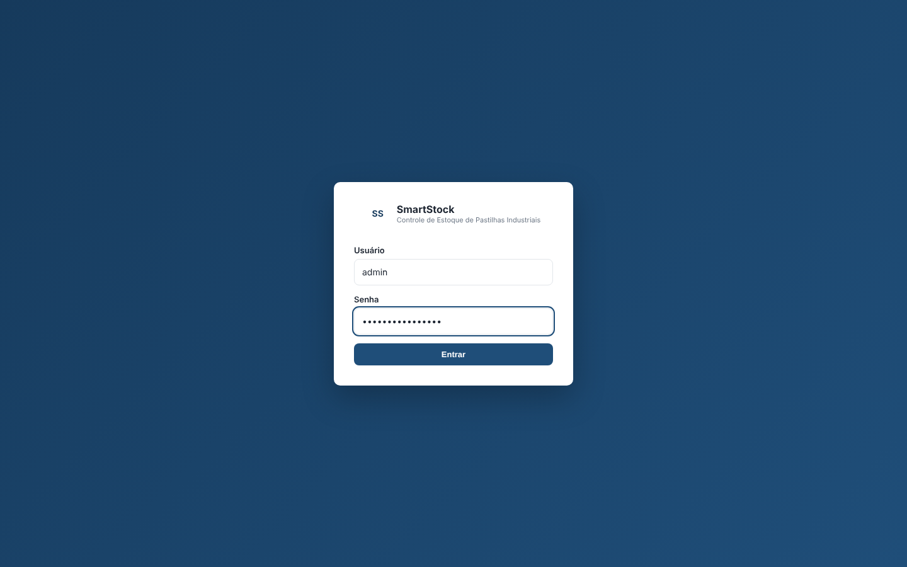

*Figura 1 – Login: primeira etapa, usuário e senha*

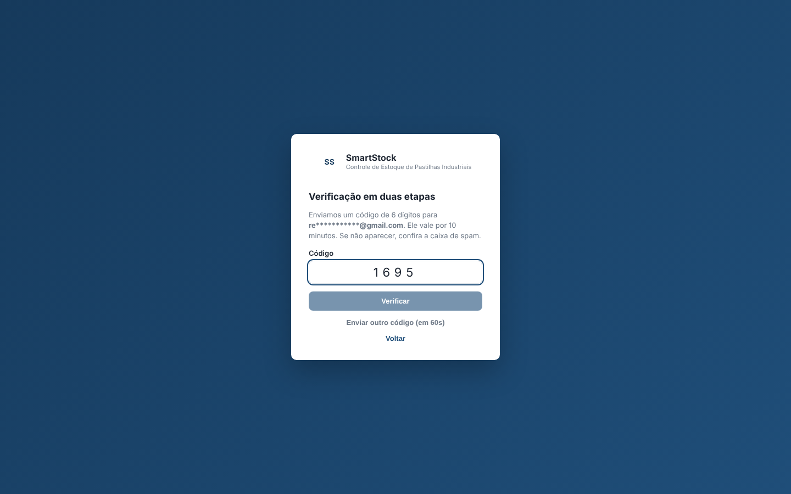

*Figura 2 – Segunda etapa (2FA): código de 6 dígitos enviado por e-mail*

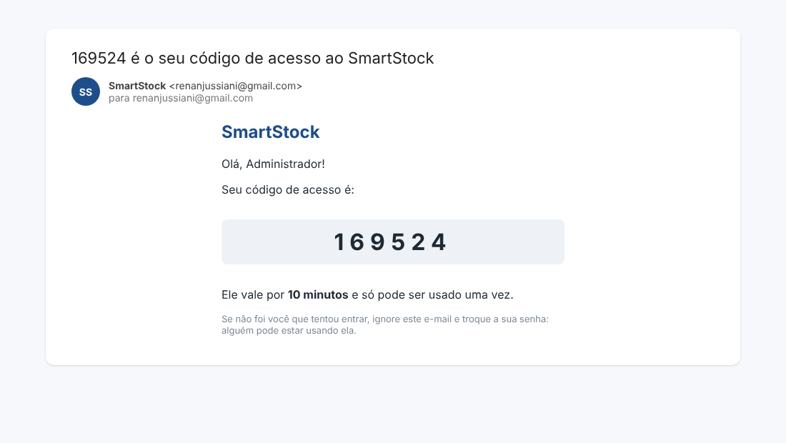

*Figura 3 – E-mail com o código de acesso, válido por 10 minutos*

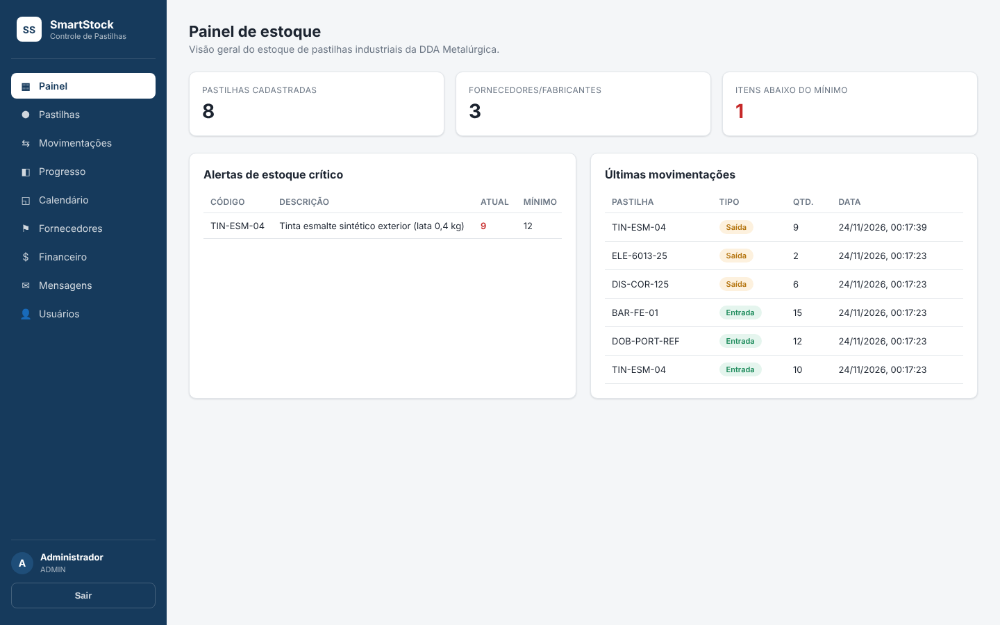

*Figura 4 – Painel inicial: visão geral e alertas de estoque abaixo do mínimo*

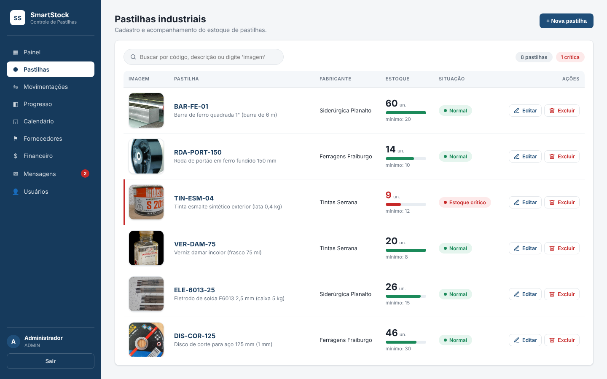

*Figura 5 – Cadastro de itens com foto, estoque mínimo e nível visual*

*Figura 6 – Cadastro de um item de estoque*

*Figura 7 – Histórico de entradas e saídas com responsável e data*

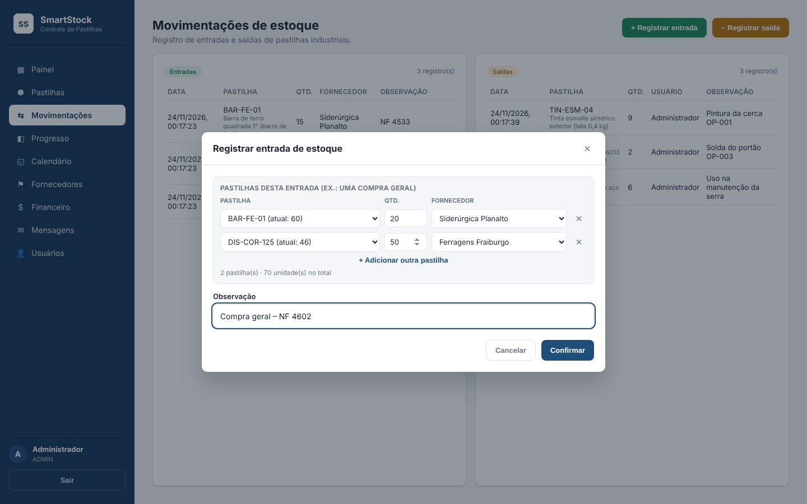

*Figura 8 – Entrada em lote: uma compra inteira registrada de uma vez*

*Figura 9 – Fornecedores e preço de cada item*

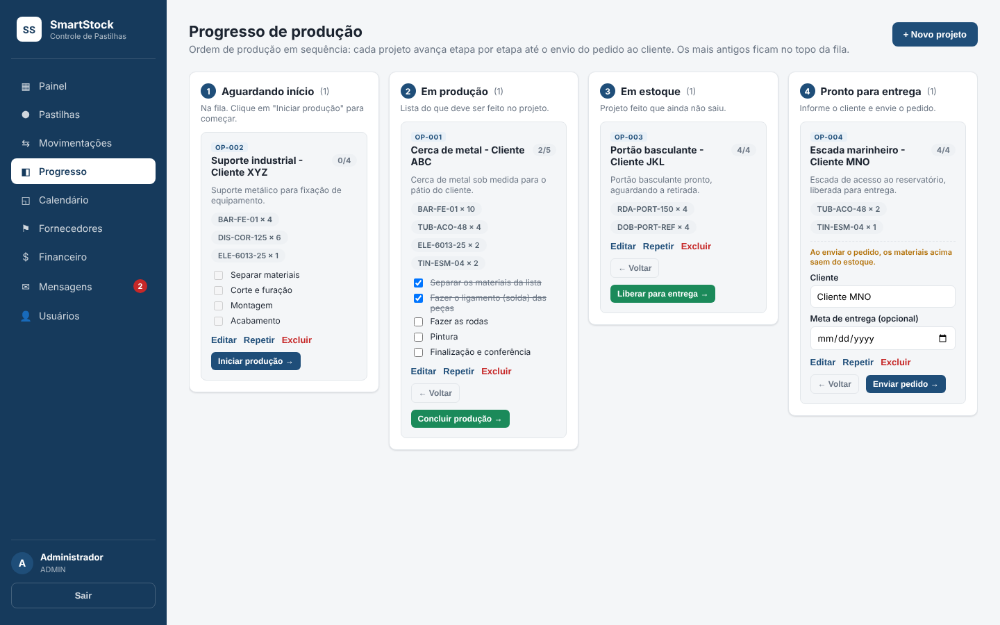

*Figura 10 – Quadro de produção: cada pedido vira uma ordem de produção*

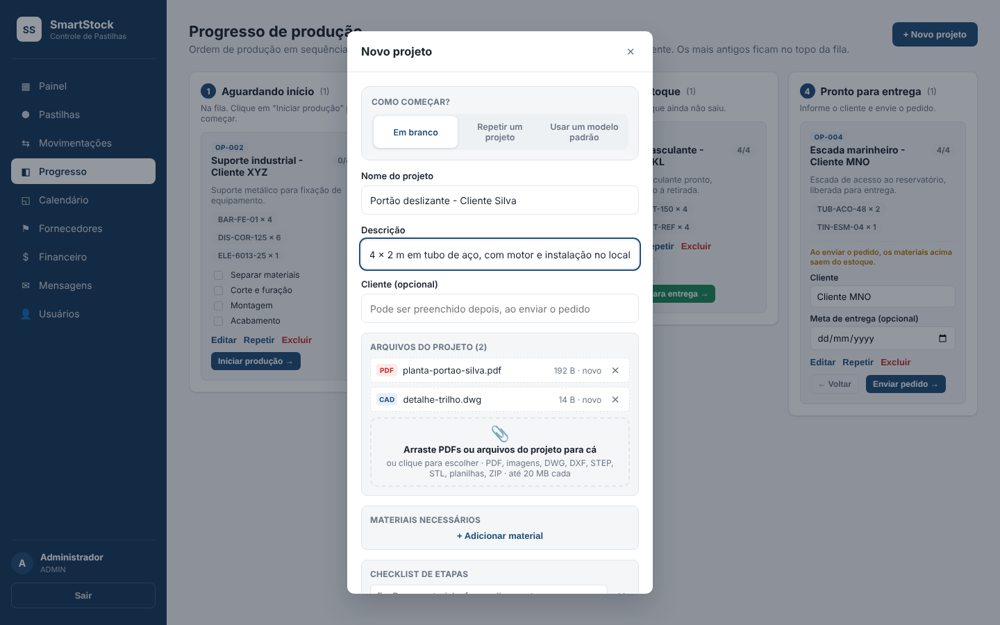

*Figura 11 – Criação de projeto com checklist, materiais e arquivos (PDF/CAD)*

*Figura 12 – Editar ou excluir projeto exige a senha do administrador*

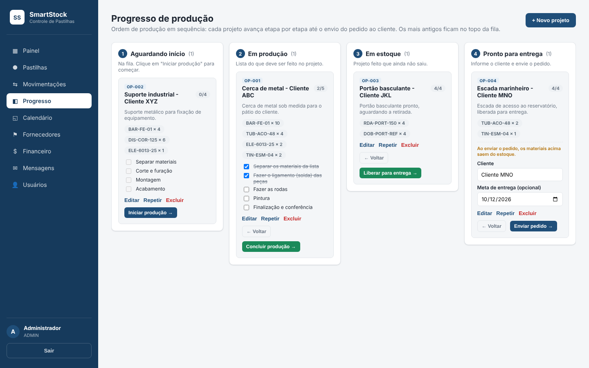

*Figura 13 – Envio do pedido com meta de entrega e baixa automática do estoque*

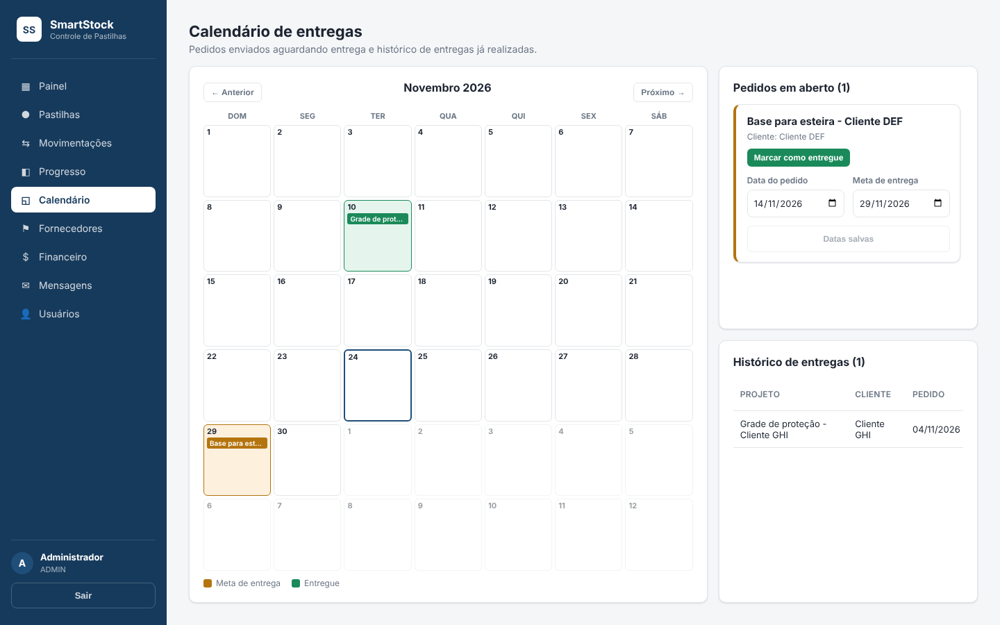

*Figura 14 – Calendário de entregas com a meta de cada pedido*

*Figura 15 – Financeiro: valor em estoque, custo, vendas e margem*

*Figura 16 – Mensagens internas entre setores*

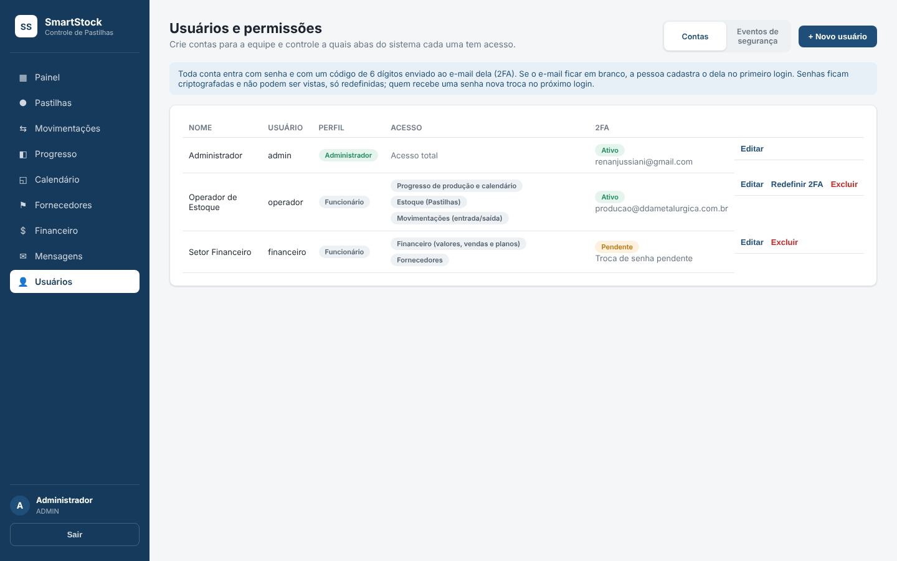

*Figura 17 – Administração de contas, permissões por aba e 2FA*

*Figura 18 – Interface responsiva usada no celular*

# 4. Descritivo comercial

## 4.1 Público-alvo

- **Público principal:** metalúrgicas, serralherias e pequenas indústrias de transformação (5 a 50 funcionários) que
  produzem sob encomenda.
- **Usuários dentro da empresa:** dono/gestor (visão geral e financeiro), produção (Progresso), almoxarifado (estoque e
  movimentações), compras (fornecedores) e administrativo (vendas).

## 4.2 Benefícios

- **Menos parada de produção:** o painel mostra os itens críticos antes de faltarem.
- **Compra mais barata:** comparação de preço por fornecedor e custo real de cada projeto.
- **Prazo sob controle:** quadro de produção e calendário de entregas com a meta de cada pedido.
- **Tudo do projeto num lugar só:** desenhos, PDFs e fotos anexados ao pedido certo.
- **Rastreabilidade:** cada movimentação e cada evento de segurança registrados com data e responsável.
- **Segurança de nível bancário:** senha + código enviado por e-mail (2FA), senhas fortes obrigatórias, bloqueio após
  tentativas erradas, dados criptografados no tráfego e arquivos privados.

## 4.3 Diferenciais

- Feito a partir do dia a dia real de uma metalúrgica da região (DDA Metalúrgica, Fraiburgo/SC).
- Baixa de estoque **automática** ao enviar o pedido, com a regra "tudo ou nada": se faltar um item, nada é baixado.
- Editar ou excluir um projeto exige a **senha do administrador**, evitando alterações acidentais.
- **Modelos de projeto** reaproveitáveis (ex.: "portão deslizante padrão") para abrir pedidos parecidos em segundos.
- Roda na nuvem (AWS + Supabase), sem servidor na empresa e sem instalar nada nos computadores.

## 4.4 Modelo de oferta (proposta)

| Plano | Para quem | Inclui |
|------------------|----------------------|------------------------------------------------------------|
| **Essencial** | até 5 contas | Estoque, movimentações, fornecedores, progresso e calendário |
| **Profissional** | até 15 contas | Tudo do Essencial + financeiro, modelos de projeto e mensagens |
| **Implantação** | pagamento único | Cadastro inicial dos materiais e fornecedores, treinamento da equipe |

Cobrança mensal por empresa (SaaS). O custo de infraestrutura de uma empresa pequena cabe numa instância `t3.micro` da
AWS e no plano gratuito/básico do Supabase.

*Tabela 2 – Planos de oferta*

## 4.5 Comparação com as alternativas

| Critério | Planilhas / caderno | ERP genérico | **SmartStock** |
|----------------------------------|------------------|------------------|------------------------------|
| Produção sob encomenda (etapas, checklist, arquivos do projeto) | Não | Em geral, módulo à parte ou adaptação | **Nativo: é o centro do sistema** |
| Baixa de estoque ao enviar o pedido | Manual | Varia | **Automática e "tudo ou nada"** (se faltar um item, nada é baixado) |
| Custo do projeto pelo menor preço entre fornecedores | Manual | Varia | **Automático** |
| Arquivos do projeto (PDF, CAD) junto do pedido | Espalhados | Varia | **Anexados à ordem de produção** |
| Aprender a usar | — | Treinamento longo | **Poucas abas, em português, pensadas para o chão de fábrica** |
| Acesso por setor | Não | Sim | **Sim, aba por aba, definido pelo administrador** |
| Login com 2FA obrigatório | Não | Raramente obrigatório | **Obrigatório para todas as contas** |
| Infraestrutura | Arquivo no PC | Servidor ou mensalidade alta | **Nuvem (Supabase + AWS), sem servidor na empresa** |

*Tabela 3 – SmartStock comparado a planilhas e a ERPs genéricos*

# 5. Requisitos

Legenda de prioridade: **Alta** (essencial para o uso), **Média** (importante), **Baixa** (desejável). A coluna *Onde*
indica o arquivo principal no código (`backend/src/main/java/com/smartstock/backend/...` e `frontend/src/...`).

## 5.1 Requisitos funcionais

**Acesso e usuários**

| Id | Requisito | Prioridade | Onde |
|-------|---------------------------------------------------|----------|--------------------------------|
| RF01 | O sistema deve exigir login com usuário e senha para qualquer acesso. | Alta | `controller/AuthController`, `pages/Login.jsx` |
| RF02 | Toda conta deve usar verificação em duas etapas (2FA) por e-mail: a cada login, um código aleatório de 6 dígitos é enviado ao e-mail da conta, vale 10 minutos e uma única vez. | Alta | `service/AuthService`, `service/EmailService` |
| RF03 | Na primeira entrada de uma conta sem e-mail, o sistema deve pedir o e-mail e só aceitá-lo depois que o código enviado a ele for digitado; deve permitir reenviar o código (no máximo a cada 60 s). | Alta | `service/AuthService`, `pages/Login.jsx` |
| RF04 | O sistema deve obrigar a troca de senha no primeiro acesso e sempre que o administrador definir uma senha. | Alta | `service/AuthService`, `service/PoliticaSenha` |
| RF05 | O administrador deve poder criar, editar e excluir contas, definir o perfil (Administrador/Operador) e escolher quais abas cada conta acessa. | Alta | `controller/UsuarioController`, `pages/Usuarios.jsx` |
| RF06 | O administrador deve poder definir ou trocar o e-mail do 2FA de uma conta e redefinir o 2FA (apagar o e-mail de quem perdeu o acesso a ele). | Média | `UsuarioService`, `UsuarioController` (`/redefinir-2fa`) |
| RF07 | O usuário deve poder sair do sistema, encerrando todas as sessões abertas da conta. | Média | `AuthController` (`/sair`) |
| RF08 | O sistema deve registrar os eventos de segurança (logins, falhas, bloqueios, 2FA, troca de senha) e mostrá-los ao administrador. | Média | `service/AuditoriaService`, `controller/SegurancaController` |

*Tabela 4 – Requisitos funcionais – acesso e usuários*

**Estoque**

| Id | Requisito | Prioridade | Onde |
|-------|---------------------------------------------------|----------|--------------------------------|
| RF09 | Cadastrar, consultar, editar e excluir itens de estoque com código único, descrição, fabricante, estoque mínimo, quantidade inicial e foto. | Alta | `controller/PastilhaController`, `pages/Pastilhas.jsx` |
| RF10 | Alertar os itens cuja quantidade atual está igual ou abaixo do estoque mínimo (painel e lista de alertas). | Alta | `PastilhaService`, `pages/Dashboard.jsx` |
| RF11 | Registrar entradas de estoque (uma ou várias de uma vez), com fornecedor e observação, somando à quantidade do item. | Alta | `controller/MovimentacaoController` |
| RF12 | Registrar saídas de estoque, recusando a saída quando não houver quantidade suficiente. | Alta | `service/MovimentacaoService` |
| RF13 | Manter o histórico de movimentações com data, tipo, quantidade, item, fornecedor e usuário responsável, com filtro por item. | Alta | `pages/Movimentacoes.jsx` |
| RF14 | Impedir a exclusão de itens e fornecedores que já estão em uso (movimentações, projetos), avisando o motivo. | Média | `exception/GlobalExceptionHandler` (409) |

*Tabela 5 – Requisitos funcionais – estoque*

**Fornecedores**

| Id | Requisito | Prioridade | Onde |
|-------|---------------------------------------------------|----------|--------------------------------|
| RF15 | Cadastrar, consultar, editar e excluir fornecedores/fabricantes com contato, telefone e e-mail. | Alta | `controller/FornecedorController` |
| RF16 | Registrar quais itens cada fornecedor vende e por qual preço. | Média | `FornecedorController` (`/produtos`) |

*Tabela 6 – Requisitos funcionais – fornecedores*

**Produção (Progresso) e entregas (Calendário)**

| Id | Requisito | Prioridade | Onde |
|-------|---------------------------------------------------|----------|--------------------------------|
| RF17 | Criar projetos (ordens de produção) com nome, descrição, checklist de etapas e lista de materiais. | Alta | `controller/ProjetoController`, `pages/Progresso.jsx` |
| RF18 | Anexar arquivos ao projeto (PDF, desenhos CAD, imagens, documentos), abrir/baixar e remover. | Alta | `ProjetoController` (`/anexos`), `components/AnexosProjeto.jsx` |
| RF19 | Conduzir o projeto pelas etapas Aguardando → Em produção → Em estoque → Pronto para entrega, uma etapa por vez, nos dois sentidos. | Alta | `service/ProjetoService` |
| RF20 | Marcar as etapas do checklist apenas enquanto o projeto está "Em produção". | Média | `ProjetoService` |
| RF21 | Exigir a senha de um administrador para editar ou excluir um projeto e para anexar/remover arquivos. | Alta | `service/SenhaAdminService` |
| RF22 | Enviar o pedido ao cliente informando cliente e meta de entrega, dando baixa automática nos materiais; se faltar qualquer item, nada é baixado. | Alta | `ProjetoService.enviarPedido` |
| RF23 | Mostrar os pedidos enviados em um calendário, permitir alterar data e meta, e marcar como entregue. | Alta | `pages/Calendario.jsx` |
| RF24 | Salvar e reaproveitar modelos de projeto (checklist e materiais), e repetir um projeto existente com seus arquivos. | Média | `controller/ModeloProjetoController` |

*Tabela 7 – Requisitos funcionais – produção (progresso) e entregas (calendário)*

**Financeiro**

| Id | Requisito | Prioridade | Onde |
|-------|---------------------------------------------------|----------|--------------------------------|
| RF25 | Calcular o valor parado em estoque e o custo de cada projeto pelo menor preço entre os fornecedores. | Média | `service/FinanceiroService` |
| RF26 | Cadastrar planos (orçamentos) para clientes, editá-los, fechá-los como venda e excluí-los. | Média | `controller/VendaController` |
| RF27 | Mostrar resumo financeiro: total em estoque, vendas, planos em aberto e margem dos projetos. | Média | `pages/Financeiro.jsx` |

*Tabela 8 – Requisitos funcionais – financeiro*

**Comunicação e painel**

| Id | Requisito | Prioridade | Onde |
|-------|---------------------------------------------------|----------|--------------------------------|
| RF28 | Trocar mensagens de texto e imagens entre as contas, com contagem de não lidas. | Baixa | `controller/MensagemController`, `pages/Mensagens.jsx` |
| RF29 | Exibir um painel inicial com totais, itens críticos e últimas movimentações, conforme as permissões da conta. | Média | `controller/DashboardController` |

*Tabela 9 – Requisitos funcionais – comunicação e painel*

## 5.2 Requisitos não funcionais

| Id | Categoria | Requisito | Como foi atendido |
|--------|--------------|--------------------------------------------|----------------------------------|
| RNF01 | Segurança | Senhas guardadas apenas como *hash* BCrypt; política de senha forte (8+ caracteres, letras e números, sem conter o usuário). | `SecurityConfig.passwordEncoder`, `PoliticaSenha` |
| RNF02 | Segurança | Autenticação sem estado com token JWT assinado (HS256), validade de 8 h, revogável ("Sair", troca de senha, redefinição de 2FA). | `JwtService`, campo `token_versao` |
| RNF03 | Segurança | Códigos do 2FA gerados com `SecureRandom`, guardados só como HMAC-SHA256 (nunca o código), comparados em tempo constante, de uso único; 5 erros cancelam o código; envio por SMTP com TLS e certificado conferido; e-mail validado contra injeção de cabeçalhos. | `Segredos`, `AuthService`, `EmailService` |
| RNF04 | Segurança | Bloqueio de 15 minutos após 5 tentativas erradas (senha, código do e-mail, senha de administrador); reenvio de código limitado a 1 por minuto. | `TentativasService`, `AuthService` |
| RNF05 | Segurança | Controle de acesso por perfil e por aba em todas as rotas da API (não só nas telas). | `@PreAuthorize` nos controllers |
| RNF06 | Segurança | Tráfego cifrado: TLS com verificação de certificado até o banco (Supabase); HTTPS no servidor público (Nginx + certbot). | `BancoSeguro`, `deploy/nginx-smartstock.conf` |
| RNF07 | Segurança | Banco protegido contra acesso direto pela API pública do Supabase (RLS ligado e permissões revogadas); arquivos privados só passam pelo backend. | `BancoSeguro`, `SupabaseStorage` |
| RNF08 | Segurança | Nenhuma senha ou chave no código: tudo em `.env` (fora do Git) ou variáveis de ambiente. | `.env.example`, `.gitignore` |
| RNF09 | Segurança | Arquivos enviados conferidos pelo conteúdo (não só pela extensão) e com tamanho limitado (5 MB imagens, 20 MB anexos). | `storage/TipoArquivo`, `AnexoProjetoService` |
| RNF10 | Segurança | Cabeçalhos de proteção do navegador (CSP, X-Frame-Options, Referrer-Policy) e mensagens de erro sem detalhes internos. | `SecurityConfig`, `GlobalExceptionHandler` |
| RNF11 | Rastreabilidade | Movimentações e eventos de segurança registrados com data, usuário e IP. | `Movimentacao`, `EventoSeguranca` |
| RNF12 | Integridade | Operações compostas são "tudo ou nada" (transações): envio de pedido, entrada em lote, projeto com arquivos. | `@Transactional` nos serviços |
| RNF13 | Manutenibilidade | Banco versionado por migrations (Flyway); o Hibernate só valida o esquema. Código em camadas (controller → service → repository). | `db/migration`, `ddl-auto=validate` |
| RNF14 | Documentação | API documentada em OpenAPI 3 com exemplos reais, disponível no próprio sistema (`/swagger-ui.html`). | `static/openapi.yaml`, springdoc |
| RNF15 | Padrões REST | Respostas com códigos HTTP corretos: 200, 201 (criado), 204 (excluído), 400, 401, 403, 404, 409, 422, 429; erros em JSON padronizado. | controllers, `GlobalExceptionHandler` |
| RNF16 | Usabilidade | Interface em português, responsiva (computador e celular), menus mostrando só as abas permitidas. | `index.css`, `components/Layout.jsx` |
| RNF17 | Disponibilidade | Publicação em AWS EC2 com reinício automático do backend (systemd) e Elastic IP fixo. | `deploy/smartstock.service` |
| RNF18 | Desempenho | Respostas comuns em menos de 1 s para até 15 usuários simultâneos numa instância `t3.micro`; pool de 5 conexões com o banco. | `application.properties` |
| RNF19 | Portabilidade | Uso pelo navegador (Chrome, Edge, Firefox) sem instalar nada; backend em Java 21 roda em Windows e Linux. | — |
| RNF20 | Privacidade (LGPD) | Coleta só os dados necessários (nome, usuário, contato de fornecedores); senhas e segredos nunca aparecem em respostas ou logs. | DTOs de resposta |

*Tabela 10 – Requisitos não funcionais*

# 6. Casos de uso

## 6.1 Atores

| Ator | Quem é | O que pode fazer |
|--------------------|------------------------------|--------------------------------------------------|
| **Administrador** | Dono/gestor da metalúrgica | Tudo: contas, permissões, segurança e todas as abas; sua senha autoriza editar/excluir projetos |
| **Operador** | Funcionário de um setor (produção, almoxarifado, compras, financeiro) | Só as abas liberadas para a conta dele |
| **Serviço de e-mail** | Gmail (ator externo) | Entrega à caixa de entrada da pessoa o código de 6 dígitos do 2FA |
| **Supabase** | Serviço de nuvem (ator externo) | Guarda o banco de dados e os arquivos |

*Tabela 11 – Atores do sistema*

## 6.2 Diagrama de casos de uso

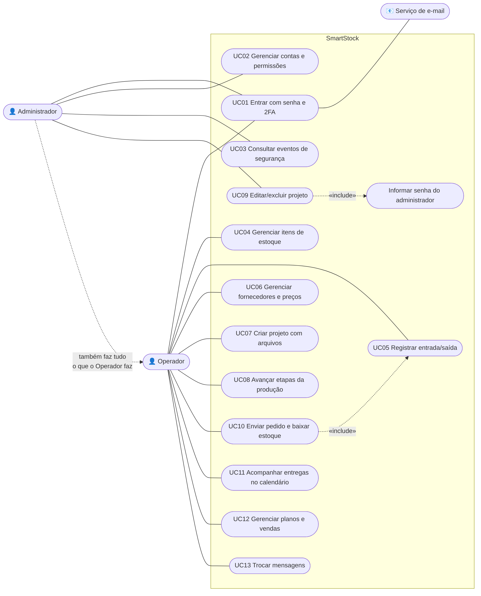

*Figura 19 – Diagrama de casos de uso*

O Operador só vê os casos de uso das abas liberadas para a conta dele (por exemplo, o almoxarifado vê UC04 e UC05).

## 6.3 Descrição dos principais casos de uso

### UC01 – Entrar com senha e 2FA

- **Atores:** Administrador ou Operador; Serviço de e-mail.
- **Pré-condição:** a conta existe.
- **Fluxo principal:**
  1. O usuário informa usuário e senha.
  2. O sistema confere a senha, envia um código de 6 dígitos para o e-mail da conta e pede esse código.
  3. O usuário abre o e-mail e digita o código.
  4. O sistema confere o código e libera o acesso às abas permitidas por 8 horas.
- **Fluxos alternativos:**
  - *2a. Primeira entrada (conta sem e-mail):* o sistema pede o e-mail, envia o código para ele e, quando o código é
    digitado, passa a usar esse e-mail. Se a senha for de exemplo, o usuário é obrigado a trocá-la.
  - *3a. Código não chegou:* o usuário pede outro código (no máximo um por minuto); o anterior deixa de valer.
  - *3b. Perdeu o acesso ao e-mail:* o administrador troca o e-mail da conta ou redefine o 2FA.
  - *1a/3c. Erro:* senha ou código errado mostram aviso; após 5 erros seguidos, a conta fica bloqueada por 15 minutos.
- **Pós-condição:** evento registrado em *Segurança*.

### UC02 – Gerenciar contas e permissões

- **Ator:** Administrador (ou Operador com a aba Usuários).
- **Fluxo principal:** o administrador cria a conta com nome, usuário, senha provisória, perfil, abas permitidas e,
  opcionalmente, o e-mail; a pessoa troca a senha no primeiro acesso (e confirma o e-mail, se ele não foi informado).
- **Alternativos:** editar (trocar a senha ou o e-mail encerra as sessões da pessoa); redefinir 2FA; excluir.
- **Regras:** não é possível excluir a própria conta nem o único administrador; um Operador só concede abas que ele tem.

### UC05 – Registrar entrada/saída de estoque

- **Ator:** Operador com a aba Movimentações.
- **Fluxo principal:** escolhe o item, o tipo (entrada ou saída), a quantidade e, na entrada, o fornecedor; o sistema
  atualiza a quantidade e registra quem fez.
- **Alternativos:** *entrada em lote* (várias linhas de uma vez: se uma falhar, nenhuma é gravada); *saída maior que o
  estoque*: recusada com a quantidade disponível.
- **Pós-condição:** se o item ficar no mínimo ou abaixo, aparece nos alertas do painel.

### UC07 – Criar projeto com arquivos

- **Ator:** Operador com a aba Progresso.
- **Fluxo principal:** informa nome e descrição, monta o checklist e a lista de materiais (ou parte de um modelo),
  anexa PDFs/desenhos e salva. O projeto entra em "Aguardando início".
- **Alternativos:** *repetir projeto* (copia dados e arquivos); *arquivo recusado* (tipo ou tamanho inválido): o projeto
  não é criado e o motivo é mostrado.

### UC09 – Editar/excluir projeto

- **Ator:** Operador com a aba Progresso + **senha de um Administrador**.
- **Fluxo principal:** o usuário altera o projeto (ou pede a exclusão), o sistema pede a senha do administrador, confere
  e grava. Na exclusão, os arquivos do projeto também são apagados.
- **Alternativo:** senha incorreta → nada é alterado; 5 erros seguidos → bloqueio de 15 minutos.

### UC10 – Enviar pedido e baixar estoque

- **Ator:** Operador com a aba Progresso.
- **Pré-condição:** projeto em "Pronto para entrega".
- **Fluxo principal:** informa cliente e meta de entrega; o sistema dá baixa em todos os materiais do projeto e move o
  pedido para o Calendário.
- **Alternativo:** falta algum material → o envio é recusado, informando o item, e **nada** é baixado.

### UC11 – Acompanhar entregas no calendário

- **Ator:** Operador com a aba Progresso.
- **Fluxo principal:** vê os pedidos enviados por data, ajusta data do pedido e meta, e marca como entregue.
- **Pós-condição:** pedidos entregues ficam no histórico.

### UC12 – Gerenciar planos e vendas

- **Ator:** Operador com a aba Financeiro.
- **Fluxo principal:** cria um plano para um cliente (opcionalmente ligado a um projeto, com custo calculado), ajusta o
  valor e, quando o cliente aceita, fecha o plano como venda.

# 7. Arquitetura e diagramas

## 7.1 Arquitetura geral

O SmartStock segue a arquitetura cliente-servidor em três partes: o **frontend** (React) roda no navegador; o
**backend** (Spring Boot) concentra as regras de negócio, a segurança e o acesso aos dados; e os **serviços em nuvem**
guardam os dados (PostgreSQL no Supabase), os arquivos (Supabase Storage) e enviam o código de login (Gmail). No
servidor da AWS, o Nginx entrega as telas e repassa à API apenas os pedidos `/api`.

*Figura 20 – Arquitetura geral do SmartStock*

## 7.2 Camadas do backend

Cada pedido percorre as camadas de cima para baixo, e cada camada tem uma única responsabilidade: o **filtro de
segurança** confere o token; o **controller** recebe o pedido e confere a permissão da aba; o **service** aplica as
regras de negócio; o **repository** lê e grava no banco por meio das **entidades** (JPA).

*Figura 21 – Camadas do backend*

## 7.3 Banco de dados

O banco é PostgreSQL (Supabase), no schema `smartstock`, criado e versionado por **migrations Flyway**:
`V1__esquema_inicial.sql` (16 tabelas e chaves estrangeiras), `V2__seguranca_2fa.sql` (dados de segurança e auditoria)
e `V3__dois_fatores_por_email.sql` (troca do 2FA por aplicativo pelo 2FA por e-mail). O Hibernate só **valida** se o
banco corresponde às entidades. Para facilitar a leitura, o modelo entidade-relacionamento está dividido por assunto.

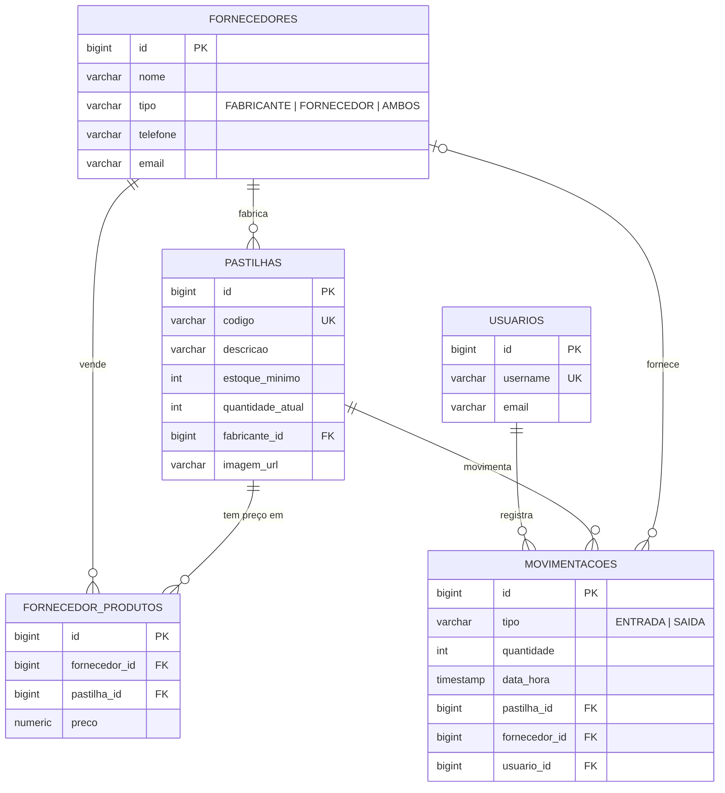

*Figura 22 – Modelo ER – estoque, fornecedores e movimentações*
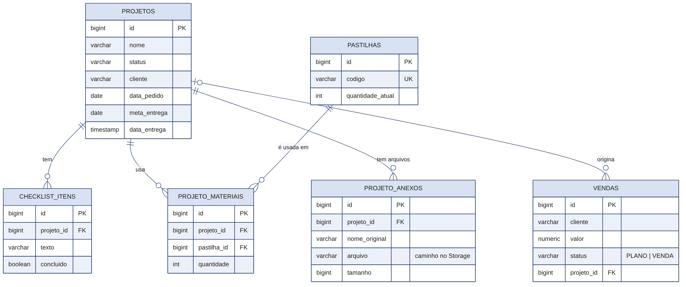

*Figura 23 – Modelo ER – projetos (ordens de produção) e vendas*
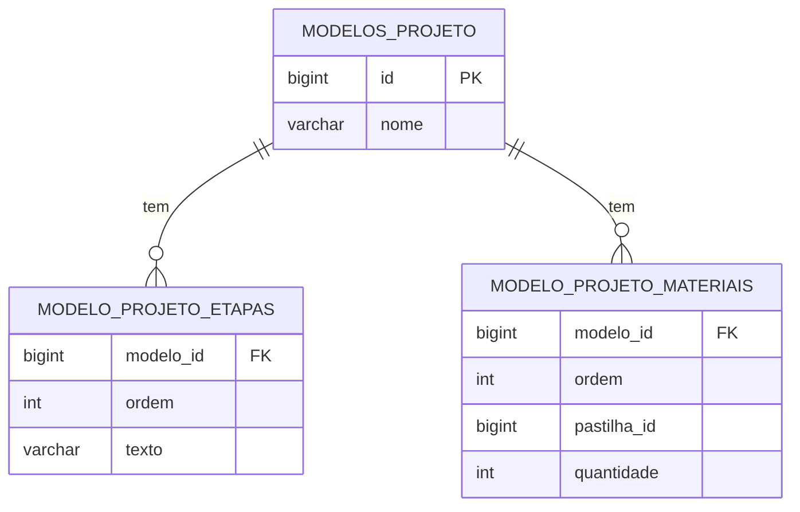

*Figura 24 – Modelo ER – modelos de projeto*
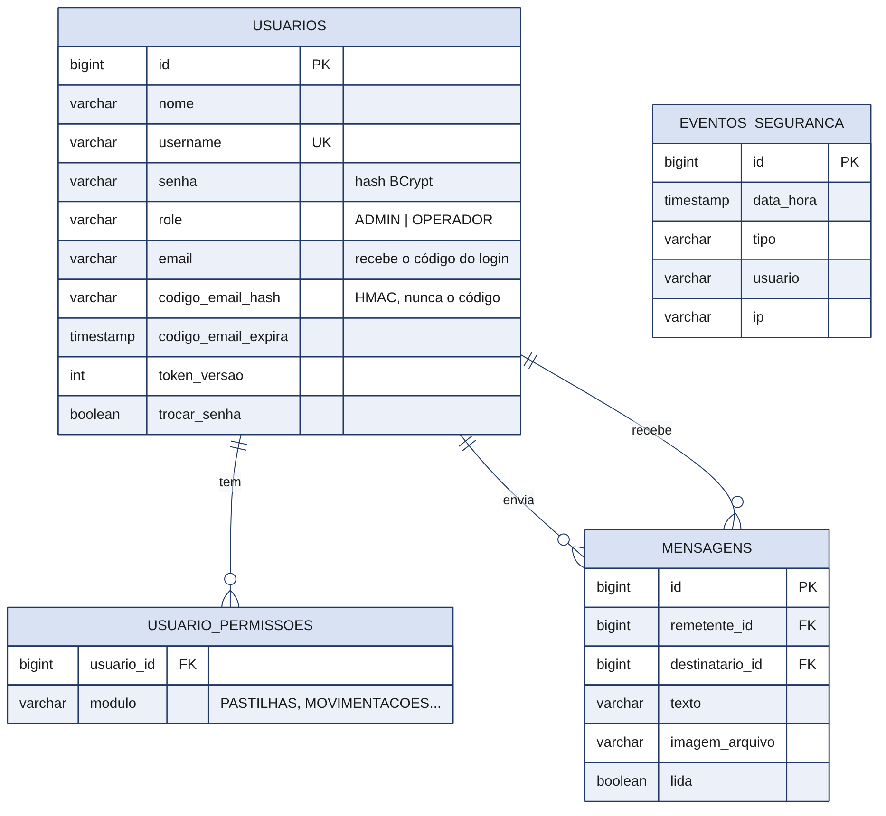

*Figura 25 – Modelo ER – contas, permissões, mensagens e auditoria*

## 7.4 Sequência do login com 2FA por e-mail

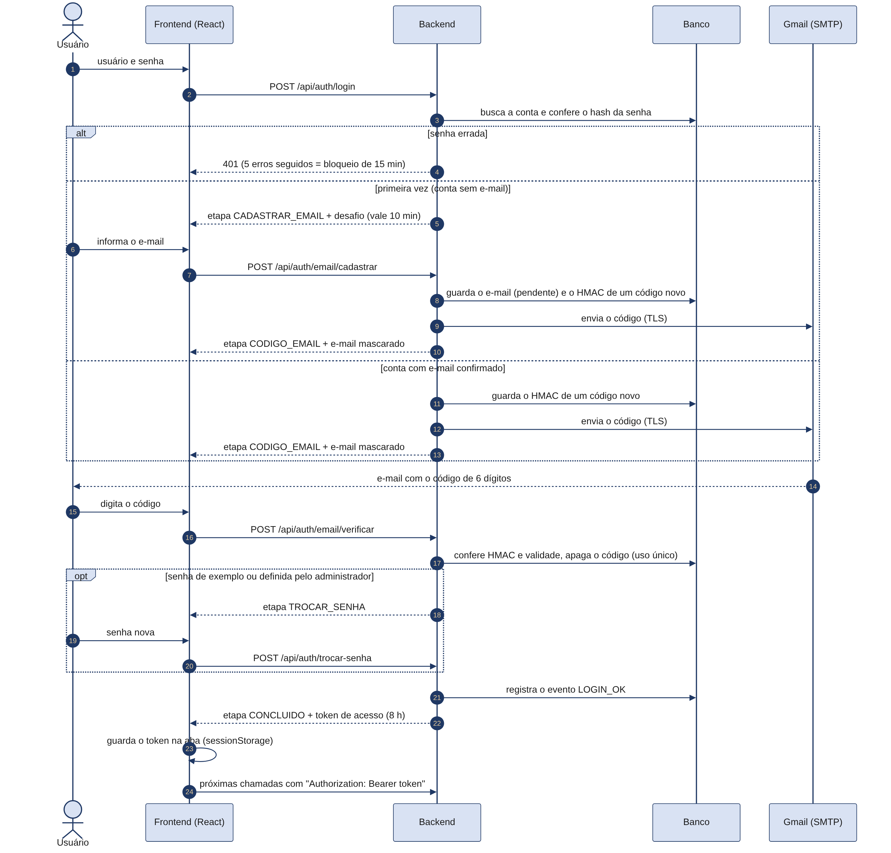

*Figura 26 – Diagrama de sequência do login com verificação em duas etapas*

## 7.5 Estados de um projeto

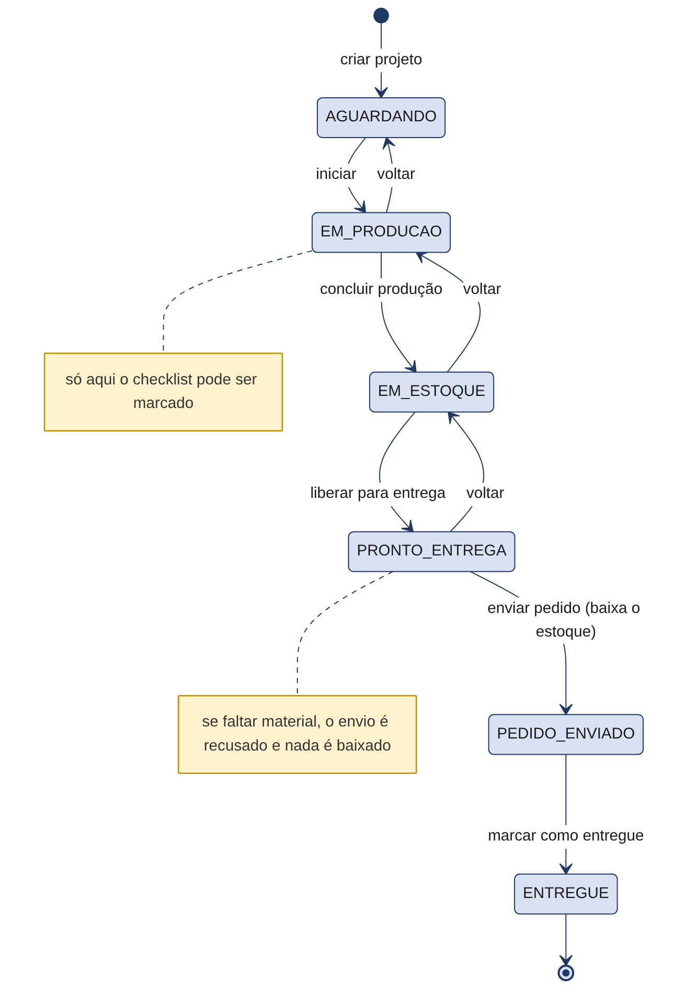

*Figura 27 – Diagrama de estados de um projeto (ordem de produção)*

# 8. Tecnologias

| Camada | Tecnologia | Uso no SmartStock |
|----------------|------------------------------|------------------------------------------------------|
| Frontend | React 19 + Vite | Telas, navegação por abas, interface responsiva |
| Backend | Java 21 + Spring Boot 3.5 | API REST, regras de negócio |
| Segurança | Spring Security + JWT + 2FA por e-mail | Login em etapas, permissões por aba, auditoria |
| Dados | Spring Data JPA (Hibernate) + PostgreSQL | Entidades, repositórios e consultas |
| Migrations | Flyway | Versionamento do banco (V1, V2, V3) |
| Arquivos | Supabase Storage | Fotos dos itens, imagens das mensagens e arquivos dos projetos |
| E-mail | SMTP (Gmail) com TLS | Envio do código de login |
| Documentação | OpenAPI 3 / Swagger UI (springdoc) | Documentação interativa das 67 rotas |
| Nuvem | AWS EC2 + Elastic IP, Nginx, systemd | Hospedagem do sistema |
| Versionamento | Git + GitHub | Código-fonte e histórico |

*Tabela 12 – Tecnologias utilizadas*

# 9. Segurança

A segurança foi tratada como requisito do sistema, e não como detalhe. A tabela resume o que foi implementado em cada camada.

| Camada | O que o SmartStock faz |
|--------------------|--------------------------------------------------------------------------------|
| **Login** | Senha + **código de 6 dígitos enviado por e-mail (2FA)** para todas as contas, sem precisar instalar nenhum app; o código vale 10 minutos e uma única vez, e o e-mail é confirmado no primeiro acesso |
| **Senhas** | Guardadas só como *hash* BCrypt (ninguém, nem o administrador, consegue vê-las); política de senha forte; **troca obrigatória** das senhas de exemplo e das definidas pelo administrador |
| **Ataques de força bruta** | 5 tentativas erradas (senha, código do e-mail ou senha do administrador) bloqueiam por 15 minutos; um código novo só pode ser pedido a cada 60 s |
| **Sessões** | Token JWT assinado, válido por 8 h e **revogável**: "Sair", troca de senha ou redefinição do 2FA derrubam todas as sessões da conta |
| **Permissões** | Conferidas **no servidor, em cada rota** da API, por perfil e por aba (esconder o menu não basta) |
| **Dados em trânsito** | HTTPS no servidor público; conexão com o banco e com o servidor de e-mail por TLS **verificando o certificado** |
| **Dados guardados** | Códigos do e-mail guardados só como "impressão digital" (HMAC-SHA256), nunca o código em si; banco fechado para a API pública do Supabase (RLS); fotos de conversas e arquivos de projetos em armazenamento **privado** |
| **Arquivos enviados** | Tipo conferido pelo conteúdo (não só pela extensão) e tamanho limitado |
| **Segredos** | Nenhuma senha ou chave no código: tudo no `.env`, fora do Git |
| **Auditoria** | Registro de eventos de segurança (logins, falhas, bloqueios, 2FA, trocas de senha) com data, conta e IP, visível ao administrador |
| **Navegador e servidor** | Cabeçalhos de proteção (CSP, anti-clickjacking), erros sem detalhes internos, backend escondido atrás do Nginx |

*Tabela 13 – Medidas de segurança por camada*

O **controle de acesso** combina dois níveis: o perfil da conta (Administrador ou Operador) e as **abas liberadas**
para cada conta (Estoque, Movimentações, Progresso, Fornecedores, Financeiro, Usuários). As permissões são conferidas
**no servidor, em cada rota** da API (anotação `@PreAuthorize`), e não apenas escondendo os menus nas telas. Ações
sensíveis, como editar ou excluir um projeto, exigem também a senha de um administrador.

# 10. API REST

O backend expõe uma API REST com **67 rotas**, organizada em controllers, services, repositories e entidades. Todas as
rotas começam com `/api` e, exceto as de login, exigem o token JWT no cabeçalho `Authorization: Bearer`.

- **Métodos HTTP:** `GET` para consultas, `POST` para criação, `PUT` para edição completa, `PATCH` para mudanças
  parciais (etapa do projeto, checklist, datas) e `DELETE` para exclusão.
- **Respostas:** `200 OK`, `201 Created` nas criações, `204 No Content` nas exclusões e erros padronizados no formato
  `{status, message, timestamp}` (400, 401, 403, 404, 409, 422 e 429).
- **CRUD completo** para itens de estoque, fornecedores, projetos, modelos de projeto, vendas e usuários. As
  movimentações só podem ser criadas e consultadas, de propósito: o histórico de estoque não pode ser alterado.
- **Documentação:** especificação **OpenAPI 3** com descrição, permissões e exemplos reais de cada rota, disponível no
  próprio sistema em `/swagger-ui.html` e no repositório em `docs/openapi` (`openapi.yaml`, `openapi.json` e referência
  em texto).

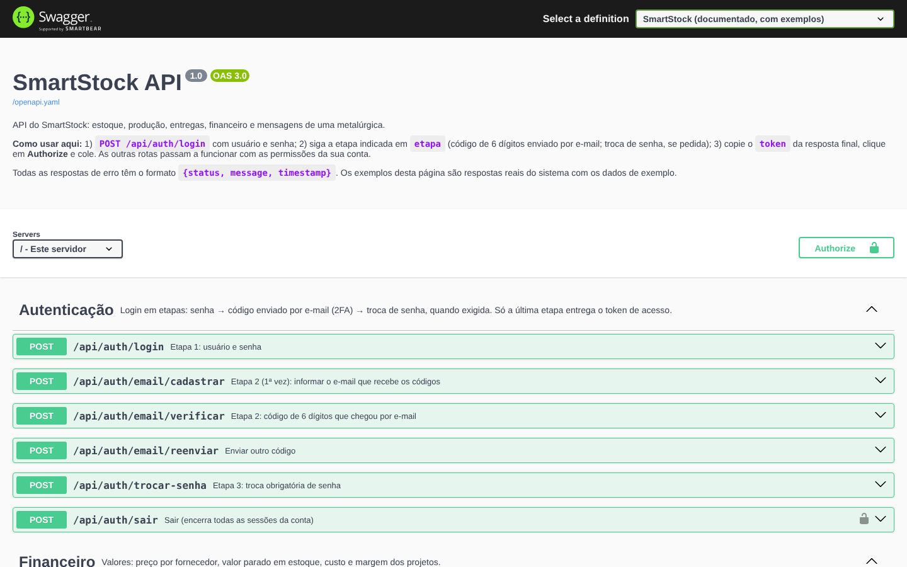

*Figura 28 – Documentação interativa da API (OpenAPI/Swagger)*

# 11. Infraestrutura em nuvem

O SmartStock está publicado na **AWS**, em uma instância **EC2** do AWS Academy (Learner Lab), região `us-east-1`. O
banco de dados e os arquivos ficam no **Supabase** (PostgreSQL gerenciado e Storage), e o envio do código de login é
feito pelo **Gmail** via SMTP com TLS.

| Item | Configuração |
|--------------------|--------------------------------------------------------------------------------|
| Instância | EC2 `t3.micro`, Ubuntu Server LTS, 20 GiB |
| Endereço | **Elastic IP 34.199.252.233** (fixo, não muda ao religar a instância) |
| Servidor web | **Nginx** na porta 80: entrega as telas (build do React) e repassa `/api` e a documentação ao backend |
| Backend | Serviço **systemd** `smartstock.service`: liga junto com o servidor e reinicia sozinho se cair; escuta só em `127.0.0.1:8080`, com usuário próprio sem acesso ao terminal |
| Dependências | Java 21 (OpenJDK), Nginx, certbot e firewall `ufw`, instalados pelo script `deploy/instalar-ec2.sh` |
| Segredos | Arquivo `/opt/smartstock/.env` com permissão `600`, fora do Git |
| Security Group | Entrada **22 (SSH) apenas do IP do administrador** e **80 (HTTP)** para todos; **8080 fechada**; a 443 só é aberta ao ativar o HTTPS |
| Acesso administrativo | SSH com **chave** (`.pem`), sem senha |
| Publicação | Script `deploy/publicar.ps1`: gera backend e frontend, envia por `scp` e reinicia o serviço; para no primeiro erro |
| Banco e arquivos | Supabase (PostgreSQL com TLS verificando o certificado; RLS ligado; Storage privado para arquivos sensíveis) |

*Tabela 14 – Configuração da infraestrutura*

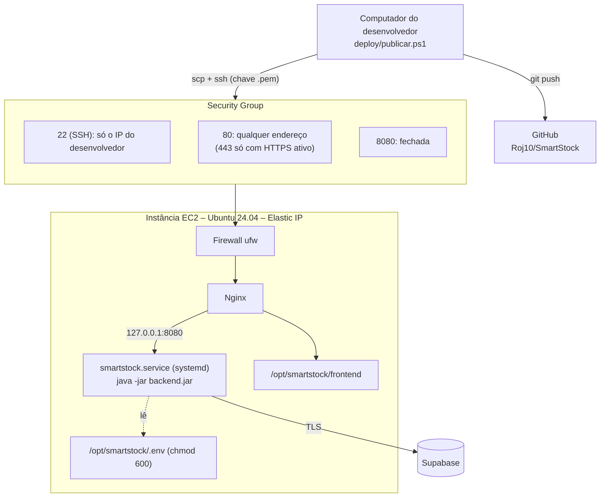

*Figura 29 – Diagrama de implantação*
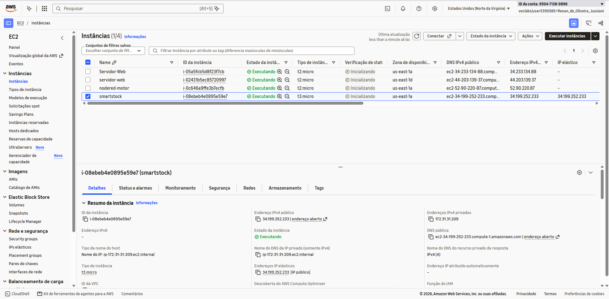

*Figura 30 – Instância EC2 do SmartStock com o IP elástico*

*Figura 31 – Security Group com apenas as portas necessárias (22 restrita e 80)*

O passo a passo completo da implantação está em `docs/implantacao-aws-ec2.md`.

# 12. Usabilidade

As telas foram avaliadas pelas **10 heurísticas de usabilidade de Nielsen**.

| # | Heurística | Como o SmartStock atende |
|-----|------------------------------|-----------------------------------------------------------------|
| 1 | **Visibilidade do estado do sistema** — o usuário sempre sabe o que está acontecendo | Botões mudam para *Entrando...*, *Salvando...*, *Enviando...*, *Verificando...* enquanto a ação acontece; listas mostram *Carregando...*; barra de nível colorida em cada item de estoque; contador de etapas do checklist em cada projeto; aviso de mensagens não lidas no menu e no título da aba do navegador; contagem regressiva de "Enviar outro código" no login |
| 2 | **Correspondência com o mundo real** — linguagem e conceitos do usuário | Tudo em português e com os termos da metalúrgica: *ordem de produção*, *pronto para entrega*, *enviar pedido*, *estoque mínimo*, *fornecedor*, *plano/venda*; o quadro de Progresso segue as etapas reais (Aguardando → Em produção → Em estoque → Pronto para entrega); valores em R$ e datas no formato brasileiro |
| 3 | **Controle e liberdade do usuário** — saídas claras para desfazer | Etapas do projeto podem **voltar** uma posição; todo formulário abre em janela com **Cancelar**; no login há *Voltar*, *Cancelar* e *Digitei o e-mail errado*; o código por e-mail pode ser reenviado |
| 4 | **Consistência e padrões** — mesmas ações, mesma aparência | Todas as telas seguem o mesmo layout (menu lateral, título, tabela ou quadro, botão principal no topo à direita); mesmos botões (*Editar*, *Excluir*, *Salvar*, *Cancelar*) e as mesmas cores para o mesmo significado (vermelho = crítico/perigo, verde = ok); mensagens de erro sempre no mesmo lugar e formato |
| 5 | **Prevenção de erros** — evitar que o erro aconteça | Confirmação antes de excluir qualquer registro, fechar uma venda ou enviar um pedido; aviso se o checklist ainda tem etapas pendentes ao concluir; senha do administrador para editar/excluir projetos; o servidor recusa saída maior que o estoque e envio de pedido com material faltando (*tudo ou nada*); campos obrigatórios marcados; o código do login só aceita números e libera o botão com 6 dígitos |
| 6 | **Reconhecer em vez de lembrar** — informação à vista | Listas de seleção para itens, fornecedores e modelos (não é preciso decorar códigos); materiais do projeto mostram o estoque atual ao passar o mouse e ficam vermelhos se faltar; exemplos nos campos (*Ex: BAR-FE-01*, *Ex: Cerca de metal - Cliente ABC*); fotos dos itens; o login mostra para qual e-mail o código foi (*re\*\*\*\*@gmail.com*) |
| 7 | **Flexibilidade e eficiência de uso** — atalhos para quem já sabe | **Modelos de projeto** e **Repetir projeto** criam pedidos parecidos em segundos; **entrada em lote** registra uma compra inteira de uma vez; filtros por item nas movimentações e busca nas mensagens; o código do e-mail é reconhecido pelo celular (*one-time-code*) |
| 8 | **Estética e design minimalista** — só o necessário | Cada conta vê **só as abas que tem permissão**; painel inicial com três números e duas listas; informações secundárias (fotos ampliadas, arquivos do projeto) aparecem só quando pedidas |
| 9 | **Ajudar a reconhecer, diagnosticar e corrigir erros** — mensagens claras | Mensagens em linguagem simples e com a solução: *"Estoque insuficiente para a pastilha BAR-FE-01. Disponível: 3"*, *"Não foi possível concluir: este registro está ligado a outros cadastros"*, *"Aguarde 42 segundos para pedir outro código"*, *"A senha deve ter letras e números."*; erros técnicos nunca aparecem para o usuário |
| 10 | **Ajuda e documentação** | Textos de orientação nas telas (ex.: "Como começar?" ao criar projeto, explicação do 2FA no primeiro login, dica de conferir o spam); dicas ao passar o mouse; README com roteiro de uso; documentação da API em `/swagger-ui.html` e guia para leigos |

*Tabela 15 – Avaliação pelas heurísticas de Nielsen*

Além disso, a interface é **responsiva** (funciona no celular e no tablet do chão de fábrica sem instalar nada), usa
campos com rótulo e o tipo de teclado adequado, e não depende só de cores para indicar estados importantes.

# 13. Conhecimentos das unidades curriculares aplicados

| Unidade curricular | Onde aparece no SmartStock |
|----------------------------|------------------------------------------------------------------------|
| Desenvolvimento web | Frontend em React e API REST em Spring Boot |
| Computação em nuvem | AWS EC2, Elastic IP, Security Groups, Nginx, systemd; Supabase (PostgreSQL e Storage) |
| Sistemas distribuídos | Frontend, backend, banco, armazenamento e e-mail como serviços separados que conversam pela rede, com autenticação sem estado (JWT) |
| Desenvolvimento de sistemas móveis | Interface responsiva, usada pelo navegador do celular no chão de fábrica |
| Banco de dados | Modelagem relacional, chaves estrangeiras, migrations e transações "tudo ou nada" |

*Tabela 16 – Conhecimentos aplicados*

# 14. Considerações finais

O SmartStock atende ao desafio proposto pela DDA Metalúrgica: o estoque passou a ter alertas e histórico completo, cada
pedido é acompanhado como uma ordem de produção até a entrega, os materiais são baixados automaticamente e o custo dos
projetos é calculado pelo menor preço dos fornecedores. O sistema está publicado na AWS, com banco PostgreSQL
gerenciado, migrations versionadas, API documentada e segurança em várias camadas, incluindo verificação em duas etapas
por e-mail para todas as contas.

**Próximos passos:** ativar o HTTPS com um domínio próprio; relatórios de consumo de material por período; notificação
por e-mail quando um item atingir o estoque mínimo; testes automatizados e teste de usabilidade com os funcionários da
metalúrgica; e um aplicativo móvel para o chão de fábrica.

# Referências

- Código-fonte do SmartStock. Disponível em: <https://github.com/Roj10/SmartStock>.
- AMAZON WEB SERVICES. *Amazon EC2 Documentation*. Disponível em: <https://docs.aws.amazon.com/ec2/>.
- SPRING. *Spring Boot Reference Documentation*. Disponível em: <https://docs.spring.io/spring-boot/>.
- SUPABASE. *Supabase Docs*. Disponível em: <https://supabase.com/docs>.
- OPENAPI INITIATIVE. *OpenAPI Specification 3.0.3*. Disponível em: <https://spec.openapis.org/oas/v3.0.3>.
- NIELSEN, J. *10 Usability Heuristics for User Interface Design*. Nielsen Norman Group, 1994 (atualizado em 2024).
  Disponível em: <https://www.nngroup.com/articles/ten-usability-heuristics/>.
- REDGATE. *Flyway Documentation*. Disponível em: <https://documentation.red-gate.com/flyway>.
