<!-- Relatório do sistema SmartStock. O arquivo Word (Relatorio-SmartStock.docx) é gerado a partir deste texto. -->

<div align="center">

**SERVIÇO NACIONAL DE APRENDIZAGEM INDUSTRIAL – SENAI/SC**<br>
Curso de Análise e Desenvolvimento de Sistemas · Unidade curricular Projeto Aplicado III

# SmartStock

**Relatório do sistema** – gestão de estoque, produção e entregas para a DDA Metalúrgica

Renan de Oliveira Jussiani · Florianópolis/SC, 2026

</div>

## Folha de rosto {.unnumbered}

Relatório técnico apresentado à unidade curricular **Projeto Aplicado III** do curso de Análise e Desenvolvimento de Sistemas do Serviço Nacional de Aprendizagem Industrial – SENAI/SC, como requisito parcial de avaliação. O sistema foi desenvolvido a partir de um desafio real proposto pela **DDA Metalúrgica**, de Fraiburgo/SC. Docente: **Prof. Fernando Lengler**.

*Tabela 1 – Identificação do projeto*

| Item | Descrição |
|------------------------|----------------------------------------------------------------------------|
| **Autor** | Renan de Oliveira Jussiani |
| **Instituição** | SENAI/SC – Florianópolis |
| **Curso e unidade curricular** | Análise e Desenvolvimento de Sistemas · Projeto Aplicado III |
| **Docente** | Prof. Fernando Lengler |
| **Empresa do desafio** | DDA Metalúrgica – Fraiburgo/SC |
| **Sistema no ar** | <http://34.199.252.233> (AWS EC2 – AWS Academy) |
| **Código-fonte** | <https://github.com/Roj10/SmartStock> |
| **Documentação da API** | `/swagger-ui.html` no sistema e `docs/openapi` no repositório |
| **Vídeo de demonstração** | (inserir o link do vídeo) |

## Resumo {.unnumbered}

O **SmartStock** é um sistema web desenvolvido no Projeto Aplicado III para a **DDA Metalúrgica**, empresa de Fraiburgo/SC que fabrica portões, grades, estruturas e peças sob encomenda. O problema enfrentado era o controle de estoque, produção e entregas feito em planilhas, cadernos e mensagens: o material acabava sem aviso no meio da produção, o andamento dos pedidos dependia de perguntar na oficina e os desenhos de cada projeto ficavam espalhados. O objetivo do trabalho foi construir e publicar na nuvem um sistema que reunisse, com segurança, o estoque com alertas de mínimo, as movimentações com responsável, os fornecedores e seus preços, as ordens de produção com checklist, materiais e arquivos, o calendário de entregas, o financeiro e as mensagens entre os setores. Foram utilizados **React** no frontend, **Java 21 com Spring Boot** no backend (Spring Security, JWT e JPA), **PostgreSQL** no Supabase com migrations **Flyway**, **Supabase Storage** para os arquivos e **AWS EC2** com Nginx para a hospedagem. Como resultado, o sistema está publicado e em funcionamento, com 67 rotas de API documentadas em OpenAPI, verificação em duas etapas por e-mail obrigatória, permissões por setor, baixa automática de estoque no envio do pedido ("tudo ou nada") e 37 testes funcionais aprovados.

**Palavras-chave:** gestão de estoque; ordem de produção; metalúrgica; Spring Boot; React; AWS; autenticação em dois fatores.

# 1. Introdução

## 1.1 Contextualização

A ideia do SmartStock surgiu de um desafio real apresentado pela **DDA Metalúrgica**, de Fraiburgo/SC, ao Projeto
Aplicado III. A empresa é de pequeno porte e trabalha **sob encomenda**: cada portão, grade, estrutura ou peça nasce de
um pedido de cliente, passa pela oficina e é entregue numa data combinada. Para isso, ela depende de ter os materiais
certos em estoque (chapas, tubos, barras, eletrodos, discos de corte, tintas), de saber em que etapa está cada pedido e
de guardar os desenhos e as fotos de cada projeto.

Como em muitas metalúrgicas e serralherias da região, esse controle era feito com planilhas, cadernos e mensagens de
WhatsApp, sem um sistema próprio. O SmartStock foi construído para substituir esse controle manual por um sistema web
simples, acessado pelo navegador do computador, do tablet ou do celular da oficina.

## 1.2 Problema

Pequenas e médias metalúrgicas, como a DDA Metalúrgica, costumam controlar estoque, produção e entregas com planilhas,
cadernos e mensagens de WhatsApp. Isso causa:

- **falta de material no meio da produção** — ninguém percebe que a barra ou o eletrodo acabou até precisar dele;
- **compras no escuro** — não se sabe qual fornecedor vende mais barato nem quanto dinheiro está parado no estoque;
- **pedidos sem dono** — não fica claro em que etapa cada portão, estrutura ou peça está, nem quando deve ser entregue;
- **informação espalhada** — o desenho do cliente está no e-mail de um, a foto no celular de outro;
- **pouca segurança** — senhas compartilhadas e planilhas que qualquer pessoa pode alterar ou apagar.

Na prática, a DDA Metalúrgica perdia tempo procurando informação e corria o risco de parar uma produção por falta de um
item simples, de atrasar uma entrega sem perceber e de comprar mais caro por não comparar fornecedores.

## 1.3 Justificativa

O estoque e a produção são o centro da operação de uma metalúrgica: quando falta material, a máquina e o funcionário
ficam parados; quando um pedido atrasa, o cliente é perdido. Os sistemas de gestão (ERPs) do mercado resolvem parte
disso, mas são caros, demoram para implantar e não tratam a produção sob encomenda como ordem de produção com checklist
e arquivos. Um sistema enxuto, em português, feito a partir do dia a dia da empresa e hospedado na nuvem (sem servidor
na fábrica) reduz paradas, organiza os prazos e protege as informações com segurança de nível profissional. Para a
formação acadêmica, o projeto reúne na prática os conteúdos de desenvolvimento web, banco de dados, computação em nuvem,
sistemas distribuídos e segurança.

## 1.4 Objetivo geral

Desenvolver e publicar na nuvem um sistema web que organize o estoque, a produção e as entregas de uma metalúrgica de
pequeno porte, com segurança e facilidade de uso.

## 1.5 Objetivos específicos

- levantar com a empresa os problemas do controle atual e transformá-los em requisitos;
- controlar os itens de estoque com estoque mínimo e alertas automáticos;
- registrar todas as entradas e saídas com data, fornecedor e responsável;
- acompanhar cada pedido como uma ordem de produção, da espera à entrega, com checklist, materiais e arquivos;
- dar baixa automática nos materiais ao enviar um pedido, sem permitir baixa parcial;
- calcular o custo dos projetos e o valor parado em estoque pelo menor preço dos fornecedores;
- proteger o acesso com permissões por setor e verificação em duas etapas por e-mail;
- documentar a API (OpenAPI) e versionar o banco de dados (Flyway);
- publicar o sistema em nuvem (AWS EC2) com banco PostgreSQL gerenciado (Supabase) e validá-lo com testes.

## 1.6 Público-alvo

- **Público principal:** metalúrgicas, serralherias e pequenas indústrias de transformação (5 a 50 funcionários) que
  produzem sob encomenda.
- **Usuários dentro da empresa:** dono/gestor (visão geral e financeiro), produção (Progresso), almoxarifado (estoque e
  movimentações), compras (fornecedores) e administrativo (vendas).

# 2. Visão geral do sistema

## 2.1 Nome e descrição geral

**SmartStock** ("estoque inteligente") é um sistema web de gestão de estoque, produção sob encomenda e entregas. Ele é
usado pelo navegador, sem instalar nada, e cada setor da empresa tem a própria conta, que mostra só as abas de que o
setor precisa. O fluxo principal acompanha o trabalho da metalúrgica: o pedido do cliente vira um **projeto** (ordem de
produção) com checklist, materiais e arquivos; o projeto avança pelas etapas *Aguardando → Em produção → Em estoque →
Pronto para entrega*; ao **enviar o pedido**, os materiais são baixados do estoque de uma só vez e o pedido passa ao
**calendário** até ser marcado como entregue. As compras entram pelas **movimentações**, e o **painel** avisa quando um
item chega ao estoque mínimo.

## 2.2 Principais funcionalidades

*Tabela 2 – Módulos do SmartStock*

| Módulo | O que resolve |
|----------------------|------------------------------------------------------------------------------|
| **Estoque** | Cadastro dos materiais com foto, estoque mínimo e alerta automático quando chega ao limite |
| **Movimentações** | Toda entrada e saída fica registrada com data, quantidade, fornecedor e quem fez |
| **Fornecedores** | Quem fabrica e quem vende cada item, e por qual preço |
| **Progresso (produção)** | Cada pedido vira uma ordem de produção com etapas, checklist, materiais e os arquivos do projeto (PDF, CAD) |
| **Calendário** | Pedidos enviados com data prometida de entrega; ao enviar, o estoque é baixado sozinho |
| **Financeiro** | Valor parado em estoque, custo de cada projeto pelo menor preço, planos (orçamentos) e vendas, margem |
| **Mensagens** | Conversa interna entre os setores, com envio de imagens |
| **Usuários e segurança** | Uma conta por setor, cada uma só com as abas que precisa; login com código enviado por e-mail (2FA), sem instalar nada |

## 2.3 Tipos de usuários

*Tabela 3 – Tipos de usuários (atores)*

| Ator | Quem é | O que pode fazer |
|------------------|--------------------------------|--------------------------------------------------|
| **Administrador** | Dono/gestor da metalúrgica | Tudo: contas, permissões, segurança e todas as abas; sua senha autoriza editar/excluir projetos |
| **Operador** | Funcionário de um setor (produção, almoxarifado, compras, financeiro) | Só as abas liberadas para a conta dele |
| **Serviço de e-mail** | Gmail (ator externo) | Entrega à caixa de entrada da pessoa o código de 6 dígitos do 2FA |
| **Supabase** | Serviço de nuvem (ator externo) | Guarda o banco de dados e os arquivos |

As abas que podem ser liberadas para cada conta são: **Estoque**, **Movimentações**, **Progresso** (produção e
calendário), **Fornecedores**, **Financeiro** e **Usuários**. O Painel e as Mensagens ficam disponíveis para todas as
contas.

## 2.4 Regras gerais de funcionamento

- Todo acesso exige usuário, senha e um código de 6 dígitos enviado ao e-mail da conta (verificação em duas etapas).
- Cada conta só vê e só usa as abas liberadas para ela; a permissão é conferida no servidor em cada operação.
- O estoque só muda por **movimentações** (entrada ou saída), que ficam registradas com data e responsável e não podem
  ser editadas nem apagadas.
- Um projeto anda **uma etapa por vez**; editar ou excluir um projeto exige a senha de um administrador.
- Enviar o pedido baixa todos os materiais do projeto de uma vez; se faltar algum item, nada é baixado.
- Os custos usam sempre o **menor preço** entre os fornecedores de cada item.

As regras de negócio completas estão na seção 3.3.

## 2.5 Escopo do projeto

*Tabela 4 – Escopo do projeto*

| Está incluído | Não está incluído (fora do escopo desta versão) |
|--------------------------------------------------|--------------------------------------------------|
| Cadastro de itens de estoque com foto, estoque mínimo e alertas | Emissão de nota fiscal e integração com a contabilidade |
| Entradas (inclusive em lote) e saídas com responsável | Leitura de código de barras ou QR Code |
| Fornecedores, fabricantes e preço de cada item | Pedido de compra automático ao fornecedor |
| Ordens de produção com checklist, materiais, arquivos e modelos | Controle de horas e de máquinas da produção |
| Calendário de entregas, com atraso destacado | Rastreamento do transporte da entrega |
| Financeiro: valor em estoque, custo dos projetos, planos e vendas | Contas a pagar e a receber, fluxo de caixa |
| Mensagens internas com imagens | Chat com clientes ou integração com WhatsApp |
| Contas por setor, 2FA por e-mail, auditoria de segurança | Login com Google/Microsoft (SSO) |
| Publicação na AWS com banco e arquivos no Supabase | Aplicativo nativo para Android/iOS (o sistema é responsivo) |

## 2.6 Limitações conhecidas

- O endereço público usa **HTTP** (porta 80): o HTTPS já está preparado no Nginx e no script de instalação, mas depende
  de um domínio próprio para emitir o certificado.
- O laboratório do **AWS Academy** desliga a instância ao fim de cada sessão; o IP elástico mantém o endereço, mas o
  sistema fica fora do ar enquanto o laboratório está parado.
- Os testes automatizados de código (unitários) ainda são poucos; a validação foi feita principalmente por testes
  funcionais na API (seção 9).
- Não há leitura de código de barras nem integração com nota fiscal.
- O envio do código de login depende do Gmail; se o serviço de e-mail estiver fora, o login fica impedido até ele voltar.

## 2.7 Descritivo comercial

**Benefícios**

- **Menos parada de produção:** o painel mostra os itens críticos antes de faltarem.
- **Compra mais barata:** comparação de preço por fornecedor e custo real de cada projeto.
- **Prazo sob controle:** quadro de produção e calendário de entregas com a meta de cada pedido.
- **Tudo do projeto num lugar só:** desenhos, PDFs e fotos anexados ao pedido certo.
- **Rastreabilidade:** cada movimentação e cada evento de segurança registrados com data e responsável.
- **Segurança de nível bancário:** senha + código enviado por e-mail (2FA), senhas fortes obrigatórias, bloqueio após
  tentativas erradas, dados criptografados no tráfego e arquivos privados.

**Diferenciais**

- Feito a partir do dia a dia real de uma metalúrgica da região (DDA Metalúrgica, Fraiburgo/SC).
- Baixa de estoque **automática** ao enviar o pedido, com a regra "tudo ou nada": se faltar um item, nada é baixado.
- Editar ou excluir um projeto exige a **senha do administrador**, evitando alterações acidentais.
- **Modelos de projeto** reaproveitáveis (ex.: "portão deslizante padrão") para abrir pedidos parecidos em segundos.
- Roda na nuvem (AWS + Supabase), sem servidor na empresa e sem instalar nada nos computadores.

**Modelo de oferta (proposta)**

*Tabela 5 – Planos de oferta*

| Plano | Para quem | Inclui |
|------------------|----------------------|------------------------------------------------------------|
| **Essencial** | até 5 contas | Estoque, movimentações, fornecedores, progresso e calendário |
| **Profissional** | até 15 contas | Tudo do Essencial + financeiro, modelos de projeto e mensagens |
| **Implantação** | pagamento único | Cadastro inicial dos materiais e fornecedores, treinamento da equipe |

Cobrança mensal por empresa (SaaS). O custo de infraestrutura de uma empresa pequena cabe numa instância `t3.micro` da
AWS e no plano gratuito/básico do Supabase.

**Comparação com as alternativas**

*Tabela 6 – SmartStock comparado a planilhas e a ERPs genéricos*

| Critério | Planilhas / caderno | ERP genérico | **SmartStock** |
|----------------------------------|------------------|------------------|------------------------------|
| Produção sob encomenda (etapas, checklist, arquivos do projeto) | Não | Em geral, módulo à parte ou adaptação | **Nativo: é o centro do sistema** |
| Baixa de estoque ao enviar o pedido | Manual | Varia | **Automática e "tudo ou nada"** (se faltar um item, nada é baixado) |
| Custo do projeto pelo menor preço entre fornecedores | Manual | Varia | **Automático** |
| Arquivos do projeto (PDF, CAD) junto do pedido | Espalhados | Varia | **Anexados à ordem de produção** |
| Aprender a usar | — | Treinamento longo | **Poucas abas, em português, pensadas para o chão de fábrica** |
| Acesso por setor | Não | Sim | **Sim, aba por aba, definido pelo administrador** |
| Login com 2FA obrigatório | Não | Raramente obrigatório | **Obrigatório para todas as contas** |
| Infraestrutura | Arquivo no PC | Servidor ou mensalidade alta | **Nuvem (Supabase + AWS), sem servidor na empresa** |

# 3. Levantamento e análise de requisitos

Os requisitos foram levantados a partir das dificuldades relatadas pela DDA Metalúrgica (seção 1.2) e refinados durante
o desenvolvimento. Legenda de prioridade: **Alta** (essencial para o uso), **Média** (importante), **Baixa**
(desejável). A coluna *Onde* indica o arquivo principal no código (`backend/src/main/java/com/smartstock/backend/...` e
`frontend/src/...`).

## 3.1 Requisitos funcionais (RF)

*Tabela 7 – Requisitos funcionais – acesso e usuários*

| Id | Requisito | Prioridade | Onde |
|------|----------------------------------------------------|---------|---------------------------------|
| RF01 | O sistema deve exigir login com usuário e senha para qualquer acesso. | Alta | `controller/AuthController`, `pages/Login.jsx` |
| RF02 | Toda conta deve usar verificação em duas etapas (2FA) por e-mail: a cada login, um código aleatório de 6 dígitos é enviado ao e-mail da conta, vale 10 minutos e uma única vez. | Alta | `service/AuthService`, `service/EmailService` |
| RF03 | Na primeira entrada de uma conta sem e-mail, o sistema deve pedir o e-mail e só aceitá-lo depois que o código enviado a ele for digitado; deve permitir reenviar o código (no máximo a cada 60 s). | Alta | `service/AuthService`, `pages/Login.jsx` |
| RF04 | O sistema deve obrigar a troca de senha no primeiro acesso e sempre que o administrador definir uma senha. | Alta | `service/AuthService`, `service/PoliticaSenha` |
| RF05 | O administrador deve poder criar, editar e excluir contas, definir o perfil (Administrador/Operador) e escolher quais abas cada conta acessa. | Alta | `controller/UsuarioController`, `pages/Usuarios.jsx` |
| RF06 | O administrador deve poder definir ou trocar o e-mail do 2FA de uma conta e redefinir o 2FA (apagar o e-mail de quem perdeu o acesso a ele). | Média | `UsuarioService`, `UsuarioController` (`/redefinir-2fa`) |
| RF07 | O usuário deve poder sair do sistema, encerrando todas as sessões abertas da conta. | Média | `AuthController` (`/sair`) |
| RF08 | O sistema deve registrar os eventos de segurança (logins, falhas, bloqueios, 2FA, troca de senha) e mostrá-los ao administrador. | Média | `service/AuditoriaService`, `controller/SegurancaController` |

*Tabela 8 – Requisitos funcionais – estoque*

| Id | Requisito | Prioridade | Onde |
|------|----------------------------------------------------|---------|---------------------------------|
| RF09 | Cadastrar, consultar, editar e excluir itens de estoque com código único, descrição, fabricante, estoque mínimo, quantidade inicial e foto. | Alta | `controller/PastilhaController`, `pages/Pastilhas.jsx` |
| RF10 | Alertar os itens cuja quantidade atual está igual ou abaixo do estoque mínimo (painel e lista de alertas). | Alta | `PastilhaService`, `pages/Dashboard.jsx` |
| RF11 | Registrar entradas de estoque (uma ou várias de uma vez), com fornecedor e observação, somando à quantidade do item. | Alta | `controller/MovimentacaoController` |
| RF12 | Registrar saídas de estoque, recusando a saída quando não houver quantidade suficiente. | Alta | `service/MovimentacaoService` |
| RF13 | Manter o histórico de movimentações com data, tipo, quantidade, item, fornecedor e usuário responsável, com filtro por item. | Alta | `pages/Movimentacoes.jsx` |
| RF14 | Impedir a exclusão de itens e fornecedores que já estão em uso (movimentações, projetos), avisando o motivo. | Média | `exception/GlobalExceptionHandler` (409) |

*Tabela 9 – Requisitos funcionais – fornecedores*

| Id | Requisito | Prioridade | Onde |
|------|----------------------------------------------------|---------|---------------------------------|
| RF15 | Cadastrar, consultar, editar e excluir fornecedores/fabricantes com contato, telefone e e-mail. | Alta | `controller/FornecedorController` |
| RF16 | Registrar quais itens cada fornecedor vende e por qual preço. | Média | `FornecedorController` (`/produtos`) |

*Tabela 10 – Requisitos funcionais – produção (progresso) e entregas (calendário)*

| Id | Requisito | Prioridade | Onde |
|------|----------------------------------------------------|---------|---------------------------------|
| RF17 | Criar projetos (ordens de produção) com nome, descrição, checklist de etapas e lista de materiais. | Alta | `controller/ProjetoController`, `pages/Progresso.jsx` |
| RF18 | Anexar arquivos ao projeto (PDF, desenhos CAD, imagens, documentos), abrir/baixar e remover. | Alta | `ProjetoController` (`/anexos`), `components/AnexosProjeto.jsx` |
| RF19 | Conduzir o projeto pelas etapas Aguardando → Em produção → Em estoque → Pronto para entrega, uma etapa por vez, nos dois sentidos. | Alta | `service/ProjetoService` |
| RF20 | Marcar as etapas do checklist apenas enquanto o projeto está "Em produção". | Média | `ProjetoService` |
| RF21 | Exigir a senha de um administrador para editar ou excluir um projeto e para anexar/remover arquivos. | Alta | `service/SenhaAdminService` |
| RF22 | Enviar o pedido ao cliente informando cliente e meta de entrega, dando baixa automática nos materiais; se faltar qualquer item, nada é baixado. | Alta | `ProjetoService.enviarPedido` |
| RF23 | Mostrar os pedidos enviados em um calendário, permitir alterar data e meta, e marcar como entregue. | Alta | `pages/Calendario.jsx` |
| RF24 | Salvar e reaproveitar modelos de projeto (checklist e materiais), e repetir um projeto existente com seus arquivos. | Média | `controller/ModeloProjetoController` |

*Tabela 11 – Requisitos funcionais – financeiro*

| Id | Requisito | Prioridade | Onde |
|------|----------------------------------------------------|---------|---------------------------------|
| RF25 | Calcular o valor parado em estoque e o custo de cada projeto pelo menor preço entre os fornecedores. | Média | `service/FinanceiroService` |
| RF26 | Cadastrar planos (orçamentos) para clientes, editá-los, fechá-los como venda e excluí-los. | Média | `controller/VendaController` |
| RF27 | Mostrar resumo financeiro: total em estoque, vendas, planos em aberto e margem dos projetos. | Média | `pages/Financeiro.jsx` |

*Tabela 12 – Requisitos funcionais – comunicação e painel*

| Id | Requisito | Prioridade | Onde |
|------|----------------------------------------------------|---------|---------------------------------|
| RF28 | Trocar mensagens de texto e imagens entre as contas, com contagem de não lidas. | Baixa | `controller/MensagemController`, `pages/Mensagens.jsx` |
| RF29 | Exibir um painel inicial com totais, itens críticos e últimas movimentações, conforme as permissões da conta. | Média | `controller/DashboardController` |

## 3.2 Requisitos não funcionais (RNF)

*Tabela 13 – Requisitos não funcionais*

| Id | Categoria | Requisito | Como foi atendido |
|-------|-------------|----------------------------------------------|----------------------------------|
| RNF01 | Segurança | Senhas guardadas apenas como *hash* BCrypt; política de senha forte (8+ caracteres, letras e números, sem conter o usuário). | `SecurityConfig.passwordEncoder`, `PoliticaSenha` |
| RNF02 | Segurança | Autenticação sem estado com token JWT assinado (HS256), validade de 8 h, revogável ("Sair", troca de senha, redefinição de 2FA). | `JwtService`, campo `token_versao` |
| RNF03 | Segurança | Códigos do 2FA gerados com `SecureRandom`, guardados só como HMAC-SHA256 (nunca o código), comparados em tempo constante, de uso único; 5 erros cancelam o código; envio por SMTP com TLS e certificado conferido; e-mail validado contra injeção de cabeçalhos. | `Segredos`, `AuthService`, `EmailService` |
| RNF04 | Segurança | Bloqueio de 15 minutos após 5 tentativas erradas (senha, código do e-mail, senha de administrador); reenvio de código limitado a 1 por minuto. | `TentativasService`, `AuthService` |
| RNF05 | Segurança | Controle de acesso por perfil e por aba em todas as rotas da API (não só nas telas). | `@PreAuthorize` nos controllers |
| RNF06 | Segurança | Tráfego cifrado: TLS com verificação de certificado até o banco (Supabase); HTTPS no servidor público (Nginx + certbot). | `BancoSeguro`, `deploy/nginx-smartstock.conf` |
| RNF07 | Segurança | Banco protegido contra acesso direto pela API pública do Supabase (RLS ligado e permissões revogadas); arquivos privados só passam pelo backend. | `BancoSeguro`, `SupabaseStorage` |
| RNF08 | Segurança | Nenhuma senha ou chave no código: tudo em `.env` (fora do Git) ou variáveis de ambiente. | `.env.example`, `.gitignore` |
| RNF09 | Segurança | Arquivos enviados conferidos pelo conteúdo (não só pela extensão) e com tamanho limitado (5 MB imagens, 20 MB anexos). | `storage/TipoArquivo`, `AnexoProjetoService` |
| RNF10 | Segurança | Cabeçalhos de proteção do navegador (CSP, X-Frame-Options, Referrer-Policy) e mensagens de erro sem detalhes internos. | `SecurityConfig`, `GlobalExceptionHandler` |
| RNF11 | Rastreabilidade | Movimentações e eventos de segurança registrados com data, usuário e IP. | `Movimentacao`, `EventoSeguranca` |
| RNF12 | Integridade | Operações compostas são "tudo ou nada" (transações): envio de pedido, entrada em lote, projeto com arquivos. | `@Transactional` nos serviços |
| RNF13 | Manutenibilidade | Banco versionado por migrations (Flyway); o Hibernate só valida o esquema. Código em camadas (controller → service → repository). | `db/migration`, `ddl-auto=validate` |
| RNF14 | Documentação | API documentada em OpenAPI 3 com exemplos reais, disponível no próprio sistema (`/swagger-ui.html`). | `static/openapi.yaml`, springdoc |
| RNF15 | Padrões REST | Respostas com códigos HTTP corretos: 200, 201 (criado), 204 (excluído), 400, 401, 403, 404, 409, 422, 429; erros em JSON padronizado. | controllers, `GlobalExceptionHandler` |
| RNF16 | Usabilidade | Interface em português, responsiva (computador e celular), menus mostrando só as abas permitidas. | `index.css`, `components/Layout.jsx` |
| RNF17 | Disponibilidade | Publicação em AWS EC2 com reinício automático do backend (systemd) e Elastic IP fixo. | `deploy/smartstock.service` |
| RNF18 | Desempenho | Respostas comuns em menos de 1 s para até 15 usuários simultâneos numa instância `t3.micro`; pool de 5 conexões com o banco. | `application.properties` |
| RNF19 | Portabilidade | Uso pelo navegador (Chrome, Edge, Firefox) sem instalar nada; backend em Java 21 roda em Windows e Linux. | — |
| RNF20 | Privacidade (LGPD) | Coleta só os dados necessários (nome, usuário, contato de fornecedores); senhas e segredos nunca aparecem em respostas ou logs. | DTOs de resposta |

## 3.3 Regras de negócio

As regras de negócio ficam no **backend** (camada *service*), e não só nas telas: mesmo que alguém chame a API
diretamente, a regra continua valendo. Quando uma regra é violada, a API responde `422` com uma mensagem em português
que explica o que fazer.

*Tabela 14 – Regras de negócio*

| Id | Regra | Onde é aplicada |
|------|----------------------------------------------------------------|------------------------------|
| RN01 | O código de cada item de estoque é único. | `PastilhaService` |
| RN02 | Toda movimentação tem quantidade maior que zero; a saída é recusada se pedir mais do que existe. | `MovimentacaoService` |
| RN03 | Movimentações não podem ser editadas nem excluídas: o histórico do estoque é permanente. | `MovimentacaoController` (sem PUT/DELETE) |
| RN04 | Na entrada em lote, se uma linha falhar, nenhuma é gravada. | `MovimentacaoService` (`@Transactional`) |
| RN05 | Um item com quantidade igual ou menor que o estoque mínimo entra nos alertas do painel. | `Pastilha.isAbaixoDoMinimo` |
| RN06 | O projeto anda uma etapa por vez (Aguardando → Em produção → Em estoque → Pronto para entrega), para frente ou para trás. | `ProjetoService.atualizarStatus` |
| RN07 | As etapas do checklist só podem ser marcadas com o projeto *Em produção*. | `ProjetoService` |
| RN08 | Editar ou excluir um projeto, e incluir ou remover arquivos dele, exige a senha de um administrador. | `SenhaAdminService` |
| RN09 | Só um projeto *Pronto para entrega* pode ter o pedido enviado, e é obrigatório informar o cliente. | `ProjetoService.enviarPedido` |
| RN10 | Ao enviar o pedido, todos os materiais são conferidos antes; se faltar algum, nada é baixado ("tudo ou nada"). | `MovimentacaoService.registrarSaidasDoProjeto` |
| RN11 | Pedido enviado não volta ao quadro de produção; só pedido enviado pode ser marcado como entregue. | `ProjetoService` |
| RN12 | Cada projeto aceita até 20 arquivos de até 20 MB, dos tipos permitidos (PDF, imagens, CAD, documentos, ZIP), conferidos pelo conteúdo. | `AnexoProjetoService`, `TipoArquivo` |
| RN13 | O custo de um projeto usa o menor preço entre os fornecedores de cada material. | `CalculadoraCusto` |
| RN14 | Um plano fechado vira venda e não pode ser fechado de novo. | `VendaService` |
| RN15 | Não é possível excluir a própria conta nem o único administrador; só administrador cria ou altera outro administrador. | `UsuarioService` |
| RN16 | Uma conta só pode conceder a outra as abas que ela mesma tem e não pode mudar as próprias permissões. | `UsuarioService` |
| RN17 | Senha com pelo menos 8 caracteres, letras e números, diferente da atual e sem o nome de usuário; senhas de exemplo são recusadas. | `PoliticaSenha` |
| RN18 | O código do 2FA vale 10 minutos e uma única vez; 5 erros o cancelam; um novo código só pode ser pedido após 60 segundos. | `AuthService` |
| RN19 | Cinco erros seguidos de senha, de código ou da senha do administrador bloqueiam a conta por 15 minutos. | `TentativasService` |
| RN20 | Mensagens têm limite de tamanho; imagens só PNG, JPG, WEBP ou GIF até 5 MB, e só quem enviou ou recebeu pode abri-las. | `MensagemService` |

## 3.4 Casos de uso

O diagrama mostra os atores e os principais casos de uso. O Operador só vê os casos de uso das abas liberadas para a
conta dele (por exemplo, o almoxarifado vê UC04 e UC05).


*Figura 1 – Diagrama de casos de uso. Fonte: o autor (2026).*

### UC01 – Entrar com senha e 2FA

- **Atores:** Administrador ou Operador; Serviço de e-mail.
- **Pré-condição:** a conta existe.
- **Fluxo principal:**
  1. O usuário informa usuário e senha.
  2. O sistema confere a senha, envia um código de 6 dígitos para o e-mail da conta e pede esse código.
  3. O usuário abre o e-mail e digita o código.
  4. O sistema confere o código e libera o acesso às abas permitidas por 8 horas.
- **Fluxos alternativos:**
  - *2a. Primeira entrada (conta sem e-mail):* o sistema pede o e-mail, envia o código para ele e, quando o código é
    digitado, passa a usar esse e-mail. Se a senha for de exemplo, o usuário é obrigado a trocá-la.
  - *3a. Código não chegou:* o usuário pede outro código (no máximo um por minuto); o anterior deixa de valer.
  - *3b. Perdeu o acesso ao e-mail:* o administrador troca o e-mail da conta ou redefine o 2FA.
  - *1a/3c. Erro:* senha ou código errado mostram aviso; após 5 erros seguidos, a conta fica bloqueada por 15 minutos.
- **Pós-condição:** evento registrado em *Segurança*.

### UC02 – Gerenciar contas e permissões

- **Ator:** Administrador (ou Operador com a aba Usuários).
- **Fluxo principal:** o administrador cria a conta com nome, usuário, senha provisória, perfil, abas permitidas e,
  opcionalmente, o e-mail; a pessoa troca a senha no primeiro acesso (e confirma o e-mail, se ele não foi informado).
- **Alternativos:** editar (trocar a senha ou o e-mail encerra as sessões da pessoa); redefinir 2FA; excluir.
- **Regras:** não é possível excluir a própria conta nem o único administrador; um Operador só concede abas que ele tem.

### UC05 – Registrar entrada/saída de estoque

- **Ator:** Operador com a aba Movimentações.
- **Fluxo principal:** escolhe o item, o tipo (entrada ou saída), a quantidade e, na entrada, o fornecedor; o sistema
  atualiza a quantidade e registra quem fez.
- **Alternativos:** *entrada em lote* (várias linhas de uma vez: se uma falhar, nenhuma é gravada); *saída maior que o
  estoque*: recusada com a quantidade disponível.
- **Pós-condição:** se o item ficar no mínimo ou abaixo, aparece nos alertas do painel.

### UC07 – Criar projeto com arquivos

- **Ator:** Operador com a aba Progresso.
- **Fluxo principal:** informa nome e descrição, monta o checklist e a lista de materiais (ou parte de um modelo),
  anexa PDFs/desenhos e salva. O projeto entra em "Aguardando início".
- **Alternativos:** *repetir projeto* (copia dados e arquivos); *arquivo recusado* (tipo ou tamanho inválido): o projeto
  não é criado e o motivo é mostrado.

### UC09 – Editar/excluir projeto

- **Ator:** Operador com a aba Progresso + **senha de um Administrador**.
- **Fluxo principal:** o usuário altera o projeto (ou pede a exclusão), o sistema pede a senha do administrador, confere
  e grava. Na exclusão, os arquivos do projeto também são apagados.
- **Alternativo:** senha incorreta → nada é alterado; 5 erros seguidos → bloqueio de 15 minutos.

### UC10 – Enviar pedido e baixar estoque

- **Ator:** Operador com a aba Progresso.
- **Pré-condição:** projeto em "Pronto para entrega".
- **Fluxo principal:** informa cliente e meta de entrega; o sistema dá baixa em todos os materiais do projeto e move o
  pedido para o Calendário.
- **Alternativo:** falta algum material → o envio é recusado, informando o item, e **nada** é baixado.

### UC11 – Acompanhar entregas no calendário

- **Ator:** Operador com a aba Progresso.
- **Fluxo principal:** vê os pedidos enviados por data, ajusta data do pedido e meta, e marca como entregue.
- **Pós-condição:** pedidos entregues ficam no histórico.

### UC12 – Gerenciar planos e vendas

- **Ator:** Operador com a aba Financeiro.
- **Fluxo principal:** cria um plano para um cliente (opcionalmente ligado a um projeto, com custo calculado), ajusta o
  valor e, quando o cliente aceita, fecha o plano como venda.

# 4. Modelagem e arquitetura do sistema

Foram escolhidos os diagramas que ajudam a entender o funcionamento do SmartStock: arquitetura e camadas (como o
software se organiza), classes (o modelo de domínio), atividades (o processo principal da metalúrgica), sequência (o
login com verificação em duas etapas) e estados (o ciclo de vida de um pedido). O diagrama de casos de uso está na seção
3.4, e o modelo entidade-relacionamento, na seção 7. Todos foram feitos em **Mermaid** e também ficam no repositório, em
`docs/diagramas.md`.

## 4.1 Diagrama de arquitetura

O SmartStock segue a arquitetura **cliente-servidor** em três partes: o **frontend** (React) roda no navegador; o
**backend** (Spring Boot) concentra as regras de negócio, a segurança e o acesso aos dados; e os **serviços em nuvem**
guardam os dados (PostgreSQL no Supabase), os arquivos (Supabase Storage) e enviam o código de login (Gmail). No
servidor da AWS, o Nginx entrega as telas e repassa à API apenas os pedidos `/api`.

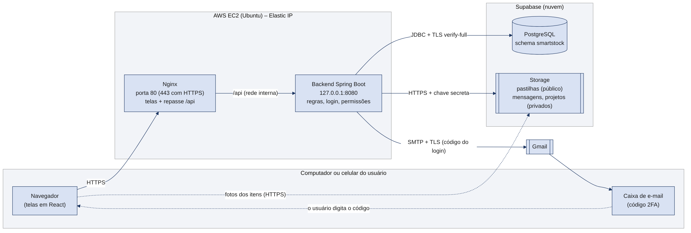

*Figura 2 – Arquitetura geral do SmartStock. Fonte: o autor (2026).*

## 4.2 Camadas do backend

Cada pedido percorre as camadas de cima para baixo, e cada camada tem uma única responsabilidade: o **filtro de
segurança** confere o token; o **controller** recebe o pedido e confere a permissão da aba; o **service** aplica as
regras de negócio; o **repository** lê e grava no banco por meio das **entidades** (JPA).

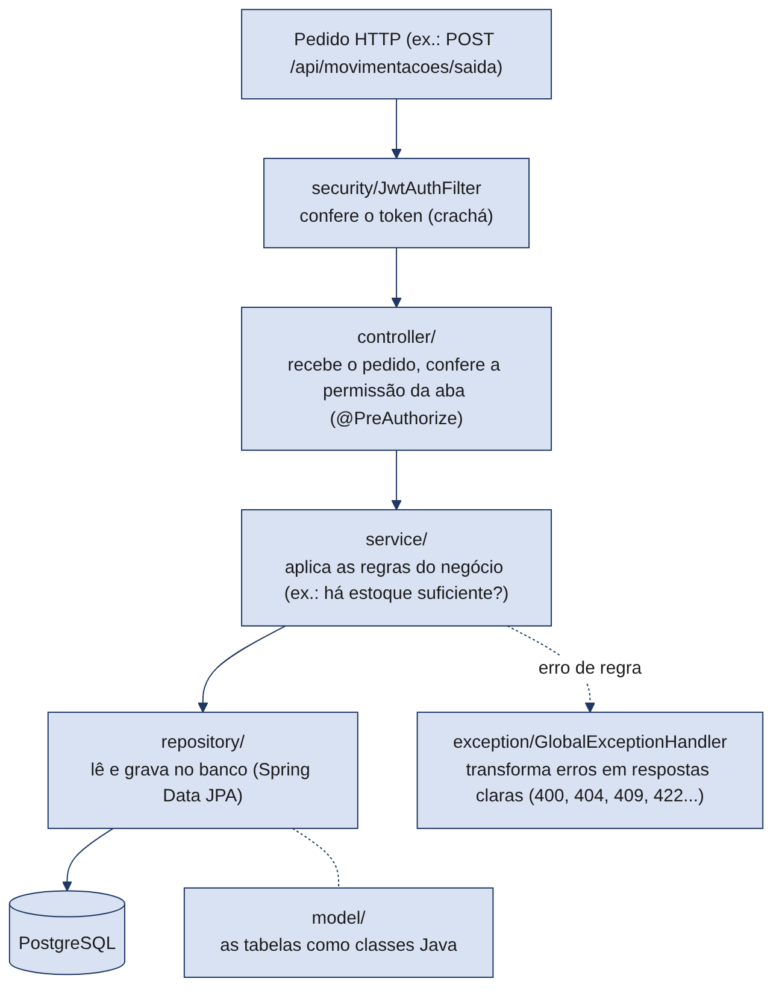

*Figura 3 – Camadas do backend. Fonte: o autor (2026).*

## 4.3 Diagrama de classes

O diagrama mostra as principais classes de domínio (entidades JPA, pacote `model`) com seus atributos e
relacionamentos. A composição (losango preto) indica as partes que só existem dentro de um projeto: checklist,
materiais e arquivos.

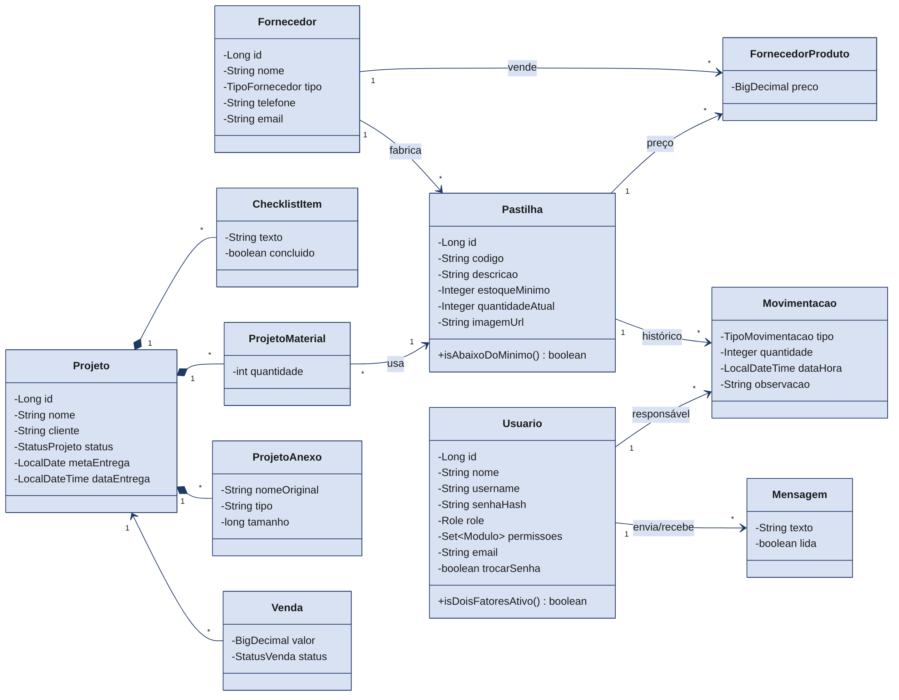

*Figura 4 – Diagrama de classes do domínio. Fonte: o autor (2026).*

## 4.4 Diagrama de atividades

O processo central da metalúrgica, do pedido do cliente à entrega, com a decisão de estoque que garante a regra "tudo ou
nada" no envio do pedido.

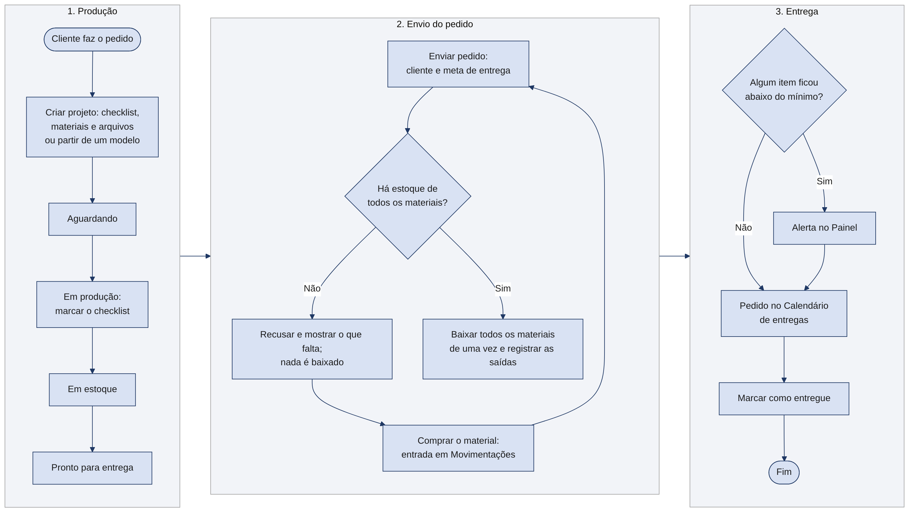

*Figura 5 – Diagrama de atividades: do pedido à entrega. Fonte: o autor (2026).*

## 4.5 Diagrama de sequência do login com 2FA por e-mail


*Figura 6 – Diagrama de sequência do login com verificação em duas etapas. Fonte: o autor (2026).*

## 4.6 Diagrama de estados de um projeto


*Figura 7 – Diagrama de estados de um projeto (ordem de produção). Fonte: o autor (2026).*

# 5. Tecnologias e ferramentas utilizadas

*Tabela 15 – Tecnologias utilizadas e sua finalidade*

| Tecnologia | Finalidade |
|------------------------------|----------------------------------------------------------------------|
| **HTML5 e CSS3** | Estrutura e estilo das telas, com layout responsivo (`@media`) para celular e tablet |
| **JavaScript + React 19** | Interface em componentes, navegação por abas e chamadas à API |
| **Vite** | Servidor de desenvolvimento e geração do *build* de produção do frontend |
| **Axios** | Cliente HTTP do frontend, com o token JWT em todas as chamadas |
| **Java 21** | Linguagem do backend |
| **Spring Boot 3.5** | Base do backend: API REST, injeção de dependências e configuração |
| **Spring Security + JWT** | Login em etapas, token de acesso e permissões por aba (`@PreAuthorize`) |
| **Spring Data JPA (Hibernate)** | Mapeamento das tabelas em classes e consultas ao banco |
| **Bean Validation** | Validação dos dados recebidos (`@NotBlank`, `@Positive`...) |
| **PostgreSQL (Supabase)** | Banco de dados relacional gerenciado na nuvem |
| **Flyway** | Versionamento do banco por migrations (V1, V2, V3) |
| **Supabase Storage** | Fotos dos itens, imagens das mensagens e arquivos dos projetos |
| **SMTP (Gmail) com TLS** | Envio do código de login (2FA) |
| **springdoc-openapi / Swagger UI** | Documentação interativa das 67 rotas da API |
| **AWS EC2, Elastic IP e Security Group** | Hospedagem do sistema na nuvem |
| **Nginx e systemd** | Servidor web (telas e repasse da API) e execução do backend como serviço |
| **Maven e npm** | Gerenciadores de dependências e de *build* do backend e do frontend |
| **Git e GitHub** | Controle de versão e repositório do código |
| **Mermaid** | Diagramas da documentação |

## 5.1 Ambiente de desenvolvimento

*Tabela 16 – Ambiente de desenvolvimento*

| Item | Utilizado |
|----------------------|------------------------------------------------------------------------------|
| Sistema operacional | Windows 10/11 (desenvolvimento) e Ubuntu Server LTS (servidor na AWS) |
| IDEs | **Visual Studio Code** (frontend e documentação) e **IntelliJ IDEA** (backend Java) |
| Execução local | Backend em `localhost:8080` (Maven Wrapper) e frontend em `localhost:5173` (`npm run dev`, com *proxy* para `/api`) |
| Banco local de testes | H2 em memória (perfil `h2`), com as mesmas migrations do PostgreSQL |
| Testes da API | Swagger UI, `curl` e scripts de teste funcional |
| Publicação | Script `deploy/publicar.ps1` (gera, envia por `scp` e reinicia o serviço na EC2) |

## 5.2 Justificativa das escolhas

- **Java + Spring Boot:** padrão de mercado para APIs corporativas, com segurança (Spring Security), validação e acesso
  a dados prontos e bem documentados; Java 21 é a versão de suporte longo (LTS).
- **React + Vite:** interface rápida e organizada em componentes reutilizáveis; o Vite gera arquivos estáticos que o
  Nginx serve sem precisar de um servidor Node em produção.
- **PostgreSQL no Supabase:** banco relacional robusto (transações, chaves estrangeiras), gerenciado e com plano
  gratuito, sem manter servidor de banco; o Storage do mesmo serviço guarda os arquivos.
- **Flyway:** cada mudança no banco vira um arquivo SQL versionado, aplicado em ordem e uma única vez — o banco de
  qualquer ambiente fica igual ao do código.
- **AWS EC2:** conteúdo da unidade curricular de computação em nuvem, disponível pelo AWS Academy, com controle total do
  servidor (Nginx, systemd, firewall).
- **2FA por e-mail (Gmail):** gratuito e sem exigir que o funcionário instale um aplicativo autenticador.

# 6. Desenvolvimento e implementação

## 6.1 Estrutura de pastas e arquivos

O repositório tem duas aplicações independentes, que conversam pela API: `backend` (Java) e `frontend` (React), além
das pastas `deploy` (publicação na AWS) e `docs` (documentação).

```
SmartStock/
├── backend/                         Servidor (Java 21 + Spring Boot 3.5)
│   ├── pom.xml                      Dependências do backend
│   ├── mvnw / mvnw.cmd              Maven Wrapper (dispensa instalar o Maven)
│   └── src/main/
│       ├── java/com/smartstock/backend/
│       │   ├── controller/          Rotas da API (uma por módulo)
│       │   ├── service/             Regras de negócio
│       │   ├── repository/          Acesso ao banco (Spring Data JPA)
│       │   ├── model/               Entidades (tabelas)
│       │   ├── dto/                 Formatos de entrada e saída da API
│       │   ├── security/            Login JWT e leitura do usuário logado
│       │   ├── config/              Segurança, CORS, arquivos e dados de exemplo (DataSeeder)
│       │   └── exception/           Tratamento de erros
│       └── resources/
│           ├── application.properties   Configurações
│           ├── db/migration/            Migrations do banco (Flyway): V1 esquema inicial, V2 segurança, V3 2FA por e-mail
│           ├── static/openapi.yaml      Documentação da API com exemplos (aberta em /swagger-ui.html)
│           └── seed-images/             Fotos dos dados de exemplo (+ CREDITOS.md)
└── frontend/                        Interface (React 19 + Vite)
    ├── package.json                 Dependências e comandos do frontend
    └── src/
        ├── pages/                   Uma tela por aba (Pastilhas, Progresso, Calendário...)
        ├── components/              Peças reutilizáveis (menu, pop-up, seletor de emojis...)
        ├── context/                 Estado de login e permissões
        ├── api/client.js            Configuração das chamadas à API
        └── index.css, chat.css      Estilos
├── deploy/                          Publicação na AWS EC2 (Nginx, serviço systemd, scripts)
└── docs/                            Relatório: requisitos, casos de uso, diagramas, descrição comercial
    └── openapi/                     Documentação OpenAPI da API (referência, openapi.yaml/.json, swagger.html)
```

## 6.2 Organização do frontend e do backend

- **Frontend:** cada aba é uma página em `src/pages` (`Pastilhas.jsx`, `Movimentacoes.jsx`, `Progresso.jsx`,
  `Calendario.jsx`, `Financeiro.jsx`, `Mensagens.jsx`, `Usuarios.jsx`...). O `Layout` monta o menu só com as abas
  permitidas; o `AuthContext` guarda o token e as permissões da sessão; `api/client.js` concentra as chamadas à API
  (Axios) e coloca o token em todas elas. Os componentes reutilizáveis (janela, seletor de emojis, envio de arquivos)
  ficam em `src/components`.
- **Backend:** organizado em camadas (seção 4.2). São 12 *controllers* (um por módulo), os *services* com as regras de
  negócio, os *repositories* do Spring Data JPA, as entidades em `model`, os formatos de entrada e saída em `dto`, a
  segurança em `security` e `config`, e o tratamento de erros em `exception`.

## 6.3 Implementação das funcionalidades

O desenvolvimento foi incremental: primeiro o estoque e as movimentações, depois fornecedores e preços, a produção
(projetos com checklist e materiais), o calendário, o financeiro, as mensagens e, por fim, o reforço de segurança (2FA,
auditoria, limite de tentativas), as migrations, a documentação da API e a publicação na AWS. O trecho abaixo mostra a
regra mais importante do sistema, a baixa de estoque "tudo ou nada" ao enviar um pedido: primeiro o sistema confere
**todos** os materiais e só depois baixa; como o método roda dentro de uma transação (`@Transactional`), qualquer erro
desfaz tudo.

```java
// MovimentacaoService.java – baixa dos materiais ao enviar o pedido
public List<Movimentacao> registrarSaidasDoProjeto(Projeto projeto, String cliente) {
    // 1) soma o total necessário de cada item (o mesmo item pode aparecer em mais de uma linha)
    Map<Long, Integer> necessario = new LinkedHashMap<>();
    for (ProjetoMaterial material : projeto.getMateriais()) {
        necessario.merge(material.getPastilha().getId(), material.getQuantidade(), Integer::sum);
    }
    // 2) confere TUDO antes de baixar qualquer coisa, e junta todas as faltas numa mensagem só
    List<String> faltas = new ArrayList<>();
    for (Map.Entry<Long, Integer> item : necessario.entrySet()) {
        Pastilha pastilha = buscarPastilha(item.getKey());
        if (pastilha.getQuantidadeAtual() < item.getValue()) {
            faltas.add(pastilha.getCodigo() + " (necessário " + item.getValue()
                    + ", disponível " + pastilha.getQuantidadeAtual() + ")");
        }
    }
    if (!faltas.isEmpty()) {
        throw new BusinessException("Estoque insuficiente para enviar o pedido: " + String.join("; ", faltas)
                + ". Registre uma entrada de estoque e tente novamente.");
    }
    // 3) com tudo disponível, registra uma saída por item, identificando o projeto e o cliente
    ...
}
```

## 6.4 Integração com o banco de dados

O backend acessa o PostgreSQL pelo **Spring Data JPA**: cada tabela é uma classe em `model` (por exemplo, `Pastilha`
→ tabela `pastilhas`) e cada *repository* é uma interface que o Spring implementa sozinho (`findByCodigo`,
`findByStatusIn`...). Todas as consultas são parametrizadas, sem montar SQL com texto digitado pelo usuário. O esquema
do banco é criado pelas migrations do **Flyway** ao iniciar o backend, e o Hibernate só **valida** se as tabelas
correspondem às classes (`ddl-auto=validate`). A conexão usa TLS com verificação do certificado do Supabase.

## 6.5 Comunicação entre os módulos

Frontend e backend conversam por **HTTP com JSON** (API REST). O frontend chama sempre caminhos relativos (`/api/...`):
no computador do desenvolvedor, o Vite repassa essas chamadas para `localhost:8080`; no servidor, o Nginx faz o mesmo
para o backend, que só escuta na própria máquina (`127.0.0.1:8080`). O backend, por sua vez, fala com o PostgreSQL
(JDBC com TLS), com o Supabase Storage (HTTPS com a chave secreta, que nunca vai para o navegador) e com o Gmail (SMTP
com TLS).

## 6.6 Autenticação e autorização

A **autenticação** é feita em etapas (senha → código do e-mail → troca de senha, quando exigida). Entre uma etapa e
outra, o backend devolve um "desafio" (token curto, de 10 minutos), e o token de acesso (**JWT** assinado, válido por
8 horas) só é entregue no fim. Em cada chamada, um filtro do Spring Security confere a assinatura, a validade e a versão
do token (que muda ao sair, trocar a senha ou redefinir o 2FA, invalidando os tokens antigos).

A **autorização** usa o perfil da conta e as abas liberadas: cada rota tem a anotação `@PreAuthorize`, conferida no
servidor. O frontend esconde as abas não permitidas, mas quem garante a regra é o backend (seção 9: conta sem a aba
Usuários recebe `403`).

```java
// PastilhaController.java – cada rota declara a permissão e o código HTTP de resposta
@PostMapping
@PreAuthorize("hasAuthority('PERM_PASTILHAS')")
@ResponseStatus(HttpStatus.CREATED)          // 201 Created
public Pastilha criar(@Valid @RequestBody PastilhaRequest request) {
    return pastilhaService.criar(request);
}

@DeleteMapping("/{id}")
@PreAuthorize("hasAuthority('PERM_PASTILHAS')")
@ResponseStatus(HttpStatus.NO_CONTENT)       // 204 No Content
public void excluir(@PathVariable Long id) {
    pastilhaService.excluir(id);
}
```

## 6.7 Tratamento de erros

Os erros são tratados num único lugar, o `GlobalExceptionHandler`, que transforma cada exceção numa resposta JSON
padronizada `{status, message, timestamp}` com o código HTTP correto: `400` (dados inválidos, com o campo apontado),
`401` (não autenticado), `403` (sem permissão), `404` (não encontrado), `409` (conflito de dados), `422` (regra de
negócio violada) e `429` (muitas tentativas). Erros inesperados viram `500` com mensagem genérica; o detalhe técnico fica
só no log do servidor. No frontend, a mensagem do servidor é mostrada ao usuário no próprio formulário.

## 6.8 Segurança da aplicação

A segurança foi tratada como requisito desde o início (RNF01 a RNF10) e está detalhada na seção 10. Em resumo: senhas
com BCrypt, 2FA obrigatório por e-mail, JWT revogável, permissões por aba em cada rota, limite de tentativas, auditoria,
cabeçalhos de segurança, CORS restrito, TLS até o banco, arquivos privados e nenhum segredo no código.

## 6.9 Documentação da API

A API tem **67 rotas**, todas com prefixo `/api`, documentadas em **OpenAPI 3** com descrição, permissões e exemplos
reais. A documentação interativa fica no próprio sistema (`/swagger-ui.html`), onde é possível testar as rotas, e no
repositório, em `docs/openapi` (`openapi.yaml`, `openapi.json` e referência em texto). O Apêndice B traz o resumo das
rotas por módulo.


*Figura 8 – Documentação interativa da API (OpenAPI/Swagger). Fonte: o autor (2026).*

# 7. Banco de dados

O banco é **PostgreSQL** (Supabase), no schema `smartstock`, criado e versionado por **migrations Flyway**:
`V1__esquema_inicial.sql` (15 tabelas e chaves estrangeiras), `V2__seguranca_2fa.sql` (dados de segurança e auditoria)
e `V3__dois_fatores_por_email.sql` (troca do 2FA por aplicativo pelo 2FA por e-mail). Os arquivos (fotos e anexos)
**não** ficam no banco: ficam no Supabase Storage, e o banco guarda apenas o caminho de cada um.

## 7.1 Modelo conceitual

As entidades principais e como se relacionam: um **fornecedor** fabrica e vende **itens** (com preço); cada **item**
tem um histórico de **movimentações**, feitas por um **usuário**; um **projeto** tem checklist, **materiais** (que são
itens) e arquivos, e pode virar uma **venda**; **modelos de projeto** guardam checklist e materiais para reaproveitar;
**usuários** têm permissões, trocam **mensagens** e geram **eventos de segurança**. O diagrama de classes (seção 4.3)
mostra esse modelo.

## 7.2 Modelo lógico (entidade-relacionamento)

Para facilitar a leitura, o modelo entidade-relacionamento está dividido por assunto.


*Figura 9 – Modelo ER – estoque, fornecedores e movimentações. Fonte: o autor (2026).*


*Figura 10 – Modelo ER – projetos (ordens de produção) e vendas. Fonte: o autor (2026).*


*Figura 11 – Modelo ER – modelos de projeto. Fonte: o autor (2026).*


*Figura 12 – Modelo ER – contas, permissões, mensagens e auditoria. Fonte: o autor (2026).*

## 7.3 Modelo físico: tabelas, atributos e chaves

Todas as tabelas usam chave primária `id` do tipo `bigint` gerada pelo banco (`generated by default as identity`), exceto
as tabelas de ligação, cuja chave é composta. As chaves estrangeiras garantem que não exista, por exemplo, movimentação
de um item inexistente.

*Tabela 17 – Tabelas do banco de dados*

| Tabela | Finalidade | Colunas | Chave primária | Chaves estrangeiras |
|----------------|--------------------|------------------------------------------|---------|-------------|
| `pastilhas` | Itens de estoque | estoque_minimo, quantidade_atual, fabricante_id, codigo, descricao, imagem_url | `id` | `fabricante_id` → fornecedores |
| `movimentacoes` | Entradas e saídas (histórico permanente) | quantidade, data_hora, fornecedor_id, pastilha_id, usuario_id, observacao, tipo | `id` | `fornecedor_id` → fornecedores; `pastilha_id` → pastilhas; `usuario_id` → usuarios |
| `fornecedores` | Fabricantes e fornecedores | contato, email, nome, telefone, tipo | `id` | — |
| `fornecedor_produtos` | Preço de cada item por fornecedor | preco, fornecedor_id, pastilha_id | `id` | `fornecedor_id` → fornecedores; `pastilha_id` → pastilhas |
| `projetos` | Ordens de produção / pedidos | data_pedido, meta_entrega, data_criacao, data_entrega, data_finalizacao_producao, data_inicio_producao, cliente, descricao, nome, status | `id` | — |
| `checklist_itens` | Etapas do checklist de um projeto | concluido, ordem, projeto_id, texto | `id` | `projeto_id` → projetos |
| `projeto_materiais` | Materiais usados em um projeto | quantidade, pastilha_id, projeto_id | `id` | `pastilha_id` → pastilhas; `projeto_id` → projetos |
| `projeto_anexos` | Arquivos de um projeto (no Storage) | data_envio, projeto_id, tamanho, arquivo, nome_original, tipo | `id` | `projeto_id` → projetos |
| `modelos_projeto` | Modelos reutilizáveis de projeto | data_criacao, descricao, nome | `id` | — |
| `modelo_projeto_etapas` | Checklist de um modelo | ordem, modelo_id, texto | `ordem, modelo_id` | `modelo_id` → modelos_projeto |
| `modelo_projeto_materiais` | Materiais de um modelo | ordem, quantidade, modelo_id, pastilha_id | `ordem, modelo_id` | `modelo_id` → modelos_projeto |
| `vendas` | Planos (orçamentos) e vendas | data_criacao, data_venda, valor, projeto_id, cliente, descricao, status | `id` | `projeto_id` → projetos |
| `usuarios` | Contas, perfil, e-mail e dados do 2FA | nome, role, senha, username, token_versao, trocar_senha, email, email_pendente, codigo_email_hash, codigo_email_expira, codigo_email_enviado, codigo_email_tentativas | `id` | — |
| `usuario_permissoes` | Abas liberadas para cada conta | usuario_id, modulo | `usuario_id, modulo` | `usuario_id` → usuarios |
| `mensagens` | Mensagens entre contas | lida, data_hora, destinatario_id, remetente_id, texto, imagem_arquivo, imagem_tipo | `id` | `destinatario_id` → usuarios; `remetente_id` → usuarios |
| `eventos_seguranca` | Registro de eventos de segurança (auditoria) | data_hora, tipo, usuario, detalhe, ip | `id` | — |

## 7.4 Relacionamentos

- **1:N** – fornecedor → itens (fabricante); item → movimentações; usuário → movimentações; projeto → checklist,
  materiais e arquivos; modelo → etapas e materiais; usuário → mensagens enviadas e recebidas.
- **N:N** – fornecedores × itens, resolvido pela tabela `fornecedor_produtos` (que guarda também o preço); projetos ×
  itens, resolvido por `projeto_materiais` (com a quantidade); usuários × abas, por `usuario_permissoes`.
- **1:1 opcional** – venda → projeto (um plano pode estar ligado a um projeto para calcular o custo).

## 7.5 Normalização

O modelo está na **terceira forma normal (3FN)**: cada coluna guarda um único valor (1FN); nas tabelas de chave
composta, nenhum dado depende só de parte da chave (2FN); e nenhum dado depende de outra coluna que não seja a chave
(3FN) — por exemplo, o nome do fornecedor fica só em `fornecedores`, e as outras tabelas guardam apenas o `id`. O saldo
`quantidade_atual` do item é a única informação derivada mantida de propósito (desnormalização controlada), para o
estoque ser lido sem somar todo o histórico; ele só muda junto com uma movimentação, na mesma transação.

## 7.6 Scripts SQL relevantes

Trecho da migration `V1__esquema_inicial.sql` com as tabelas de itens e de movimentações:

```sql
create table pastilhas (
    estoque_minimo integer not null,
    quantidade_atual integer not null,
    fabricante_id bigint,
    id bigint generated by default as identity,
    codigo varchar(255) not null unique,
    descricao varchar(255) not null,
    imagem_url varchar(255),
    primary key (id)
);

create table movimentacoes (
    quantidade integer not null,
    data_hora timestamp(6) not null,
    fornecedor_id bigint,
    id bigint generated by default as identity,
    pastilha_id bigint not null,
    usuario_id bigint,
    observacao varchar(255),
    tipo varchar(255) not null check (tipo in ('ENTRADA','SAIDA')),
    primary key (id)
);

alter table if exists movimentacoes add constraint fk_movimentacao_pastilha
    foreign key (pastilha_id) references pastilhas;
```

Trecho da migration `V3__dois_fatores_por_email.sql`, que mudou o banco quando o 2FA passou a ser por e-mail:

```sql
alter table usuarios add column if not exists email varchar(254);
alter table usuarios add column if not exists codigo_email_hash varchar(100);
alter table usuarios add column if not exists codigo_email_expira timestamp(6);
alter table usuarios drop column if exists totp_segredo;
```

# 8. Interface e experiência do usuário (UI/UX)

A interface segue o mesmo padrão em todas as telas: menu lateral com as abas permitidas, título, conteúdo (tabela,
quadro ou calendário) e o botão principal no topo à direita. As cores têm o mesmo significado em todo o sistema
(vermelho = crítico ou perigo, verde = concluído). A navegação é feita pelo menu lateral; o Painel é a tela inicial após
o login, e o botão *Sair* encerra a sessão. A seguir, cada tela com sua finalidade, elementos, ações e comportamento.

## 8.1 Login – usuário e senha


*Figura 13 – Login – usuário e senha. Fonte: o autor (2026).*

| Item | Descrição |
|------------------------|----------------------------------------------------------------------------|
| **Finalidade** | Primeira etapa do acesso. |
| **Elementos** | Campos *Usuário* e *Senha*, botão *Entrar*. |
| **Ações do usuário** | Entrar. |
| **Comportamento esperado** | Senha correta leva à tela do código; senha errada mostra aviso; 5 erros bloqueiam por 15 min. |

## 8.2 Login – código do e-mail (2FA)


*Figura 14 – Login – código do e-mail (2FA). Fonte: o autor (2026).*

| Item | Descrição |
|------------------------|----------------------------------------------------------------------------|
| **Finalidade** | Segunda etapa: confirmar que é a pessoa dona da conta. |
| **Elementos** | E-mail mascarado, campo de 6 dígitos, botões *Verificar*, *Enviar outro código* (com contagem de 60 s) e *Voltar*. |
| **Ações do usuário** | Digitar o código, pedir outro, voltar. |
| **Comportamento esperado** | O botão só libera com 6 números; código certo entra no sistema (ou vai para a troca de senha). |

## 8.3 E-mail com o código


*Figura 15 – E-mail com o código. Fonte: o autor (2026).*

| Item | Descrição |
|------------------------|----------------------------------------------------------------------------|
| **Finalidade** | Entregar o código de acesso. |
| **Elementos** | Assunto com o código, nome da pessoa, código em destaque e validade. |
| **Ações do usuário** | Copiar o código. |
| **Comportamento esperado** | Vale 10 minutos e uma única vez. |

## 8.4 Painel


*Figura 16 – Painel. Fonte: o autor (2026).*

| Item | Descrição |
|------------------------|----------------------------------------------------------------------------|
| **Finalidade** | Visão geral ao entrar. |
| **Elementos** | Totais (itens, críticos, movimentações) e lista de alertas de estoque. |
| **Ações do usuário** | Ir para o item em alerta. |
| **Comportamento esperado** | Mostra só o que a conta pode ver; atualiza a cada acesso. |

## 8.5 Estoque (itens)


*Figura 17 – Estoque (itens). Fonte: o autor (2026).*

| Item | Descrição |
|------------------------|----------------------------------------------------------------------------|
| **Finalidade** | Consultar e manter os materiais. |
| **Elementos** | Busca, tabela com foto, código, fabricante, estoque atual e mínimo, barra de nível, botões *Editar* e *Excluir*. |
| **Ações do usuário** | Buscar, cadastrar, editar, excluir, ampliar a foto. |
| **Comportamento esperado** | Itens críticos ficam com faixa vermelha; a busca "imagens" mostra a galeria. |

## 8.6 Novo item

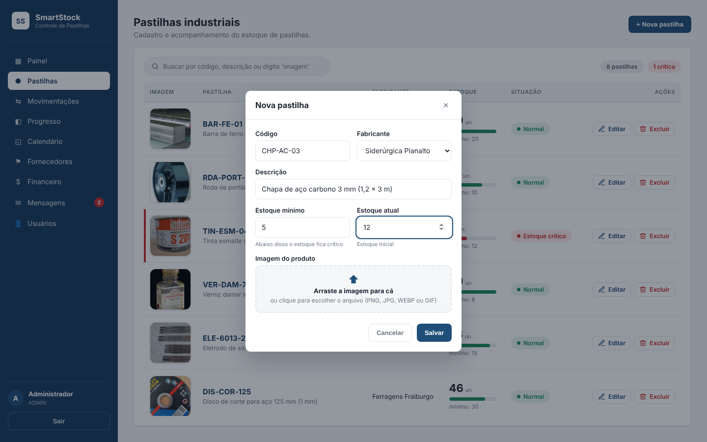

*Figura 18 – Novo item. Fonte: o autor (2026).*

| Item | Descrição |
|------------------------|----------------------------------------------------------------------------|
| **Finalidade** | Cadastrar um material. |
| **Elementos** | Código, descrição, fabricante, estoque mínimo, estoque inicial e foto (arrastar ou clicar). |
| **Ações do usuário** | Salvar ou cancelar. |
| **Comportamento esperado** | Código repetido ou campos inválidos são recusados com a mensagem no formulário. |

## 8.7 Movimentações

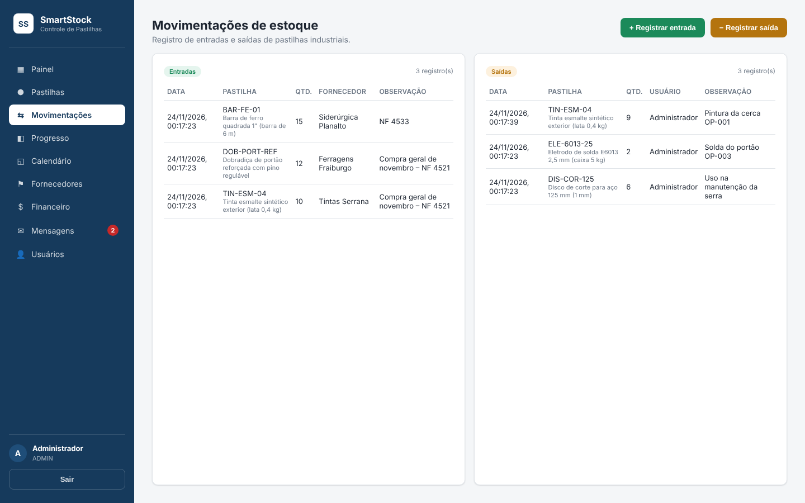

*Figura 19 – Movimentações. Fonte: o autor (2026).*

| Item | Descrição |
|------------------------|----------------------------------------------------------------------------|
| **Finalidade** | Ver o histórico do estoque. |
| **Elementos** | Colunas *Entradas* e *Saídas* com item, quantidade, fornecedor, responsável e data. |
| **Ações do usuário** | Registrar entrada ou saída. |
| **Comportamento esperado** | O histórico não pode ser editado nem apagado. |

## 8.8 Entrada em lote


*Figura 20 – Entrada em lote. Fonte: o autor (2026).*

| Item | Descrição |
|------------------------|----------------------------------------------------------------------------|
| **Finalidade** | Registrar uma compra inteira de uma vez. |
| **Elementos** | Várias linhas (item, quantidade, fornecedor) e botão para adicionar linha. |
| **Ações do usuário** | Adicionar/remover linhas, salvar. |
| **Comportamento esperado** | Se uma linha tiver erro, nenhuma é gravada. |

## 8.9 Fornecedores

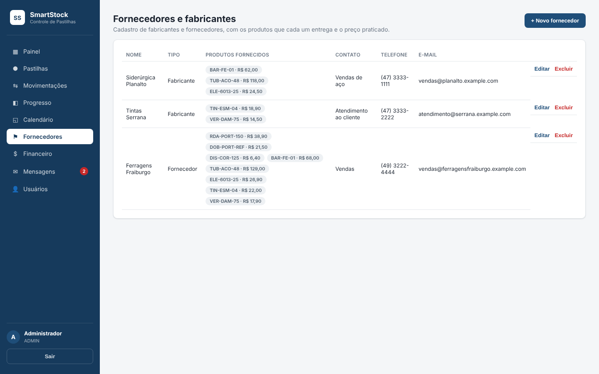

*Figura 21 – Fornecedores. Fonte: o autor (2026).*

| Item | Descrição |
|------------------------|----------------------------------------------------------------------------|
| **Finalidade** | Manter fornecedores e preços. |
| **Elementos** | Lista de fabricantes/fornecedores e tabela de produtos com preço. |
| **Ações do usuário** | Cadastrar, editar, excluir, definir preços. |
| **Comportamento esperado** | O menor preço de cada item é usado no financeiro. |

## 8.10 Progresso (quadro de produção)


*Figura 22 – Progresso (quadro de produção). Fonte: o autor (2026).*

| Item | Descrição |
|------------------------|----------------------------------------------------------------------------|
| **Finalidade** | Acompanhar as ordens de produção. |
| **Elementos** | Quatro colunas (Aguardando, Em produção, Em estoque, Pronto para entrega) com cards de projeto, checklist e materiais. |
| **Ações do usuário** | Criar, repetir, avançar/voltar etapa, marcar checklist, enviar pedido. |
| **Comportamento esperado** | Anda uma etapa por vez; checklist só em *Em produção*. |

## 8.11 Novo projeto


*Figura 23 – Novo projeto. Fonte: o autor (2026).*

| Item | Descrição |
|------------------------|----------------------------------------------------------------------------|
| **Finalidade** | Abrir uma ordem de produção. |
| **Elementos** | Nome, descrição, checklist, materiais e arquivos (PDF, CAD, imagens), opção de partir de um modelo. |
| **Ações do usuário** | Montar o projeto e salvar; salvar como modelo. |
| **Comportamento esperado** | Arquivos de tipo ou tamanho inválido são recusados e o projeto não é criado. |

## 8.12 Senha do administrador

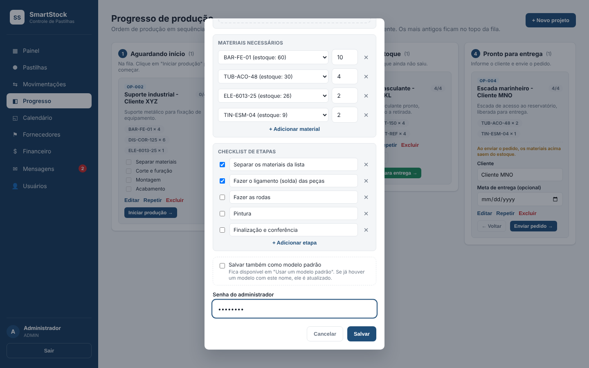

*Figura 24 – Senha do administrador. Fonte: o autor (2026).*

| Item | Descrição |
|------------------------|----------------------------------------------------------------------------|
| **Finalidade** | Proteger edição e exclusão de projetos. |
| **Elementos** | Janela pedindo a senha de um administrador. |
| **Ações do usuário** | Confirmar ou cancelar. |
| **Comportamento esperado** | Senha errada não altera nada; 5 erros bloqueiam por 15 minutos. |

## 8.13 Enviar pedido


*Figura 25 – Enviar pedido. Fonte: o autor (2026).*

| Item | Descrição |
|------------------------|----------------------------------------------------------------------------|
| **Finalidade** | Entregar o pedido ao cliente e baixar o estoque. |
| **Elementos** | Cliente, meta de entrega e lista dos materiais que serão baixados. |
| **Ações do usuário** | Confirmar o envio. |
| **Comportamento esperado** | Se faltar material, mostra o que falta e nada é baixado. |

## 8.14 Calendário de entregas


*Figura 26 – Calendário de entregas. Fonte: o autor (2026).*

| Item | Descrição |
|------------------------|----------------------------------------------------------------------------|
| **Finalidade** | Controlar os prazos. |
| **Elementos** | Calendário mensal colorido (meta e entregue), pedidos em aberto, selo *Atrasado* e histórico. |
| **Ações do usuário** | Mudar datas, marcar como entregue. |
| **Comportamento esperado** | Clicar no dia destaca os pedidos dele. |

## 8.15 Financeiro

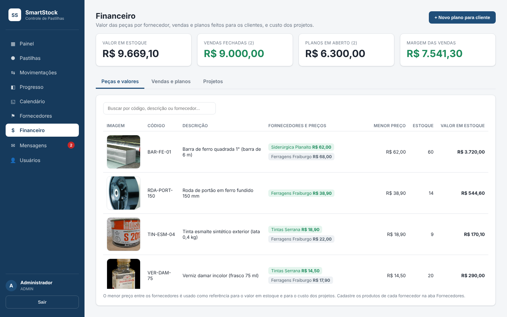

*Figura 27 – Financeiro. Fonte: o autor (2026).*

| Item | Descrição |
|------------------------|----------------------------------------------------------------------------|
| **Finalidade** | Ver valores e margens. |
| **Elementos** | Valor em estoque, preço por fornecedor, custo dos projetos, planos e vendas. |
| **Ações do usuário** | Criar plano, editar, fechar como venda. |
| **Comportamento esperado** | Custo calculado pelo menor preço; venda fechada não muda mais. |

## 8.16 Mensagens

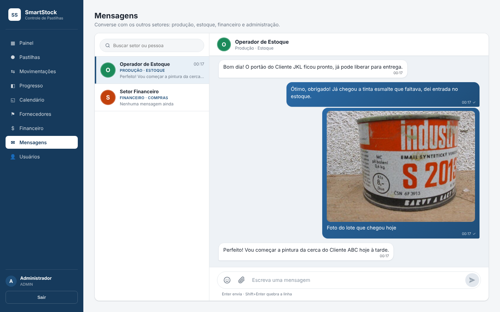

*Figura 28 – Mensagens. Fonte: o autor (2026).*

| Item | Descrição |
|------------------------|----------------------------------------------------------------------------|
| **Finalidade** | Comunicação entre os setores. |
| **Elementos** | Lista de contatos com não lidas, conversa, emojis e envio de imagem. |
| **Ações do usuário** | Enviar texto ou imagem (botão, arrastar ou colar). |
| **Comportamento esperado** | Atualiza sozinha; imagens só para quem enviou ou recebeu. |

## 8.17 Usuários e segurança


*Figura 29 – Usuários e segurança. Fonte: o autor (2026).*

| Item | Descrição |
|------------------------|----------------------------------------------------------------------------|
| **Finalidade** | Administrar as contas. |
| **Elementos** | Contas com perfil, abas, e-mail e 2FA; aba de eventos de segurança. |
| **Ações do usuário** | Criar, editar, excluir conta, redefinir 2FA. |
| **Comportamento esperado** | Só concede abas que a própria conta tem; não exclui a si mesma. |

## 8.18 Uso no celular

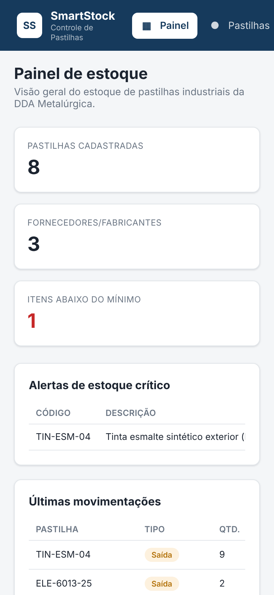

*Figura 30 – Uso no celular. Fonte: o autor (2026).*

| Item | Descrição |
|------------------------|----------------------------------------------------------------------------|
| **Finalidade** | Usar o sistema na oficina. |
| **Elementos** | Mesmo conteúdo, com menu recolhido e tabelas adaptadas. |
| **Ações do usuário** | As mesmas do computador. |
| **Comportamento esperado** | Layout responsivo, sem instalar aplicativo. |

## 8.19 Avaliação de usabilidade

As telas foram avaliadas pelas **10 heurísticas de usabilidade de Nielsen**.

*Tabela 18 – Avaliação pelas heurísticas de Nielsen*

| # | Heurística | Como o SmartStock atende |
|----|------------------------------|------------------------------------------------------------------|
| 1 | **Visibilidade do estado do sistema** — o usuário sempre sabe o que está acontecendo | Botões mudam para *Entrando...*, *Salvando...*, *Enviando...*, *Verificando...* enquanto a ação acontece; listas mostram *Carregando...*; barra de nível colorida em cada item de estoque; contador de etapas do checklist em cada projeto; aviso de mensagens não lidas no menu e no título da aba do navegador; contagem regressiva de "Enviar outro código" no login |
| 2 | **Correspondência com o mundo real** — linguagem e conceitos do usuário | Tudo em português e com os termos da metalúrgica: *ordem de produção*, *pronto para entrega*, *enviar pedido*, *estoque mínimo*, *fornecedor*, *plano/venda*; o quadro de Progresso segue as etapas reais (Aguardando → Em produção → Em estoque → Pronto para entrega); valores em R$ e datas no formato brasileiro |
| 3 | **Controle e liberdade do usuário** — saídas claras para desfazer | Etapas do projeto podem **voltar** uma posição; todo formulário abre em janela com **Cancelar**; no login há *Voltar*, *Cancelar* e *Digitei o e-mail errado*; o código por e-mail pode ser reenviado |
| 4 | **Consistência e padrões** — mesmas ações, mesma aparência | Todas as telas seguem o mesmo layout (menu lateral, título, tabela ou quadro, botão principal no topo à direita); mesmos botões (*Editar*, *Excluir*, *Salvar*, *Cancelar*) e as mesmas cores para o mesmo significado (vermelho = crítico/perigo, verde = ok); mensagens de erro sempre no mesmo lugar e formato |
| 5 | **Prevenção de erros** — evitar que o erro aconteça | Confirmação antes de excluir qualquer registro, fechar uma venda ou enviar um pedido; aviso se o checklist ainda tem etapas pendentes ao concluir; senha do administrador para editar/excluir projetos; o servidor recusa saída maior que o estoque e envio de pedido com material faltando (*tudo ou nada*); campos obrigatórios marcados; o código do login só aceita números e libera o botão com 6 dígitos |
| 6 | **Reconhecer em vez de lembrar** — informação à vista | Listas de seleção para itens, fornecedores e modelos (não é preciso decorar códigos); materiais do projeto mostram o estoque atual ao passar o mouse e ficam vermelhos se faltar; exemplos nos campos (*Ex: BAR-FE-01*, *Ex: Cerca de metal - Cliente ABC*); fotos dos itens; o login mostra para qual e-mail o código foi (*re\*\*\*\*@gmail.com*) |
| 7 | **Flexibilidade e eficiência de uso** — atalhos para quem já sabe | **Modelos de projeto** e **Repetir projeto** criam pedidos parecidos em segundos; **entrada em lote** registra uma compra inteira de uma vez; filtros por item nas movimentações e busca nas mensagens; o código do e-mail é reconhecido pelo celular (*one-time-code*) |
| 8 | **Estética e design minimalista** — só o necessário | Cada conta vê **só as abas que tem permissão**; painel inicial com três números e duas listas; informações secundárias (fotos ampliadas, arquivos do projeto) aparecem só quando pedidas |
| 9 | **Ajudar a reconhecer, diagnosticar e corrigir erros** — mensagens claras | Mensagens em linguagem simples e com a solução: *"Estoque insuficiente para a pastilha BAR-FE-01. Disponível: 3"*, *"Não foi possível concluir: este registro está ligado a outros cadastros"*, *"Aguarde 42 segundos para pedir outro código"*, *"A senha deve ter letras e números."*; erros técnicos nunca aparecem para o usuário |
| 10 | **Ajuda e documentação** | Textos de orientação nas telas (ex.: "Como começar?" ao criar projeto, explicação do 2FA no primeiro login, dica de conferir o spam); dicas ao passar o mouse; README com roteiro de uso; documentação da API em `/swagger-ui.html` e guia para leigos |

Além disso, a interface é **responsiva**, usa campos com rótulo e o tipo de teclado adequado no celular, e não depende
só de cores para indicar estados importantes.

# 9. Testes e validação

## 9.1 Estratégia de testes

*Tabela 19 – Estratégia de testes*

| Tipo | O que foi feito | Situação |
|------------------|----------------------------------------------------------------|------------------|
| Testes unitários | O projeto tem o teste automatizado de inicialização (`BackendApplicationTests`), que sobe o sistema completo com o banco em memória e as migrations. Testes unitários por classe ainda não foram escritos. | Atende parcialmente |
| Testes de integração | Backend completo rodando com o banco H2 (as mesmas migrations do PostgreSQL), chamado pela API como o frontend faz. | Atende |
| Testes funcionais | 37 casos de teste na API (tabela abaixo), cobrindo login, 2FA, permissões, estoque, projetos e contas. | Atende |
| Teste do envio de e-mail | Servidor SMTP de teste com TLS: conferido o destinatário, o assunto com acento, a recusa de e-mail com quebra de linha (injeção de cabeçalho) e que o código não aparece nos logs. | Atende |
| Testes de usabilidade | Avaliação heurística (seção 8) e uso real das telas no computador e no celular. Teste com usuários da empresa ainda não realizado. | Atende parcialmente |
| Testes de segurança | Casos negativos: sem token, token adulterado, aba sem permissão, força bruta (bloqueio), reuso de código, senha fraca. | Atende |
| Testes de desempenho | Não foi feito teste de carga formal; no uso, as telas respondem em menos de 1 segundo. | Não atende |

## 9.2 Casos de teste funcionais

Os testes foram executados em novembro de 2026 com o backend local (perfil de testes, banco H2 e as mesmas migrations do
PostgreSQL), por um script que chama a API exatamente como o frontend. **Resultado: 37 de 37 testes aprovados.**

*Tabela 20 – Casos de teste funcionais e resultados*

| Nº | Módulo | Teste | Resultado esperado | Resultado obtido | Situação |
|----|----------|------------------------|----------------------|------------------------------|----------|
| 1 | Autenticação | Login com senha incorreta | Acesso negado (401) | 401 – "Usuário ou senha inválidos." | Aprovado |
| 2 | Autenticação | Login com campos vazios | Validação (400) | 400 – pedido recusado | Aprovado |
| 3 | Autenticação | Login correto (1ª vez) | Pedir o e-mail do 2FA, sem liberar o acesso | 200 – etapa CADASTRAR_EMAIL, sem token | Aprovado |
| 4 | Autenticação | E-mail inválido no 2FA | Recusar (422) | 422 – "Digite um e-mail válido, por exemplo: nome@gmail.com" | Aprovado |
| 5 | Autenticação | Cadastrar e-mail do 2FA | Enviar código de 6 dígitos | 200 – código enviado para ad*********@gmail.com | Aprovado |
| 6 | Autenticação | Código do e-mail incorreto | Recusar (422) | 422 – "Código incorreto. Confira o último e-mail recebido." | Aprovado |
| 7 | Autenticação | Pedir outro código antes de 60 s | Recusar (422) | 422 – "Aguarde 60 segundos para pedir outro código." | Aprovado |
| 8 | Autenticação | Código do e-mail correto | Seguir para a troca de senha obrigatória | 200 – etapa TROCAR_SENHA | Aprovado |
| 9 | Autenticação | Reusar o mesmo código | Recusar (código vale uma vez) | 422 – recusado | Aprovado |
| 10 | Autenticação | Nova senha fraca (a de exemplo) | Recusar (422) | 422 – "Essa senha é fácil de adivinhar (é de exemplo ou contém o nome de usuário). Escolha outra." | Aprovado |
| 11 | Autenticação | Nova senha válida | Concluir o login e entregar o token | 200 – etapa CONCLUIDO, token JWT emitido | Aprovado |
| 12 | Autenticação | 5 senhas erradas seguidas | Bloquear a conta por 15 min (429) | 429 – "Muitas tentativas erradas. Tente de novo em 15 minutos." | Aprovado |
| 13 | Autorização | Acessar a API sem token | Acesso negado (401) | 401 | Aprovado |
| 14 | Autorização | Token adulterado | Acesso negado (401) | 401 | Aprovado |
| 15 | Autorização | Conta sem a aba Usuários abre a lista de contas | Proibido (403) | 403 | Aprovado |
| 16 | Autorização | Mesma conta na aba liberada (Financeiro) | Permitir (200) | 200 | Aprovado |
| 17 | Estoque | Cadastrar item válido | Criar (201) | 201 – item TST-01 criado | Aprovado |
| 18 | Estoque | Cadastrar código repetido | Recusar (422) | 422 – "Já existe uma pastilha cadastrada com o código TST-01" | Aprovado |
| 19 | Estoque | Cadastrar com campos vazios/negativos | Validação (400) | 400 – campos apontados | Aprovado |
| 20 | Estoque | Item abaixo do mínimo (3 de 5) | Aparecer nos alertas | 200 – item listado nos alertas | Aprovado |
| 21 | Estoque | Saída maior que o estoque | Recusar sem alterar o saldo (422) | 422 – saldo continua 3 | Aprovado |
| 22 | Estoque | Entrada de 7 unidades | Somar ao saldo e registrar o responsável | 201 – saldo 10, responsável "Administrador" | Aprovado |
| 23 | Estoque | Buscar item inexistente | Não encontrado (404) | 404 – "Pastilha não encontrada: 999999" | Aprovado |
| 24 | Projetos | Criar projeto com checklist e materiais | Criar em "Aguardando" (201) | 201 – status AGUARDANDO | Aprovado |
| 25 | Projetos | Pular etapas da produção | Recusar (422) | 422 – "A ordem de produção deve ser seguida etapa por etapa." | Aprovado |
| 26 | Projetos | Avançar etapa por etapa | Chegar a "Pronto para entrega" | 200 – status PRONTO_ENTREGA | Aprovado |
| 27 | Projetos | Editar projeto sem a senha do administrador | Recusar (422) | 422 – "Informe a senha do administrador para editar o projeto." | Aprovado |
| 28 | Projetos | Excluir projeto com senha errada | Recusar (422) | 422 – "Senha do administrador incorreta." | Aprovado |
| 29 | Projetos | Enviar pedido (usa 4 de 10) | Baixar o estoque automaticamente | 200 – saldo 10 → 6, status PEDIDO_ENVIADO | Aprovado |
| 30 | Projetos | Enviar pedido faltando material | Recusar e não baixar nada ("tudo ou nada") | 422 – nenhum saldo alterado | Aprovado |
| 31 | Projetos | Marcar pedido como entregue | Status "Entregue" | 200 – status ENTREGUE | Aprovado |
| 32 | Projetos | Excluir projeto com a senha do administrador | Excluir (204) | 204 | Aprovado |
| 33 | Contas | Criar conta de operador | Criar (201) | 201 | Aprovado |
| 34 | Contas | Administrador exclui a própria conta | Recusar (422) | 422 – "Você não pode excluir a própria conta." | Aprovado |
| 35 | Contas | Excluir conta de operador | Excluir (204) | 204 | Aprovado |
| 36 | Contas | Registro de eventos de segurança | Registrar falhas, bloqueios e 2FA | 200 – 21 eventos registrados | Aprovado |
| 37 | Contas | Sair do sistema | O token antigo deixa de valer | 200 ao sair; depois 401 | Aprovado |

# 10. Segurança e manutenção

## 10.1 Medidas de segurança

*Tabela 21 – Medidas de segurança por camada*

| Camada | O que o SmartStock faz |
|--------------------|--------------------------------------------------------------------------------|
| **Login** | Senha + **código de 6 dígitos enviado por e-mail (2FA)** para todas as contas, sem precisar instalar nenhum app; o código vale 10 minutos e uma única vez, e o e-mail é confirmado no primeiro acesso |
| **Senhas** | Guardadas só como *hash* BCrypt (ninguém, nem o administrador, consegue vê-las); política de senha forte; **troca obrigatória** das senhas de exemplo e das definidas pelo administrador |
| **Ataques de força bruta** | 5 tentativas erradas (senha, código do e-mail ou senha do administrador) bloqueiam por 15 minutos; um código novo só pode ser pedido a cada 60 s |
| **Sessões** | Token JWT assinado, válido por 8 h e **revogável**: "Sair", troca de senha ou redefinição do 2FA derrubam todas as sessões da conta |
| **Permissões** | Conferidas **no servidor, em cada rota** da API, por perfil e por aba (esconder o menu não basta) |
| **Dados em trânsito** | HTTPS preparado no Nginx (ativado ao ter um domínio; hoje o endereço público usa HTTP); conexão com o banco e com o servidor de e-mail por TLS **verificando o certificado** |
| **Dados guardados** | Códigos do e-mail guardados só como "impressão digital" (HMAC-SHA256), nunca o código em si; banco fechado para a API pública do Supabase (RLS); fotos de conversas e arquivos de projetos em armazenamento **privado** |
| **Arquivos enviados** | Tipo conferido pelo conteúdo (não só pela extensão) e tamanho limitado |
| **Segredos** | Nenhuma senha ou chave no código: tudo no `.env`, fora do Git |
| **Auditoria** | Registro de eventos de segurança (logins, falhas, bloqueios, 2FA, trocas de senha) com data, conta e IP, visível ao administrador |
| **Navegador e servidor** | Cabeçalhos de proteção (CSP, anti-clickjacking), erros sem detalhes internos, backend escondido atrás do Nginx |

- **Criptografia e proteção de senhas:** senhas guardadas só como *hash* **BCrypt** (com sal); o código do 2FA é guardado
  como HMAC-SHA256, nunca o número; tráfego com TLS até o banco, o Storage e o Gmail.
- **Controle de acesso:** perfil (Administrador/Operador) + abas liberadas, conferidos em cada rota (`@PreAuthorize`);
  senha do administrador para editar ou excluir projetos; JWT de 8 horas, revogado ao sair.
- **Validação de dados:** Bean Validation nos DTOs (`@NotBlank`, `@Positive`, `@Email`...), regras de negócio nos
  services e arquivos conferidos pelo conteúdo, não só pela extensão.
- **Proteção contra SQL Injection:** todo acesso ao banco é feito pelo JPA com consultas parametrizadas; nenhum SQL é
  montado com texto vindo do usuário.
- **Proteção do navegador:** CORS só para o endereço do sistema, cabeçalhos CSP, `X-Frame-Options` e `Referrer-Policy`.

## 10.2 Backup do banco de dados

O banco fica no Supabase, que mantém cópias de segurança automáticas conforme o plano contratado. Como rotina da
empresa, recomenda-se também um *backup* lógico semanal com `pg_dump` do schema `smartstock`, guardado fora do Supabase,
e o *backup* dos buckets do Storage. Como o esquema é todo criado pelas migrations, um banco novo pode ser montado do zero
apenas iniciando o backend e depois restaurando os dados.

## 10.3 Atualizações e correções

- **Código:** cada mudança é registrada no Git/GitHub; a publicação é feita pelo script `deploy/publicar.ps1`, que gera
  o backend e o frontend, envia ao servidor e reinicia o serviço, parando no primeiro erro.
- **Banco:** cada mudança de estrutura vira uma nova migration (`V4__...`), aplicada sozinha na próxima inicialização;
  migrations já aplicadas nunca são alteradas.
- **Servidor:** atualizações do Ubuntu com `apt upgrade`; o backend roda como serviço `systemd`, que reinicia sozinho em
  caso de falha.
- **Segredos:** senhas e chaves ficam no arquivo `.env` do servidor (permissão 600, fora do Git) e podem ser trocadas sem
  mudar o código.

## 10.4 Possibilidades de expansão

A organização em camadas e a API REST documentada permitem acrescentar módulos sem mexer no que já funciona: um
aplicativo móvel pode usar a mesma API; novos relatórios entram como novas rotas de consulta; e a mesma base pode
atender outras metalúrgicas, separando os dados por empresa (modelo SaaS da seção 2.7).

## 10.5 Infraestrutura em nuvem

*Tabela 22 – Configuração da infraestrutura*

| Item | Configuração |
|--------------------|--------------------------------------------------------------------------------|
| Instância | EC2 `t3.micro`, Ubuntu Server LTS, 20 GiB, região `us-east-1` (AWS Academy) |
| Endereço | **Elastic IP 34.199.252.233** (fixo, não muda ao religar a instância) |
| Servidor web | **Nginx** na porta 80: entrega as telas (build do React) e repassa `/api` e a documentação ao backend |
| Backend | Serviço **systemd** `smartstock.service`: liga junto com o servidor e reinicia sozinho se cair; escuta só em `127.0.0.1:8080`, com usuário próprio sem acesso ao terminal |
| Security Group | Entrada **22 (SSH) apenas do IP do administrador** e **80 (HTTP)** para todos; **8080 fechada**; a 443 só é aberta ao ativar o HTTPS |
| Firewall do servidor | `ufw` liberando apenas OpenSSH e Nginx HTTP |
| Acesso administrativo | SSH com **chave** (`.pem`), sem senha |
| Banco e arquivos | Supabase (PostgreSQL com TLS verificando o certificado; RLS ligado; Storage privado para arquivos sensíveis) |


*Figura 31 – Diagrama de implantação. Fonte: o autor (2026).*


*Figura 32 – Instância EC2 do SmartStock com o IP elástico. Fonte: o autor (2026).*

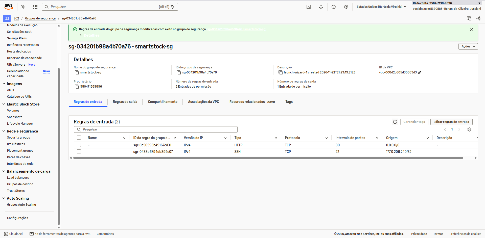

*Figura 33 – Security Group com apenas as portas necessárias (22 restrita e 80). Fonte: o autor (2026).*

# 11. Resultados alcançados

## 11.1 Funcionalidades implementadas

Todos os módulos planejados foram implementados e estão publicados em <http://34.199.252.233>: estoque com fotos e
alertas, movimentações (inclusive em lote), fornecedores e preços, quadro de produção com checklist, materiais, arquivos
e modelos, calendário de entregas, financeiro (valor em estoque, custo, planos e vendas), mensagens com imagens, contas
com permissões por aba, verificação em duas etapas por e-mail e registro de eventos de segurança. A API tem 67 rotas
documentadas em OpenAPI.

## 11.2 Requisitos atendidos

*Tabela 23 – Situação dos requisitos*

| Grupo | Quantidade | Situação | Observação |
|------------------------------|----------|----------------|--------------------------------------------|
| Requisitos funcionais (RF) | 29 | Atende | Todos implementados e publicados |
| Regras de negócio (RN) | 20 | Atende | Conferidas no servidor; várias validadas nos testes da seção 9 |
| RNF de segurança (RNF01–RNF05, RNF07–RNF10) | 9 | Atende | Validados nos testes de autenticação e autorização |
| RNF06 – tráfego cifrado | 1 | Atende parcialmente | TLS até o banco, Storage e e-mail; HTTPS público depende de um domínio |
| RNF11 a RNF17, RNF19, RNF20 | 9 | Atende | Rastreabilidade, transações, migrations, OpenAPI, REST, responsividade, systemd |
| RNF18 – desempenho | 1 | Atende parcialmente | Respostas rápidas no uso, mas sem teste de carga formal |

## 11.3 Problemas encontrados e soluções aplicadas

*Tabela 24 – Problemas encontrados e soluções*

| Problema | Solução aplicada |
|------------------------------------------|----------------------------------------------------------|
| O 2FA por aplicativo autenticador exigia instalar um aplicativo e não agradou | Troca por código de 6 dígitos enviado por e-mail (Gmail), gratuito e sem instalar nada; migration V3 ajustou o banco |
| O banco foi criado inicialmente pelo Hibernate, sem histórico de mudanças | Adoção do Flyway com a migration V1 (esquema completo) e *baseline* para bancos que já existiam |
| No AWS Academy, a regra de SSH criada para IPv6 bloqueava o acesso | Regra refeita para o IPv4 do administrador (/32); documentado no guia de implantação |
| Uma variável de configuração foi gravada na mesma linha da senha do e-mail e o envio falhou (erro 535) | Correção do `.env` no servidor e uso de `printf` com quebra de linha na documentação |
| A publicação parecia concluída mesmo quando o *build* do frontend falhava | O script `publicar.ps1` passou a parar no primeiro erro e a usar `npm install` |
| Nomes de tabelas com maiúsculas diferentes entre H2 e PostgreSQL nos testes | Banco de testes configurado com `DATABASE_TO_LOWER=TRUE` |

## 11.4 Resultados dos testes

Dos 37 testes funcionais executados, **37 foram aprovados** (seção 9.2). Os testes confirmaram as regras mais
críticas: bloqueio após tentativas erradas, código de uso único, permissões conferidas no servidor (403), recusa de
saída maior que o estoque e envio de pedido "tudo ou nada".

## 11.5 Funcionalidades que ainda precisam ser desenvolvidas

- HTTPS com domínio próprio;
- testes unitários automatizados por classe e teste de carga;
- relatórios de consumo de material por período e exportação para planilha;
- aviso por e-mail quando um item atingir o estoque mínimo;
- separação dos dados por empresa, para oferecer o sistema como serviço (SaaS);
- teste de usabilidade com os funcionários da DDA Metalúrgica.

# 12. Conclusão

O SmartStock atendeu ao desafio proposto pela DDA Metalúrgica: o estoque passou a ter alertas e histórico completo, cada
pedido é acompanhado como uma ordem de produção até a entrega, os materiais são baixados automaticamente e o custo dos
projetos é calculado pelo menor preço dos fornecedores. O sistema está publicado na AWS, com banco PostgreSQL gerenciado,
migrations versionadas, API documentada e segurança em várias camadas.

**Importância do sistema.** Para uma metalúrgica pequena, o SmartStock troca planilhas e mensagens soltas por um único
lugar confiável, o que reduz paradas de produção por falta de material, atrasos de entrega e compras mais caras.

**Conhecimentos adquiridos.** O projeto colocou em prática conteúdos de várias unidades curriculares:

*Tabela 25 – Conhecimentos aplicados*

| Unidade curricular | Onde aparece no SmartStock |
|----------------------------|------------------------------------------------------------------------|
| Desenvolvimento web | Frontend em React e API REST em Spring Boot |
| Computação em nuvem | AWS EC2, Elastic IP, Security Groups, Nginx, systemd; Supabase (PostgreSQL e Storage) |
| Sistemas distribuídos | Frontend, backend, banco, armazenamento e e-mail como serviços separados que conversam pela rede, com autenticação sem estado (JWT) |
| Desenvolvimento de sistemas móveis | Interface responsiva, usada pelo navegador do celular no chão de fábrica |
| Banco de dados | Modelagem relacional, normalização, chaves estrangeiras, migrations e transações "tudo ou nada" |
| Segurança da informação | Hash de senhas, 2FA, JWT, controle de acesso, auditoria, TLS |

**Dificuldades encontradas.** As maiores dificuldades foram a configuração da nuvem no AWS Academy (Security Group,
IP elástico, firewall e serviço do backend), o envio de e-mail com segurança (TLS e senha de aplicativo do Gmail) e a
migração do banco para um modelo versionado sem perder os dados existentes.

**Limitações atuais.** Endereço público ainda em HTTP, poucos testes unitários, dependência do laboratório do AWS
Academy e do Gmail, e ausência de integração com nota fiscal (seção 2.6).

**Melhorias futuras.** HTTPS com domínio próprio, relatórios de consumo, avisos automáticos de estoque mínimo, testes
automatizados, separação por empresa (SaaS) e um aplicativo para o chão de fábrica.

# Referências {.unnumbered}

- AMAZON WEB SERVICES. *Amazon EC2 Documentation*. Disponível em: <https://docs.aws.amazon.com/ec2/>. Acesso em: novembro de 2026.
- FLYWAY (REDGATE). *Flyway Documentation*. Disponível em: <https://documentation.red-gate.com/flyway>. Acesso em: novembro de 2026.
- MERMAID. *Mermaid Documentation*. Disponível em: <https://mermaid.js.org/>. Acesso em: novembro de 2026.
- NGINX. *nginx documentation*. Disponível em: <https://nginx.org/en/docs/>. Acesso em: novembro de 2026.
- NIELSEN, J. *10 Usability Heuristics for User Interface Design*. Nielsen Norman Group, 1994 (atualizado em 2024).
  Disponível em: <https://www.nngroup.com/articles/ten-usability-heuristics/>. Acesso em: novembro de 2026.
- OPENAPI INITIATIVE. *OpenAPI Specification 3.0.3*. Disponível em: <https://spec.openapis.org/oas/v3.0.3>. Acesso em: novembro de 2026.
- OWASP FOUNDATION. *OWASP Top 10 – 2021*. Disponível em: <https://owasp.org/Top10/>. Acesso em: novembro de 2026.
- POSTGRESQL GLOBAL DEVELOPMENT GROUP. *PostgreSQL Documentation*. Disponível em: <https://www.postgresql.org/docs/>. Acesso em: novembro de 2026.
- REACT. *React Documentation*. Disponível em: <https://react.dev/>. Acesso em: novembro de 2026.
- SPRING. *Spring Boot Reference Documentation*. Disponível em: <https://docs.spring.io/spring-boot/>. Acesso em: novembro de 2026.
- SPRING. *Spring Security Reference*. Disponível em: <https://docs.spring.io/spring-security/reference/>. Acesso em: novembro de 2026.
- SUPABASE. *Supabase Docs*. Disponível em: <https://supabase.com/docs>. Acesso em: novembro de 2026.
- JUSSIANI, R. O. *SmartStock* (código-fonte). GitHub, 2026. Disponível em: <https://github.com/Roj10/SmartStock>.

# Apêndices {.unnumbered}

## Apêndice A – Migrations do banco de dados

Scripts SQL produzidos pelo autor, em `backend/src/main/resources/db/migration`:

*Tabela 26 – Migrations do banco de dados*

| Arquivo | Conteúdo |
|----------------------------|------------------------------------------------------------------------|
| `V1__esquema_inicial.sql` | Criação das 15 tabelas iniciais, chaves primárias, únicas e estrangeiras |
| `V2__seguranca_2fa.sql` | Colunas de segurança (versão do token, troca obrigatória de senha), tabela `eventos_seguranca` e índice por data |
| `V3__dois_fatores_por_email.sql` | Colunas do 2FA por e-mail e remoção das colunas do 2FA por aplicativo |

## Apêndice B – Resumo das rotas da API

*Tabela 27 – Rotas da API por módulo*

| Módulo | Rotas | Exemplos |
|--------------------|--------|------------------------------------------------------------------------|
| Autenticação | 6 | `POST /api/auth/login`, `POST /api/auth/email/cadastrar`, `POST /api/auth/email/verificar` |
| Painel | 1 | `GET /api/dashboard` |
| Itens de estoque | 8 | `GET /api/pastilhas`, `POST /api/pastilhas`, `GET /api/pastilhas/alertas` |
| Movimentações | 4 | `GET /api/movimentacoes`, `POST /api/movimentacoes/entrada`, `POST /api/movimentacoes/entrada/lote` |
| Fornecedores | 7 | `GET /api/fornecedores`, `POST /api/fornecedores`, `GET /api/fornecedores/{id}` |
| Projetos | 14 | `GET /api/projetos/progresso`, `GET /api/projetos/calendario`, `GET /api/projetos/{id}` |
| Modelos de projeto | 5 | `GET /api/modelos-projeto`, `POST /api/modelos-projeto`, `GET /api/modelos-projeto/{id}` |
| Financeiro | 3 | `GET /api/financeiro/resumo`, `GET /api/financeiro/pecas`, `GET /api/financeiro/projetos` |
| Vendas e planos | 6 | `GET /api/vendas`, `POST /api/vendas`, `GET /api/vendas/{id}` |
| Mensagens | 6 | `GET /api/mensagens/contatos`, `GET /api/mensagens/nao-lidas`, `GET /api/mensagens/conversa/{usuarioId}` |
| Usuários | 6 | `GET /api/usuarios`, `POST /api/usuarios`, `GET /api/usuarios/{id}` |
| Segurança | 1 | `GET /api/seguranca/eventos` |

A descrição completa de cada rota, com parâmetros, permissões e exemplos, está em `docs/openapi/README.md` e no próprio
sistema, em `/swagger-ui.html`.

## Apêndice C – Documentos complementares no repositório

*Tabela 28 – Documentos complementares*

| Documento | Conteúdo |
|----------------------------|------------------------------------------------------------------------|
| `README.md` | O que é o sistema, como rodar, segurança, funcionalidades e configuração |
| `docs/implantacao-aws-ec2.md` | Passo a passo da publicação na AWS (instância, IP elástico, Security Group, Nginx, systemd, HTTPS) |
| `docs/diagramas.md` | Código-fonte (Mermaid) de todos os diagramas deste relatório |
| `docs/usabilidade.md` | Avaliação completa pelas heurísticas de Nielsen, acessibilidade e pontos a evoluir |
| `docs/telas.md` | Os 21 prints das telas com legendas |
| `docs/como-ler-o-codigo.md` | Guia para leigos sobre a organização do código |
| `deploy/` | Scripts de instalação e publicação, configuração do Nginx e do serviço systemd |

# Anexos {.unnumbered}

## Anexo A – As 10 heurísticas de usabilidade de Nielsen

Material de terceiros usado como referência na avaliação da seção 8 (NIELSEN, 1994, atualizado em 2024):

1. Visibilidade do estado do sistema.
2. Correspondência entre o sistema e o mundo real.
3. Controle e liberdade do usuário.
4. Consistência e padrões.
5. Prevenção de erros.
6. Reconhecimento em vez de memorização.
7. Flexibilidade e eficiência de uso.
8. Estética e design minimalista.
9. Ajudar os usuários a reconhecer, diagnosticar e corrigir erros.
10. Ajuda e documentação.

## Anexo B – Especificação OpenAPI

A especificação OpenAPI 3.0.3 (OPENAPI INITIATIVE) é o padrão seguido pela documentação da API do SmartStock. O arquivo
completo do sistema, gerado a partir dela, está no repositório em `docs/openapi/openapi.yaml` e `docs/openapi/openapi.json`.
