# Telas do SmartStock

Roteiro dos prints para o relatório (item *"Proposta de solução (com prints das telas)"*). Salve cada print nesta
pasta, em `docs/telas/`, com o nome indicado: as imagens aparecem aqui automaticamente (no GitHub e no VS Code) e
podem ser coladas no relatório com a legenda da tabela.

**Como tirar os prints:** entre em <http://34.199.252.233> (ou `http://localhost:5173`) com a conta `admin`, deixe o
navegador em tela cheia (F11) e use **Win + Shift + S** › *Retângulo* para capturar só a área do sistema. Depois,
salve o print (Paint › Colar › Salvar como PNG) com o nome da tabela.

| # | Arquivo | Tela | O que deve aparecer | Legenda sugerida para o relatório |
|---|---------|------|---------------------|-----------------------------------|
| 1 | `01-login.png` | Login | Campos usuário e senha | Login: primeira etapa, usuário e senha |
| 2 | `02-codigo-email.png` | Login – código | Tela "Verificação em duas etapas" com o e-mail mascarado | Segunda etapa (2FA): código de 6 dígitos enviado por e-mail |
| 3 | `03-email-recebido.png` | Gmail | O e-mail "xxxxxx é o seu código de acesso ao SmartStock" | E-mail com o código de acesso, válido por 10 minutos |
| 4 | `04-painel.png` | Painel | Os três números e a lista de alertas de estoque crítico | Painel inicial: visão geral e alertas de estoque abaixo do mínimo |
| 5 | `05-estoque.png` | Pastilhas (Estoque) | Lista com fotos, barra de nível e um item em alerta | Cadastro de itens com foto, estoque mínimo e nível visual |
| 6 | `06-novo-item.png` | Pastilhas – formulário | Janela "Nova pastilha" aberta | Cadastro de um item de estoque |
| 7 | `07-movimentacoes.png` | Movimentações | Histórico com entradas e saídas | Histórico de entradas e saídas com responsável e data |
| 8 | `08-entrada-lote.png` | Movimentações – lote | Formulário de entrada com várias linhas | Entrada em lote: uma compra inteira registrada de uma vez |
| 9 | `09-fornecedores.png` | Fornecedores | Lista e tabela de preços por fornecedor | Fornecedores e preço de cada item |
| 10 | `10-progresso.png` | Progresso | Quadro com as 4 colunas e alguns projetos | Quadro de produção: cada pedido vira uma ordem de produção |
| 11 | `11-novo-projeto.png` | Progresso – novo projeto | Formulário com checklist, materiais e arquivos anexados | Criação de projeto com checklist, materiais e arquivos (PDF/CAD) |
| 12 | `12-senha-admin.png` | Progresso – editar | Pedido da senha do administrador | Editar ou excluir projeto exige a senha do administrador |
| 13 | `13-enviar-pedido.png` | Progresso – enviar | Confirmação de envio do pedido ao cliente | Envio do pedido com baixa automática do estoque |
| 14 | `14-calendario.png` | Calendário | Pedidos enviados com metas de entrega | Calendário de entregas com a meta de cada pedido |
| 15 | `15-financeiro.png` | Financeiro | Resumo, custo dos projetos e planos/vendas | Financeiro: valor em estoque, custo, vendas e margem |
| 16 | `16-mensagens.png` | Mensagens | Uma conversa com texto e imagem | Mensagens internas entre setores |
| 17 | `17-usuarios.png` | Usuários | Lista de contas com a coluna 2FA e os eventos de segurança | Administração de contas, permissões por aba e 2FA |
| 18 | `18-swagger.png` | `/swagger-ui.html` | Página da documentação da API | Documentação interativa da API (OpenAPI/Swagger) |
| 19 | `19-aws-ec2.png` | Console AWS › EC2 | Instância `smartstock` executando com o IP elástico | Servidor na AWS EC2 com IP elástico |
| 20 | `20-security-group.png` | Console AWS › Security Group | Regras de entrada (22 só do seu IP, 80) | Security Group expondo apenas as portas necessárias |
| 21 | `21-celular.png` | Qualquer tela no celular | O sistema aberto no navegador do celular | Interface responsiva usada no celular |

> Não deixe aparecer nos prints senhas, o conteúdo do `.env`, a chave `labsuser.pem` nem códigos de e-mail ainda
> válidos.

## Galeria

As imagens abaixo aparecem assim que os arquivos forem salvos em `docs/telas/`.

| | |
|-|-|
| 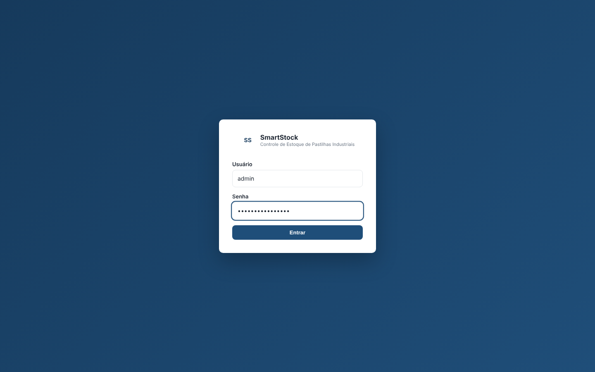 | 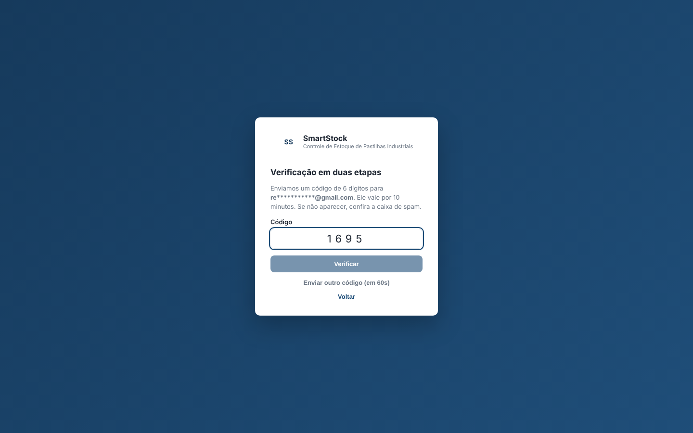 |
| 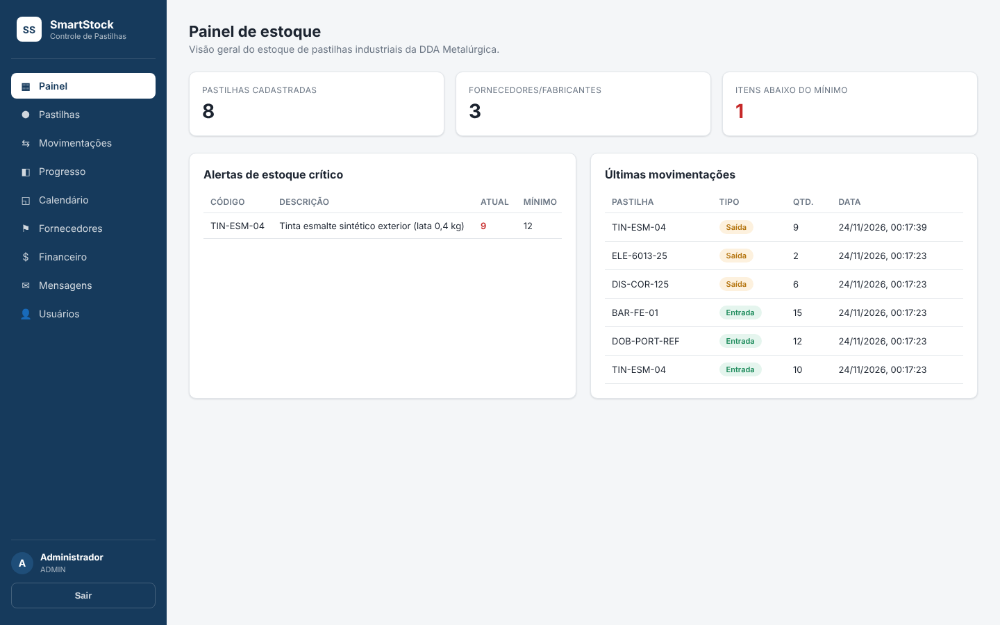 | 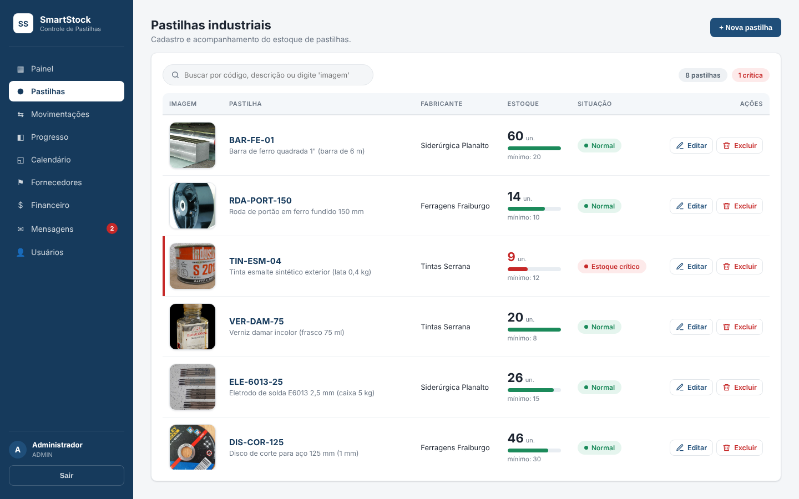 |
| 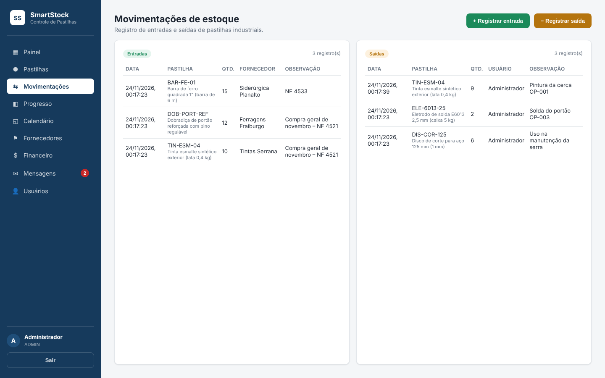 | 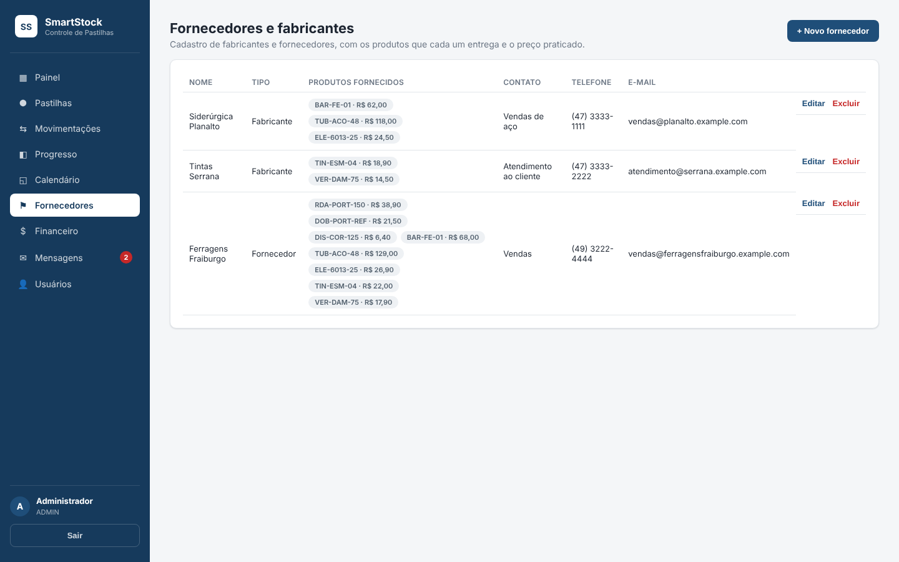 |
| 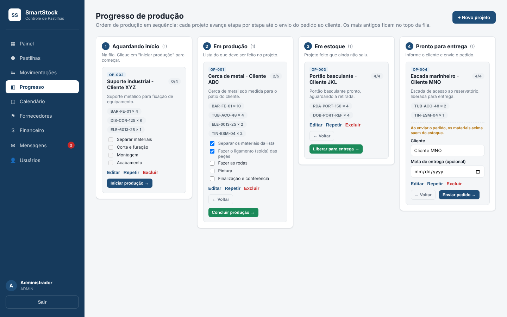 | 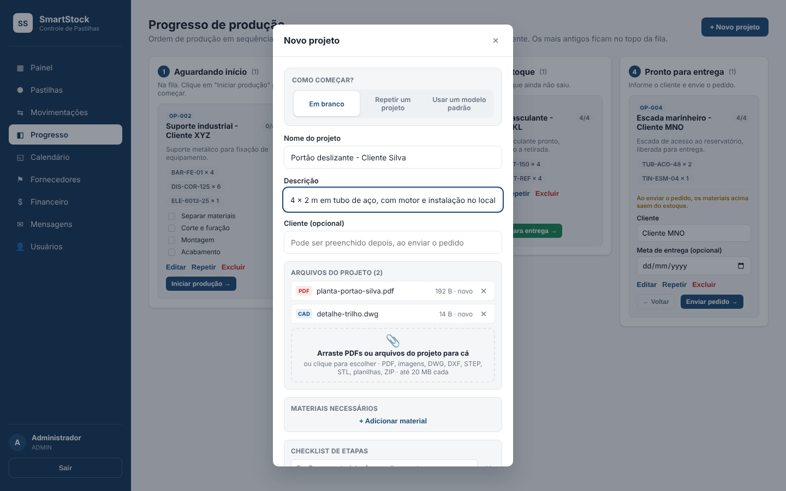 |
| 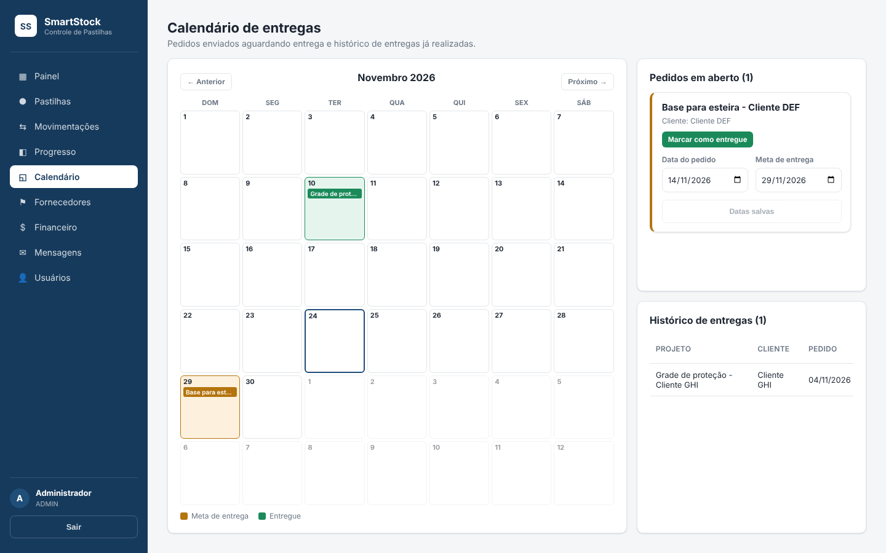 | 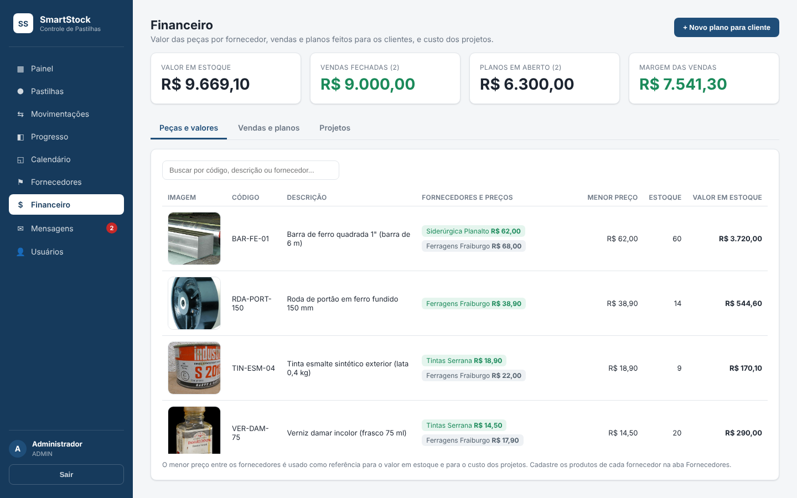 |
| 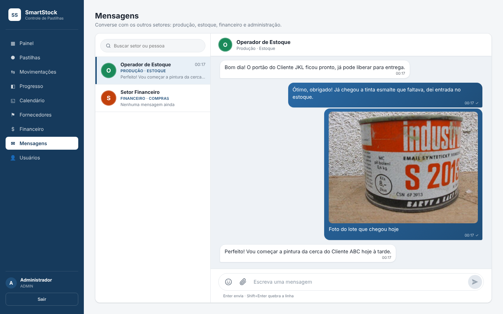 | 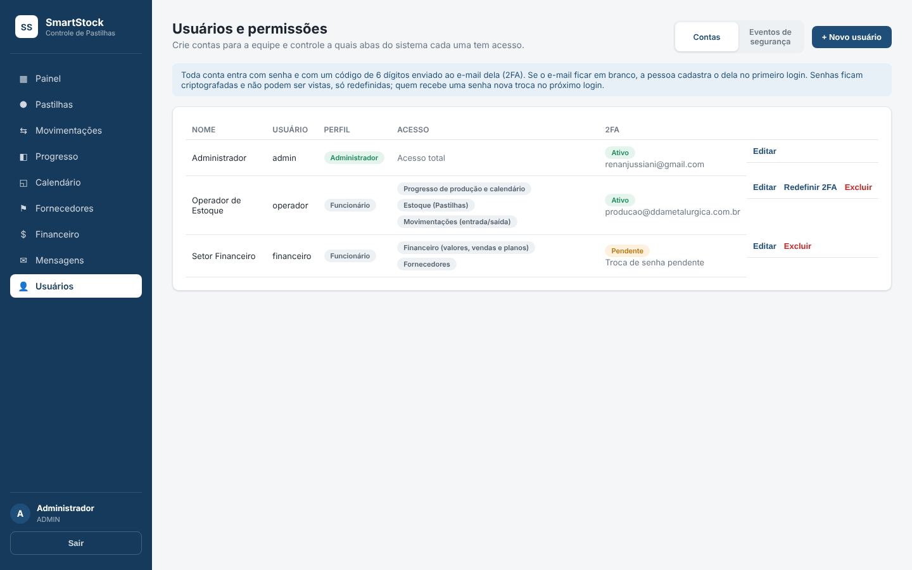 |
| 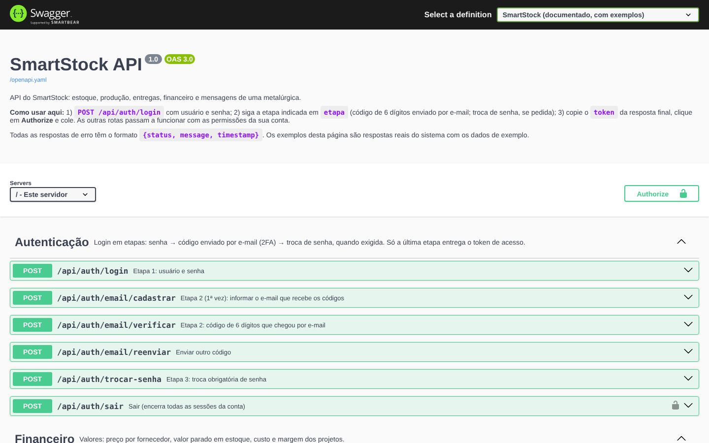 | 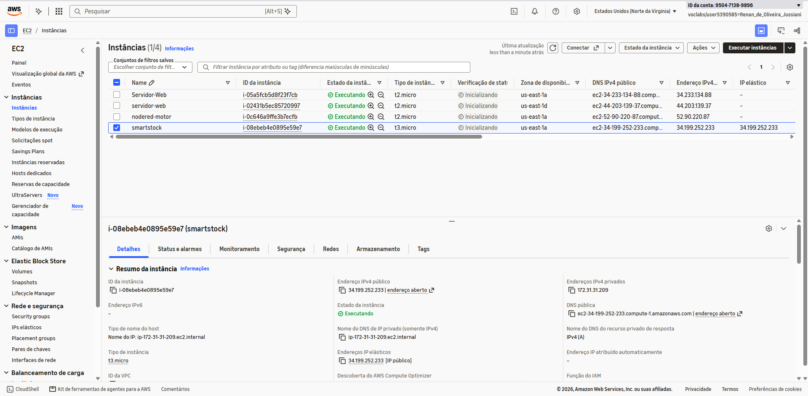 |
